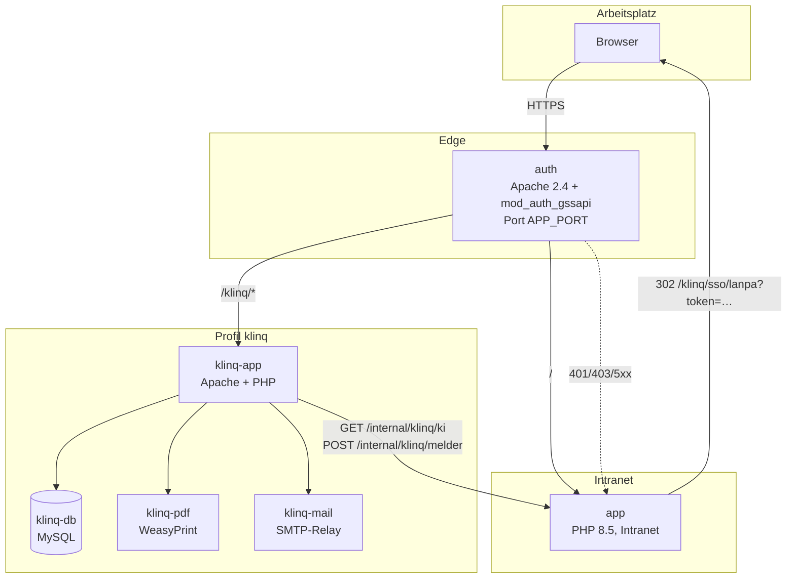
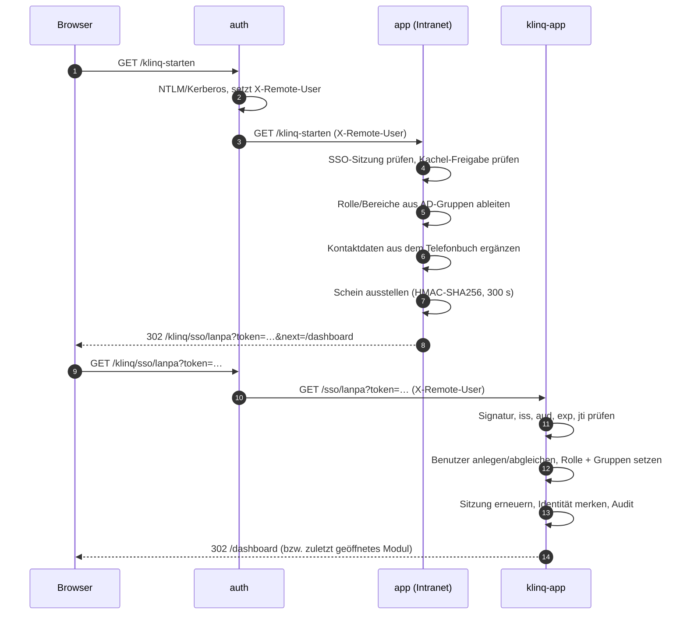
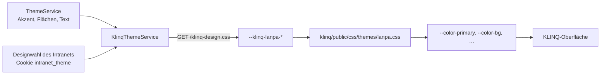

# KLINQ-Integration – Referenz

Technische Referenz der KLINQ-Integration im Intranet. Einrichtung und Betrieb
stehen in [klinq.md](klinq.md); diese Datei beschreibt Aufbau, Schnittstellen,
Sicherheitsgrenzen und alle Stellschrauben.

---

## 1. Zweck und Geltungsbereich

KLINQ (Help Desk, Asset-Management, Statistiken) ist eine eigenständige
Anwendung. Sie wird **nicht** in die Intranet-Anwendung hineinkopiert, sondern
als eigener Container-Verbund betrieben und über den `auth`-Container unter
`/klinq/` veröffentlicht.

Die Integration leistet vier Dinge:

1. **Ein Einstiegspunkt.** Windows-Anmeldung, Sitzung und Reverse-Proxy kommen
   ausschließlich vom Intranet. KLINQ hat keine eigene Kerberos-, AD-Join- oder
   SSO-Implementierung mehr.
2. **Eine Rechteverwaltung.** Rollen und Berechtigungsgruppen von KLINQ werden
   im Adminbereich des Intranets über AD-Gruppen vergeben und beim Einstieg
   übergeben.
3. **Ein durchgehendes Erscheinungsbild.** KLINQ übernimmt Akzentfarbe, Linien
   und gedämpfte Texte des Intranets, bleibt aber eigenständig.
4. **Eine zentrale KI-Konfiguration.** Endpunkt, Modell, Zeitlimit und
   API-Schlüssel werden im Intranet gepflegt.

Nicht Gegenstand: Änderungen an der Fachlogik von KLINQ (Tickets, Assets,
Auswertungen). Die Anwendung bleibt in ihrem Verhalten unverändert.

---

## 2. Begriffe

| Begriff | Bedeutung |
| --- | --- |
| **Intranet / LANPA** | Die PHP-Anwendung in `app/`, erreichbar über den `auth`-Container. |
| **auth-Container** | Apache als einziger Einstiegspunkt; terminiert NTLM/Kerberos und leitet weiter. |
| **Einstiegsschein** | Kurzlebiges, signiertes Token (HMAC-SHA256), das die Identität und die Rechte an KLINQ übergibt. |
| **Dienst-Token** | Gemeinsames Geheimnis für die internen Schnittstellen (`/internal/klinq/*`), liegt als Datei im Volume `sso_token`. |
| **Melder** | Person, die über `/stoerung` eine Störmeldung abgibt. |
| **Bereich (area)** | Grobe Sichtbarkeit in KLINQ: `helpdesk`, `assets`, `statistics`, `tickets`, `admin`. |
| **Berechtigungsgruppe** | Feine Zusatzfreigabe in KLINQ: `statistik`, `ticketaufruf`, `ticket_loeschen`, `ticket_stornieren`. |

---

## 3. Komponenten und Netze



### 3.1 Dienste

| Dienst | Image / Bau | Aufgabe |
| --- | --- | --- |
| `auth` | `docker/auth/Dockerfile` | Einziger Einstiegspunkt. NTLM/Kerberos, Header-Bereinigung, Weiterleitung an `app`, `nextcloud`, `eurooffice` und `klinq-app`. Fehlerseiten des Proxys zeigen auf Intranet-Seiten. |
| `klinq-app` | `klinq/docker/php/Dockerfile` | KLINQ selbst. Bindet `LanpaBridge`, `LanpaSsoToken`, `LanpaUserService` und `LanpaIdentityService` ein. |
| `klinq-db` | `mysql:${DB_IMAGE_TAG}` | Eigene Datenbank von KLINQ. Wird beim ersten Start von KLINQ initialisiert. |
| `klinq-pdf` | `klinq/docker/pdf/Dockerfile` | HTML → PDF (WeasyPrint) für Übergabeprotokolle. |
| `klinq-mail` | `klinq/docker/mail/Dockerfile` | SMTP-Relay für Entnahme- und Retourennachweise. |

### 3.2 Netze

| Netz | Typ | Teilnehmer | Zweck |
| --- | --- | --- | --- |
| `intranet` | bridge | `app`, `auth`, `klinq-app`, … | Alles, was die Intranet-Anwendung erreichen muss. Über dieses Netz laufen `/internal/klinq/*`. |
| `klinq` | bridge | `auth`, `klinq-app` | Ausschließlich der Proxy-Weg zum KLINQ-Container. |
| `klinq_backend` | bridge, `internal: true` | `klinq-app`, `klinq-db`, `klinq-pdf`, `klinq-mail` | Kein Zugang von außen, kein ausgehender Weg. |
| `klinq_egress` | bridge | `klinq-mail` | Ausgehender Weg zum SMTP-Relay, ohne Datenbankzugang. |

### 3.3 Volumes

| Volume | Einhängepunkt | Inhalt |
| --- | --- | --- |
| `klinq_db` | `klinq-db:/var/lib/mysql` | Datenbank von KLINQ. |
| `klinq_uploads` | `klinq-app:/var/www/html/storage/uploads` | Anhänge, Belege, Bilder. |
| `klinq_logs` | `klinq-app:/var/www/html/storage/logs` | Anwendungsprotokolle. |
| `klinq_labels` | `klinq-app:/var/www/html/storage/labels` | Erzeugte Etiketten. |
| `sso_token` | `klinq-app:/run/intranet-sso:ro` | Dienst-Token des Intranets, schreibgeschützt. |
| `app_storage` | `app:…` | Enthält u. a. `cache/klinq_health.json`. |

Das Dienst-Token wird vom Intranet erzeugt und im Volume `sso_token` abgelegt;
`klinq-app` liest es über `KLINQ_SERVICE_TOKEN_FILE=/run/intranet-sso/token`.
Dadurch ist kein zusätzliches Secret in der `.env` nötig.

---

## 4. Ablauf eines Einstiegs



### 4.1 Einzelheiten

1. **Anmeldung.** Der `auth`-Container authentifiziert per GSSAPI (Kerberos oder
   NTLM) und setzt `X-Remote-User` auf `expr=%{REMOTE_USER}`. Eingehende Werte
   dieses Headers werden verworfen. Ohne Domänenanmeldung antwortet Apache mit
   `ErrorDocument 401 /sso/nicht-erkannt`.
2. **Sitzung.** Das Intranet löst `X-Remote-User` über `SsoAuth::resolve()` in
   eine SSO-Sitzung auf – mit Anzeigename, E-Mail und den **AD-Gruppen**.
3. **Freigabe.** Beim Aufruf der Kachel (`/klinq-starten`) wird zusätzlich
   geprüft, ob die KLINQ-Kachel für die Person sichtbar ist
   (`NavigationRepository::findActiveInternalByUrl('/klinq-starten')` +
   `NavigationService::isAccessible`). Fehlt die Freigabe: HTTP 403.
   Ausgenommen sind Ziele unter `/portal…`
   (`KlinqController::isSelfServiceTarget()`): eigene Tickets sind
   Selbstbedienung und für jede angemeldete Person erreichbar (4.3).
   Bei `/stoerung` entfällt diese Prüfung.
4. **Rechte.** `KlinqAccessService::resolve()` bildet Rolle,
   Berechtigungsgruppen und Bereiche (Abschnitt 8).
5. **Kontaktdaten.** `KlinqIdentityService::contact()` ergänzt Anzeigename,
   Vorname, Nachname, E-Mail, Telefon, Mobilnummer, Abteilung und Funktion aus
   dem Telefonbuch (`PhonebookRepository::contactBySamAccountName`), mit
   Rückfall auf die SSO-Angaben.
6. **Schein.** `KlinqTokenService::issue()` signiert die Angaben. Ist
   `KLINQ_SSO_SECRET` kürzer als 32 Zeichen, wird kein Schein ausgestellt; es
   geht auf `/klinq-nicht-verfuegbar`.
7. **Erreichbarkeit.** Vorher prüft `KlinqHealthService::check(false)` den
   Endpunkt `/health` (Ergebnis 30 Sekunden zwischengespeichert). Ist KLINQ
   nicht erreichbar, geht es auf `/klinq-nicht-verfuegbar`.
8. **Weiterleitung.** Die Antwort ist ein `302` auf
   `KlinqConfigService::entryUrlFor()` + `/sso/lanpa?token=…&next=…` mit
   `Cache-Control: no-store` und `Referrer-Policy: no-referrer` – der Schein
   steht damit nicht im Referer und nicht im Cache. `entryUrlFor()` gibt die
   Adresse **relativ** aus, solange `KLINQ_PUBLIC_URL` auf denselben Host wie
   der Aufruf zeigt; der Browser behält dann Schema und Port der Seite
   (hinter dem TLS-Verteiler also `https`). Zeigt `KLINQ_PUBLIC_URL` auf einen
   anderen Host, gilt sie unverändert.
9. **Prüfung in KLINQ.** `LanpaSsoToken::verify()` prüft Signatur (zeitkonstant
   über `hash_equals`), `iss`, `aud`, `exp` und die Einmalverwendung der `jti`.
10. **Sitzung in KLINQ.** `LanpaUserService::provision()` legt den Benutzer an
    oder gleicht ihn ab, setzt `role_id`, die Berechtigungsgruppen und die
    Verknüpfung zum Mitarbeiterdatensatz (`users.employee_id`, über
    Anmeldename bzw. E-Mail).
    Anschließend erneuert `SessionManager::regenerate()` die Sitzungskennung,
    `CurrentUser::login()` meldet an, `LanpaIdentityService::remember()` merkt
    die Kontaktdaten, `AuditLogService::log('login', …)` protokolliert.

### 4.2 Rücksprungziel

`KlinqController::requestedTarget()` liest das Ziel aus `redirect`, `ziel` oder
`next` (in dieser Reihenfolge), entfernt einen führenden Unterpfad
(`/klinq/portal/4` → `/portal/4`) und übergibt es an `safeTarget()`.

`safeTarget()` akzeptiert ausschließlich einfache, lokale Pfade:

* muss mit `/` beginnen, höchstens 512 Zeichen,
* kein `//` am Anfang, kein `\`, kein `..`,
* nur `A–Z a–z 0–9 . _ ~ ! $ & ' ( ) * + , ; = : @ % / ? -`,
* `/sso`, `/login`, `/logout` (auch mit Unterpfad) sind gesperrt.

Alles andere fällt auf `/dashboard` zurück. In KLINQ prüft zusätzlich
`Url::safeLocalPath($next)`. Fehlt `next` oder entspricht es dem Standardziel
`/dashboard`, leitet KLINQ auf das zuletzt geöffnete Modul der Person um
(`ModuleNavigation::startUrl()`, siehe `klinq/docs/helpdesk.md`).

### 4.3 Selbstbedienung und eigene Tickets

`KlinqController::isSelfServiceTarget()` erkennt Ziele unter `/portal`
(`/portal`, `/portal/…`). Für sie entfällt die Kachel-Freigabe; jedes andere
Ziel bleibt an sie gebunden. Das Ziel wird unverändert als `next` übergeben,
sodass der Aufruf nach der Anmeldung im Ticket landet.

Wer ein Ticket sehen darf, entscheidet ausschließlich KLINQ:
`TicketService::getVisible()` wirft für fremde Tickets eine
`ForbiddenException`, `canView()` lässt Anfragende/r, Erfassende/r, betroffene
Mitarbeitende und Beobachter/innen zu; `helpdesk.view` (Agenten) hebt die
Beschränkung auf. `portal.view`/`portal.create` hat jede Rolle, damit ist der
eigene Bereich ohne Gruppenzuordnung erreichbar.

Ist die Person noch nicht angemeldet, merkt sich `loginTarget()` die vollständige
Anfrage (`REQUEST_URI`, also inklusive `?redirect=…`), damit das Ziel die
SSO-Anmeldung übersteht.

---

## 5. Routen des Intranets

| Methode | Pfad | Controller | Anmeldung | Zweck |
| --- | --- | --- | --- | --- |
| `GET` | `/klinq-starten` | `KlinqController::start` | SSO + Kachel-Freigabe (nicht bei `/portal…`) | Einstieg über die Kachel oder einen Direktlink. |
| `GET` | `/stoerung` | `KlinqController::report` | SSO | Störmeldung IT, ohne Gruppenzwang. |
| `GET` | `/klinq-design.css` | `KlinqController::design` | öffentlich | Designfarben als CSS. |
| `GET` | `/klinq-nicht-verfuegbar` | `KlinqController::unavailable` | öffentlich | Hinweisseite (auch `ErrorDocument` des Proxys), HTTP 503. |
| `POST` | `/internal/klinq/melder` | `InternalController::klinqReporter` | Dienst-Token | Melderdaten nachliefern. |
| `GET` | `/internal/klinq/ki` | `InternalController::klinqAi` | Dienst-Token | KI-Konfiguration abrufen. |
| `GET` | `/internal/klinq/signatur` | `InternalController::klinqSignature` | Dienst-Token | Orvanta-Signatur eines Benutzers abrufen (Agenten-E-Mail im Help Desk). |
| `GET` | `/admin/klinq` | `Admin\KlinqController::index` | Admin | Status. |
| `POST` | `/admin/klinq/pruefen` | `Admin\KlinqController::refreshHealth` | Admin + CSRF | Erreichbarkeit neu prüfen. |
| `GET` | `/admin/klinq/berechtigungen` | `Admin\KlinqController::showAccess` | Admin | AD-Gruppen. |
| `POST` | `/admin/klinq/berechtigungen` | `Admin\KlinqController::updateAccess` | Admin + CSRF | AD-Gruppen speichern. |
| `GET` | `/admin/klinq/kachel` | `Admin\KlinqController::showTile` | Admin | Kachel. |
| `POST` | `/admin/klinq/kachel` | `Admin\KlinqController::createTile` | Admin + CSRF | Kachel anlegen. |
| `POST` | `/admin/klinq/kachel/gestaltung` | `Admin\KlinqController::updateTile` | Admin + CSRF | Kachel anpassen. |
| `GET` | `/admin/klinq/ki` | `Admin\KlinqController::showAi` | Admin | KI-Endpunkt. |
| `POST` | `/admin/klinq/ki` | `Admin\KlinqController::updateAi` | Admin + CSRF | KI-Endpunkt speichern. |
| `POST` | `/admin/klinq/ki/testen` | `Admin\KlinqController::testAi` | Admin + CSRF | Verbindung testen. |

`/klinq-starten` und `/stoerung` stehen in der Liste der Pfade, für die eine
SSO-Anmeldung erzwungen wird (`public/index.php`, `ssoAttempt`).

### 5.1 Routen in KLINQ (öffentlich)

| Methode | Pfad | Zweck |
| --- | --- | --- |
| `GET` | `/sso/lanpa` | Einstieg mit Schein. |
| `GET` | `/health` | Erreichbarkeitsprüfung, Antwort `{"status":"ok"}`. |
| `GET` | `/stoerung` | Meldemaske. |
| `POST` | `/stoerung` | Meldung absenden. |
| `GET` | `/stoerung/gesendet` | Bestätigung. |
| `GET` | `/login` | Lokale Anmeldung (im Intranetbetrieb auf `/klinq-starten` umgeleitet). |

Diese Liste ist durch `RouteInventoryTest` abgesichert: neue öffentliche Routen
in KLINQ müssen dort bewusst ergänzt werden.

---

## 6. Der Einstiegsschein

### 6.1 Format

```
base64url(JSON-Nutzlast) . base64url(HMAC-SHA256(Nutzlast, KLINQ_SSO_SECRET))
```

Bewusst JWT-ähnlich, aber ohne Bibliothek – passend zum Zero-Dependency-Prinzip
beider Anwendungen. Base64url ohne Auffüllzeichen (`-`, `_`, kein `=`).

### 6.2 Angaben

| Feld | Typ | Herkunft |
| --- | --- | --- |
| `sub` | string | Anmeldename (sAMAccountName) |
| `name` | string | Anzeigename |
| `email` | string | E-Mail-Adresse |
| `first_name` | string | Vorname |
| `last_name` | string | Nachname |
| `phone` | string | Telefon (Telefonbuch) |
| `mobile` | string | Mobilnummer (Telefonbuch) |
| `department` | string | Abteilung |
| `title` | string | Funktion |
| `ip` | string | Client-Adresse (`ClientAddress::from`) |
| `host` | string | Rechnername zur Client-Adresse |
| `role` | string | `admin`, `helpdesk_admin`, `helpdesk_lead`, `helpdesk_agent`, `assetmanagement`, `readonly` |
| `permission_groups` | string[] | `statistik`, `ticketaufruf`, `ticket_loeschen`, `ticket_stornieren` |
| `areas` | string[] | `helpdesk`, `assets`, `statistics`, `tickets`, `admin` |
| `report_only` | bool | `true` nur bei `/stoerung` |
| `iss` | string | immer `lanpa` |
| `aud` | string | immer `klinq` |
| `iat` | int | Ausstellungszeitpunkt |
| `exp` | int | `iat` + `KLINQ_ENTRY_LIFETIME` (mindestens 30 s) |
| `jti` | string | 16 Zufallsbytes, hexadezimal |

### 6.3 Prüfungen

| Prüfung | Wo | Folge bei Verstoß |
| --- | --- | --- |
| Geheimnis ≥ 32 Zeichen | ausstellende und prüfende Seite | kein Schein / Ablehnung |
| Zwei Teile, gültiges Base64url | `LanpaSsoToken::verify` | HTTP 401 |
| Signatur (`hash_equals`) | `LanpaSsoToken::verify` | HTTP 401 |
| `iss` = `lanpa` | `LanpaSsoToken::verify` | HTTP 401 |
| `aud` = `klinq` | `LanpaSsoToken::verify` | HTTP 401 |
| `exp` ≥ jetzt | `LanpaSsoToken::verify` | HTTP 401 |
| `jti` noch nicht verwendet | `LanpaSsoToken::verify` | HTTP 401 |
| Rolle in KLINQ vorhanden | `LanpaUserService::provision` | Rückfall `readonly`, sonst HTTP 403 |

Die Einmalverwendung wird in `storage/tmp/lanpa-sso-used.json` vermerkt
(`LANPA_SSO_REPLAY_STORE`); abgelaufene Einträge werden beim Schreiben
bereinigt. Damit ist ein abgefangener Link auch innerhalb der Gültigkeitsdauer
nur einmal brauchbar.

### 6.4 Gültigkeitsdauer

`KLINQ_ENTRY_LIFETIME` (Vorgabe 300 s) gilt nur für den Weiterleitungsmoment.
Die Sitzung in KLINQ lebt danach unabhängig weiter. Ein zu großzügiger Wert
verlängert nur das Zeitfenster für einen abgefangenen Link.

---

## 7. Die Anbindung auf KLINQ-Seite

| Datei | Aufgabe |
| --- | --- |
| `klinq/config/lanpa.php` | Umgebungsvertrag der Anbindung. |
| `klinq/app/Security/LanpaSsoToken.php` | Prüfung des Einstiegsscheins inkl. Einmalverwendung. |
| `klinq/app/Controllers/LanpaSsoController.php` | Einstieg: prüfen, anlegen, anmelden, protokollieren. |
| `klinq/app/Services/Lanpa/LanpaUserService.php` | Benutzer anlegen/abgleichen, Rolle und Berechtigungsgruppen setzen, Mitarbeiterdatensatz verknüpfen. |
| `klinq/app/Services/Lanpa/LanpaIdentityService.php` | Kontaktdaten der Sitzung merken und bereitstellen. |
| `klinq/app/Services/Lanpa/LanpaBridge.php` | Designfarben, KI-Konfiguration, Melderdaten, Dienst-Token. |
| `klinq/app/Services/Helpdesk/ReporterIdentityService.php` | Melderdaten ermitteln (Intranet → Header → Sitzung → AD → Personal). |
| `klinq/resources/views/sso/lanpa-failed.php` | Fehlerseite bei abgelehntem Einstieg. |
| `klinq/public/css/themes/lanpa.css` | Abbildung der Intranetfarben auf die eigenen Farbvariablen. |

### 7.1 `config/lanpa.php`

| Schlüssel | Umgebungsvariable | Vorgabe | Bedeutung |
| --- | --- | --- | --- |
| `enabled` | `LANPA_ENABLED` | `true` | Anbindung aktiv. |
| `sso_secret` | `KLINQ_SSO_SECRET` | – | Gemeinsames Geheimnis. |
| `issuer` | `LANPA_SSO_ISSUER` | `lanpa` | Erwarteter Aussteller. |
| `audience` | `LANPA_SSO_AUDIENCE` | `klinq` | Erwarteter Empfänger. |
| `base_url` | `LANPA_BASE_URL` | – | Öffentliche Intranetadresse (Rückwege). |
| `internal_url` | `LANPA_INTERNAL_URL` | – | Interne Adresse für `/internal/klinq/*`. |
| `design_css` | `LANPA_DESIGN_CSS` | – | Abweichende Adresse des Farbschemas. |
| `service_token` | `KLINQ_SERVICE_TOKEN` | – | Dienst-Token direkt (hat Vorrang). |
| `service_token_file` | `KLINQ_SERVICE_TOKEN_FILE` | `/run/intranet-sso/token` | Dienst-Token aus dem Volume. |
| `replay_store` | `LANPA_SSO_REPLAY_STORE` | `storage/tmp/lanpa-sso-used.json` | Ablage der verbrauchten Scheine. |

### 7.2 `LanpaBridge`

| Methode | Rückgabe | Verhalten |
| --- | --- | --- |
| `enabled()` | bool | `lanpa.enabled`. |
| `designCssUrl()` | string | `LANPA_DESIGN_CSS`, sonst protokollrelativ `//<host>/klinq-design.css`; leer, wenn inaktiv. |
| `baseUrl()` | string | `LANPA_BASE_URL`, sonst `//<host>`. |
| `intranetUrl($path)` | string | `baseUrl()` + Pfad. |
| `internalUrl($path)` | string | `LANPA_INTERNAL_URL` + Pfad; leer, wenn nicht gesetzt. |
| `serviceToken()` | string | `KLINQ_SERVICE_TOKEN`, sonst Inhalt von `service_token_file`. |
| `aiConfig()` | ?array | `GET /internal/klinq/ki`, je Anfrage einmal, Zeitlimit 5 s. |
| `managesAi()` | bool | `true`, sobald `aiConfig()` etwas liefert. |
| `reporter($username, $ip)` | ?array | `POST /internal/klinq/melder`, Zeitlimit 5 s. |
| `signature($username)` | ?array | `GET /internal/klinq/signatur`, je Benutzer einmal, Zeitlimit 5 s; `null` ohne Signatur. |

Der Hostname wird aus `X-Forwarded-Host` bzw. `HTTP_HOST` gebildet und gegen
`^[A-Za-z0-9.\-:\[\]]{1,190}$` geprüft – ein manipulierter Host kann damit
keine beliebige Adresse in das Stylesheet schreiben.

### 7.3 Was aus KLINQ entfernt wurde

* Kerberos-Aushandlung, Keytab, `mod_auth_gssapi` in KLINQ-eigenen Konfigurationen.
* AD-Join und LDAP-Bindung für die Anmeldung.
* Eigene SSO- und Trust-Header-Auswertung zur Anmeldung.
* Die lokale Anmeldemaske bleibt als Notweg vorhanden, wird im Intranetbetrieb
  aber über den Proxy auf `/klinq-starten` umgeleitet
  (`RewriteRule ^/klinq/login/?$ …/klinq-starten [R=302,QSA,L]`, siehe 12.1).

Ersetzt wurden diese Teile durch `LanpaSsoToken` + `LanpaUserService` +
`LanpaBridge`. Die AD-Anbindung für **Fachdaten** (z. B. Telefonbuchabgleich in
KLINQ) bleibt unverändert; sie ist keine Anmeldefunktion.

---

## 8. Rollen und Berechtigungen

### 8.1 Zuordnung im Intranet

`KlinqConfigService::GROUP_KEYS` verbindet neun Einstellungen mit Rolle,
Berechtigungsgruppe und Bereich:

| Einstellung | Bezeichnung im Formular | Rolle | Berechtigung | Bereich |
| --- | --- | --- | --- | --- |
| `klinq_admin_groups` | Administration (Vollzugriff) | `admin` | – | `admin` |
| `klinq_helpdesk_admin_groups` | Help-Desk-Administration | `helpdesk_admin` | – | `helpdesk` |
| `klinq_helpdesk_lead_groups` | Help-Desk-Leitung | `helpdesk_lead` | – | `helpdesk` |
| `klinq_helpdesk_agent_groups` | Help-Desk-Agenten | `helpdesk_agent` | – | `helpdesk` |
| `klinq_asset_groups` | Asset-Management | `assetmanagement` | – | `assets` |
| `klinq_statistics_groups` | Statistiken (Auswertungen) | – | `statistik` | `statistics` |
| `klinq_ticket_history_groups` | Ticketaufruf (Verlauf) | – | `ticketaufruf` | `tickets` |
| `klinq_ticket_delete_groups` | Ticket löschen | – | `ticket_loeschen` | `helpdesk` |
| `klinq_ticket_cancel_groups` | Ticket stornieren | – | `ticket_stornieren` | `helpdesk` |

Die beiden letzten Einträge vergeben gezielt das Löschen (`helpdesk.delete`) und
das Stornieren (`helpdesk.cancel`) von Tickets. Ohne diese Gruppen – und ohne
Admin-Rolle – stehen beide Aktionen auch Help-Desk-Agenten, Leitungen und
Administration nicht zur Verfügung.

Weitere Einstellungen:

| Einstellung | Vorgabe | Bedeutung |
| --- | --- | --- |
| `klinq_default_role` | `readonly` | Rolle ohne Treffer. |
| `klinq_quick_report_open` | `1` | `/stoerung` für alle angemeldeten Personen offen. |

### 8.2 Rollengewichte

| Rolle | Gewicht |
| --- | --- |
| `admin` | 70 |
| `helpdesk_admin` | 60 |
| `helpdesk_lead` | 50 |
| `helpdesk_agent` | 40 |
| `assetmanagement` | 30 |
| `readonly` | 10 |

### 8.3 Auflösung

`KlinqConfigService::resolve(list<string> $adGroups)`:

1. AD-Gruppen normalisieren (Leerraum entfernen, Kleinschreibung) und in einer
   Menge ablegen. Groß-/Kleinschreibung spielt damit keine Rolle.
2. Start mit `klinq_default_role`.
3. Für jede der neun Zuordnungen in der Reihenfolge aus 8.1: Ist mindestens
   eine konfigurierte Gruppe in der Menge enthalten, gilt der Eintrag als
   Treffer (`matched`) – **die erste genannte Gruppe je Feld genügt**.
   * Rolle: übernehmen, wenn ihr Gewicht höher ist als das der aktuellen Rolle.
   * Berechtigung: zur Liste hinzufügen, wenn noch nicht vorhanden.
   * Bereich: zur Liste hinzufügen, wenn noch nicht vorhanden.
4. Bereiche aus der Rolle ergänzen:

   | Rolle | zusätzliche Bereiche |
   | --- | --- |
   | `admin` | `admin`, `helpdesk`, `assets`, `statistics`, `tickets` |
   | `helpdesk_admin`, `helpdesk_lead`, `helpdesk_agent` | `helpdesk` |
   | `assetmanagement` | `assets` |
   | `readonly` | – |

5. Rückgabe:

   ```php
   [
       'role' => 'helpdesk_agent',
       'role_label' => 'Help-Desk-Agent',
       'permission_groups' => ['statistik'],
       'areas' => ['helpdesk', 'statistics'],
       'area_labels' => ['Help Desk', 'Statistiken'],
       'matched' => ['klinq_helpdesk_agent_groups', 'klinq_statistics_groups'],
       'elevated' => true,
   ]
   ```

   `elevated` ist `false`, wenn Rolle `readonly` ist und keine
   Berechtigungsgruppe vorliegt.

### 8.4 Übergabe und Wirkung in KLINQ

`role`, `permission_groups` und `areas` stehen im Schein.
`LanpaUserService::provision()` setzt daraus `role_id` und die
Berechtigungsgruppen des Benutzers. Eine unbekannte Rolle führt zum Rückfall auf
`readonly`; fehlt auch diese Rolle in KLINQ, wird der Einstieg mit HTTP 403
abgelehnt.

**Wichtig:** Die Rechte werden beim Einstieg eingefroren. Änderungen an den
AD-Gruppen wirken mit dem nächsten Aufruf der Kachel, nicht in einer laufenden
Sitzung.

### 8.5 Prüfung der Eingaben

`KlinqConfigService::validate()` prüft die Formulareingaben:

* höchstens 100 Gruppen je Feld,
* höchstens 256 Zeichen je Gruppenname,
* keine Steuerzeichen (`\x00`–`\x1F`, `\x7F`),
* `klinq_default_role` muss eine bekannte Rolle sein,
* `klinq_quick_report_open` wird als `'1'`/`'0'` gespeichert.

Gruppen werden durch Komma oder Semikolon getrennt; die Speicherung erfolgt
normalisiert als `A, B, C`.

---

## 9. Adminbereich

Navigation: **Administration → KLINQ** mit vier Unterseiten
(`views/layouts/admin.php`, `activeNav` = `klinq`, `klinq-berechtigungen`,
`klinq-kachel`, `klinq-ki`).

### 9.1 Status

Zeigt:

* Erreichbarkeit aus `KlinqHealthService::check()`:
  `state` (`ok` / `down` / `disabled`), `available`, `checked_at`,
  `latency_ms`, `message`, `url`,
* öffentlichen Pfad (`publicPath()`), öffentliche Adresse (`publicUrl()`),
  Hostname (`publicHost()`), Containername (`upstream()`),
* ob das Geheimnis gesetzt ist (`hasSecret()`),
* Gültigkeit des Scheins (`entryLifetime()`),
* Anzahl konfigurierter Gruppen (`allGroups()`).

„Jetzt prüfen“ (`POST /admin/klinq/pruefen`) erzwingt eine neue Messung
(`check(true)`) und ignoriert den Zwischenspeicher.

### 9.2 Berechtigungen

Formular mit neun Gruppenfeldern, Rollenauswahl und Schalter für
`/stoerung`. Nach dem Speichern zeigt die Seite je Feld die aufgelösten
Bereiche und Rollen, damit Fehlkonfigurationen sichtbar werden.

### 9.3 Kachel

Legt über `NavigationRepository` einen Navigationseintrag an:

| Feld | Wert |
| --- | --- |
| Typ | `internal` |
| Ziel | `/klinq-starten` |
| Symbol | `wrench` |

`createTile` ist idempotent: existiert bereits ein aktiver Eintrag mit diesem
Ziel, wird kein zweiter angelegt. `updateTile` ändert Bezeichnung, Symbol,
Hintergrund und den Schalter `open_in_new_tab`, der die Kachel in einem neuen
Browser-Tab öffnen lässt (Vorgabe: aus).

### 9.4 KI

Siehe Abschnitt 10.

---

## 10. KI-Endpunkt

### 10.1 Einstellungen

`KlinqAiService::SETTING_KEYS`:

| Schlüssel | Vorgabe | Prüfung |
| --- | --- | --- |
| `klinq_ai_enabled` | `1` | `'1'`/`'0'` |
| `klinq_ai_name` | `KLINQ-KI` | Text, höchstens 60 Zeichen |
| `klinq_ai_url` | leer | `http(s)`, ohne Zugangsdaten, Parameter oder Anker |
| `klinq_ai_model` | leer | `A–Z a–z 0–9 . _ - : / @ +` |
| `klinq_ai_timeout` | `60` | 5–900 Sekunden |
| `klinq_ai_api_key` | leer | Text; `klinq_ai_api_key_clear` löscht |

Ist die KI aktiviert, sind Adresse und Modell Pflicht.

### 10.2 Vorrang des Umgebungswerts

`KlinqAiService::apiKey()` liefert `KLINQ_AI_API_KEY` aus der Umgebung, wenn
gesetzt (`apiKeyFromSecret()` = `true`); der in der Datenbank gespeicherte
Schlüssel wird dann nicht verwendet und im Formular nicht angezeigt. Empfehlung
für den Produktivbetrieb: Schlüssel als Umgebungswert oder Docker-Secret
hinterlegen, nicht in der Datenbank.

### 10.3 Schnittstelle

`GET /internal/klinq/ki` (Dienst-Token) liefert:

```json
{
  "enabled": true,
  "name": "KLINQ-KI",
  "url": "http://ki-server:11434/v1",
  "model": "llama3.1:8b",
  "timeout": 60,
  "api_key": "…"
}
```

`LanpaBridge::aiConfig()` fragt diesen Endpunkt höchstens einmal je Anfrage ab
(5 s Zeitlimit) und verwendet das Ergebnis für `managesAi()`. Solange die
Abfrage gelingt, ist die KI-Verwaltung in KLINQ nur lesend.

### 10.4 Verbindungstest

`POST /admin/klinq/ki/testen` → `KlinqAiService::runTest()`:

1. Eingaben prüfen (nur die KI-Felder),
2. `GET <url>/models` – die Modellliste muss das gewählte Modell enthalten,
3. `POST <url>/chat/completions` mit `TEST_PROMPT` („Wer bist du?“),
   `max_tokens` 400, Antwort auf 4000 Zeichen gekürzt,
4. Ergebnis (Antwort, Modell, Dauer, Fehlertext) an das Formular.

Der Test verwendet die eingegebenen Werte, nicht die gespeicherten – so lässt
sich eine Änderung vor dem Speichern prüfen.

---

## 11. Designintegration

### 11.1 Ablauf



### 11.2 Ausgelieferte Variablen

`GET /klinq-design.css` (öffentlich, `Cache-Control: no-store`, `Vary: Cookie`,
`Access-Control-Allow-Origin: *`) enthält je nach Designwahl des Intranets
einen Block (`light` bzw. `dark`) oder bei `auto` vier Blöcke: `:root`,
`@media (prefers-color-scheme: dark)` (mit `:not([data-theme="light"])`),
`:root[data-theme="dark"]`, `:root[data-theme="light"]`.

Die Designwahl kommt als Cookie `intranet_theme` mit (Werte `light`, `dark`,
`auto`), das `public/assets/js/app.js` beim Anwenden des Designs setzt. Ohne
Cookie liefert der Endpunkt das helle Standarddesign. Dadurch folgt KLINQ der
Einstellung des Intranets und nicht der Systemeinstellung des Rechners.

| Variable | Ableitung |
| --- | --- |
| `--klinq-lanpa-accent` | Akzentfarbe, 15 % in Richtung Hintergrund abgeschwächt |
| `--klinq-lanpa-accent-strong` | Akzentfarbe unverändert |
| `--klinq-lanpa-accent-dark` | Akzentfarbe, 22 % in Richtung Schwarz |
| `--klinq-lanpa-accent-soft` | Akzentfarbe, 88 % in Richtung Hintergrund |
| `--klinq-lanpa-on-accent` | lesbare Textfarbe auf dem Akzent |
| `--klinq-lanpa-background` | Hintergrund |
| `--klinq-lanpa-surface` | Fläche |
| `--klinq-lanpa-surface-hover` | Fläche bei Hover |
| `--klinq-lanpa-border` | Text 82 % in Richtung Hintergrund |
| `--klinq-lanpa-border-strong` | Text 68 % in Richtung Hintergrund (Rahmen von Eingabefeldern) |
| `--klinq-lanpa-text` | Textfarbe |
| `--klinq-lanpa-muted` | gedämpfte Textfarbe |
| `--klinq-lanpa-color-scheme` | `dark` im dunklen, sonst `light` (steuert Dateiauswahl, Auswahllisten und Bildlaufleisten des Browsers) |

Die Statusfarben werden je Design getrennt abgeleitet, weil sie in KLINQ zwei
Rollen haben: Schriftfarbe auf einer gedämpften Fläche (Badges, Hinweise,
interne Notizen) und Hintergrund von Schaltflächen und Meldungen.

| Variable | Heller Modus | Dunkler Modus |
| --- | --- | --- |
| `--klinq-lanpa-<name>` | `#107c41`, `#9a6a00`, `#b3261e`, `#5b6b7b` (Erfolg, Warnung, Fehler, Neutral) | Ausgangsfarbe, so weit aufgehellt, bis sie auf der eigenen gedämpften Fläche den Mindestkontrast 4,5:1 erreicht (`App\Support\Color::ensureContrast`) |
| `--klinq-lanpa-<name>-soft` | `#e5f3ec`, `#fdf3d7`, `#fbeae9`, `#eceff2` | Ausgangsfarbe 82 % in Richtung Hintergrund abgedunkelt |
| `--klinq-lanpa-on-<name>` | lesbare Textfarbe auf der Vollfläche | lesbare Textfarbe auf der Vollfläche (Schwarz oder Weiß nach tatsächlichem Kontrast) |
| `--klinq-lanpa-on-text` | Textfarbe auf `--klinq-lanpa-text` (Standard-Toast) | ebenso |

`<name>` steht für `success`, `warning`, `danger` und `neutral`. Ohne diese
Trennung blieb die gedämpfte Fläche im dunklen Modus hell (`#fdf3d7`), während
der Text bereits hell war – eingegebene interne Notizen waren dadurch nicht
lesbar.

### 11.3 Übernahme in KLINQ

`klinq/public/css/themes/lanpa.css` bildet die Intranetvariablen auf die
eigenen Farbvariablen ab – jeweils mit Rückfallwert, damit KLINQ ohne Anbindung
unverändert aussieht. Zusätzlich setzt sie `color-scheme`, damit die
Bedienelemente des Browsers (Dateiauswahl, Auswahllisten, Bildlaufleisten) dem
Design des Intranets folgen:

| KLINQ-Variable | Intranetvariable | Rückfall |
| --- | --- | --- |
| `--color-primary` | `--klinq-lanpa-accent-strong` | `#0f6cbd` |
| `--color-primary-hover` | `--klinq-lanpa-accent` | `#0c5aa0` |
| `--color-primary-active` | `--klinq-lanpa-accent-dark` | `#0a4d89` |
| `--color-primary-soft` | `--klinq-lanpa-accent-soft` | `#e8f1fa` |
| `--color-info` | `--klinq-lanpa-accent-strong` | `#0f6cbd` |
| `--color-info-soft` | `--klinq-lanpa-accent-soft` | `#e8f1fa` |
| `--color-bg` | `--klinq-lanpa-background` | `#f4f6f8` |
| `--color-surface` | `--klinq-lanpa-surface` | `#ffffff` |
| `--color-surface-alt` | `--klinq-lanpa-surface-hover` | `#f9fafb` |
| `--color-border` | `--klinq-lanpa-border` | `#d8dde3` |
| `--color-border-strong` | `--klinq-lanpa-border-strong` | `#b6bec7` |
| `--color-text` | `--klinq-lanpa-text` | `#1a2733` |
| `--color-text-muted` | `--klinq-lanpa-muted` | `#5b6b7b` |
| `--color-text-inverse` | `--klinq-lanpa-on-accent` | `#ffffff` |
| `--color-success`, `-soft`, `-on-success` | `--klinq-lanpa-success…` | `#107c41`, `#e5f3ec`, `#ffffff` |
| `--color-warning`, `-soft`, `-on-warning` | `--klinq-lanpa-warning…` | `#9a6a00`, `#fdf3d7`, `#ffffff` |
| `--color-danger`, `-soft`, `-on-danger` | `--klinq-lanpa-danger…` | `#b3261e`, `#fbeae9`, `#ffffff` |
| `--color-neutral`, `-soft` | `--klinq-lanpa-neutral…` | `#5b6b7b`, `#eceff2` |
| `--color-on-text` | `--klinq-lanpa-on-text` | `#ffffff` |

Die Datei wirkt bewusst nur auf `:root`. Ein eigenes Farbschema von KLINQ
(z. B. `[data-theme]`) behält damit Vorrang.

Farbpunkte bleiben fest: `--color-palette-*` in
`klinq/public/css/themes/tokens.css` liefert die Farben der wählbaren
Farbpunkte (Typen, Status, Prioritäten). Diese Werte werden weder von
`lanpa.css` noch vom dunklen Modus überschrieben, damit „Blau“ immer blau und
„Gelb“ immer gelb bleibt. `--color-info` folgt dagegen weiterhin dem Akzent
des Intranets und ist deshalb für Farbpunkte ungeeignet.

Verbraucher der Vollflächen-Schriftfarben sind `components/buttons.css`
(`.btn-success`, `.btn-danger`), `components/toasts.css` (`.toast`) und
`layout/shell.css` (`.nav-badge`, `.notification-badge`). Eingabefelder in
`components/forms.css` setzen zusätzlich `color: var(--color-text)`, damit
eingetippter Text unabhängig vom geerbten Farbkontext lesbar bleibt.

### 11.4 Einbindung

`klinq/resources/views/partials/layout.php` bindet beide Stylesheets nur ein,
wenn die Anbindung aktiv ist:

```php
<?php if (($lanpaDesignCss ?? '') !== ''): ?>
    <link rel="stylesheet" href="<?= e($lanpaDesignCss) ?>" id="style-lanpa-design">
    <link rel="stylesheet" href="<?= e(asset_url('/css/themes/lanpa.css')) ?>" id="style-lanpa-tokens">
<?php endif; ?>
```

Reihenfolge: erst die Variablen des Intranets, dann die Abbildung. Beide sind
unbedenklich für die Content-Security-Policy, da es externe Dateien sind
(kein Inline-Stil).

---

## 12. Störmeldung IT (`/stoerung`)

### 12.1 Freigabe

| Bedingung | Prüfung |
| --- | --- |
| KLINQ aktiv | `KlinqConfigService::isEnabled()` |
| Meldeseite freigegeben | `quickReportOpen()` (`klinq_quick_report_open`) |
| Person angemeldet | `SsoAuth::resolve()` |
| Geheimnis vorhanden | `hasSecret()` |
| KLINQ erreichbar | `KlinqHealthService::check(false)` |
| Gruppenzuordnung | **keine** |

Ist die Person nicht angemeldet, wird auf den SSO-Anmeldeweg mit Rückkehrziel
`/stoerung` umgeleitet (`SsoAuth::loginUrl('/stoerung')`).

### 12.2 Melderdaten

Der Schein enthält `report_only = true` sowie Anmeldename, Anzeigename,
Vorname, Nachname, E-Mail, Telefon, Mobilnummer, Abteilung, Funktion, IP und
Rechnername.

In KLINQ ermittelt `ReporterIdentityService::detect()` die Melderdaten in dieser
Reihenfolge:

1. **Intranet-Sitzung** – `LanpaIdentityService::current()` (Angaben aus dem
   Schein).
2. **Nachfrage beim Intranet** – `LanpaBridge::reporter()`, wenn die Sitzung
   keine Angaben (mehr) enthält.
3. **Header** – `X-Remote-User` des `auth`-Containers, wenn
   `HELPDESK_QUICK_REPORT_TRUST_USER_HEADER=true`.
4. **KLINQ-Sitzung** – angemeldetes Konto.
5. **AD und Personalakte** – Anzeigename, E-Mail, Telefon, Abteilung, Funktion.
6. **Rechnername** – aus der IP-Adresse (`ClientIdentity`), sonst aus dem
   Intranet.

Telefon, Mobilnummer, Abteilung und Funktion stammen bevorzugt aus dem
Telefonbuch des Intranets, weil dort die gepflegten Kontaktdaten stehen.

### 12.3 `POST /internal/klinq/melder`

| Aspekt | Wert |
| --- | --- |
| Anfrage | `username`, `ip` (Formular-kodiert) |
| Antwort | `username`, `display_name`, `first_name`, `last_name`, `email`, `phone`, `mobile`, `department`, `title`, `source`, `ip`, `host` |
| Rechnername | aus der übergebenen IP, da die Anfrage vom KLINQ-Container kommt |
| Fehler | `403` bei fehlender Berechtigung, `422` ohne Anmeldename |
| Zwischenspeicher | `Cache-Control: no-store` |

Der Endpunkt ist der Rückfallweg; im Regelfall genügen die Angaben aus dem
Schein.

### 12.4 Rechte in KLINQ

`report_only = true` kennzeichnet den Meldekontext. Die Rolle bleibt die aus
den AD-Gruppen – wer Help-Desk-Agent ist, behält seine Rechte auch beim Aufruf
über `/stoerung`.

Angelegt wird das Ticket unter dem Systemkonto
`HELPDESK_QUICK_REPORT_SYSTEM_USER` (`helpdesk.quick_report.system_user`,
Vorgabe `admin`) über `CurrentUser::runAs()`; geprüft werden die wirksamen
Rechte aus Rolle **und** Berechtigungsgruppen (`Permissions::hasEffective()`),
wie in `CurrentUser::can()`. Fehlt das Konto, legt `bin/migrate.php` es beim
Containerstart ohne Passwort mit der Rolle `helpdesk_agent` an – im Intranet
gibt es kein lokales Konto `admin`, weil `KLINQ_ADMIN_PASSWORD` leer bleibt.
Schlägt das Anlegen trotzdem fehl, antwortet `POST /stoerung` mit Status `500`
und der Meldung „Die Meldung konnte nicht gespeichert werden …“; die Ursache
steht als `ERROR` mit Typ, Text und Fundstelle in `storage/logs/app-*.log`.

### 12.5 `GET /internal/klinq/signatur`

Damit ein Help-Desk-Agent aus einem Ticket eine E-Mail senden kann, hängt KLINQ
beim Versand die **Signatur aus Orvanta** an. Sie ist fest und nicht änderbar;
der Agent soll dieselbe Signatur verwenden wie in Orvanta. KLINQ kennt nur den
Anmeldenamen, deshalb liefert das Intranet die fertige Signatur.

| Aspekt | Wert |
| --- | --- |
| Anfrage | `username` (Abfrageparameter, `SsoAuth::normalizeUsername()`) |
| Antwort | `available` (bool), `name`, `html` |
| Auflösung | Telefonbucheintrag über `PhonebookRepository::findActiveBySamAccountNameAnySource()` – quellenunabhängig, Hauptquelle (`identity_source_id = 0`) zuerst |
| Gruppen | `AdGroupRepository::namesForUser()`; daraus `OrvantaSignatureService::forUser()` |
| Fehler | `403` bei fehlender Berechtigung, `422` ohne Anmeldename |
| Zwischenspeicher | `Cache-Control: no-store` |

`available = false` bedeutet: kein Telefonbucheintrag, keine passende
Signaturregel oder leerer Text. KLINQ sendet dann ohne Signatur. Die Ausgabe ist dieselbe wie in Orvanta
(`<div class="ov-signature-block">` mit inline gestalteter Tabelle und Logo als
Data-URI) und wird **unverändert** übernommen – sie stammt aus dem vertrauten
Intranet, nicht aus dem Browser.

---

## 13. Kachel und Navigation

### 13.1 Kachel

* Ziel `/klinq-starten`, Typ `internal`, Symbol `wrench`.
* Die Kachel öffnet standardmäßig im selben Tab; `open_in_new_tab` (Spalte in
  `navigation_items`, Migration 059) lässt sie ein neues Browser-Tab öffnen.
  Setzbar in **KLINQ → Kachel** und in **Navigation → Eintrag bearbeiten**.
* Sichtbarkeit über die normalen Kachelrechte (Benutzer, AD-Gruppen).
* Direktaufruf prüft dieselbe Freigabe (`assertTileAccess`) – die Kachel ist
  damit keine reine Anzeigefrage.
* Fehlt die Kachel vollständig, gilt der Zugriff als erlaubt; dann entscheidet
  nur die Anmeldung. So bleibt eine Installation ohne angelegte Kachel
  benutzbar.

### 13.2 Navigationseintrag „Störmeldung IT“

`KlinqConfigService::internalTargets()` liefert – nur bei aktivem KLINQ – die
Auswahl für das Zielfeld eines Navigationseintrags:

```php
['/stoerung' => 'KLINQ-Meldeseite (Störmeldung IT)']
```

`views/admin/navigation/form.php` bietet diese Ziele als Auswahlliste an
(`$knownTargets`). Der Eintrag bleibt ein normaler interner Navigationspunkt;
Sichtbarkeit und Reihenfolge werden wie bisher gepflegt.

### 13.3 Reverse-Proxy

`docker/auth/klinq.conf` wird nur geladen, wenn der Container mit `-D KLINQ`
startet. Das setzt `KLINQ_ENABLED=true` voraus (`entrypoint.sh` wertet die
Variable aus und ergänzt `klinq-app` in `backend_hosts`).

| Regel | Wirkung |
| --- | --- |
| `RewriteRule ^/klinq$ https://%{HTTP_HOST}/klinq/ [R=301,L]` (mit `RewriteCond` auf `X-Forwarded-Proto`/`HTTPS`) | Unterpfad normalisieren, Schema des Clients beibehalten. |
| `RewriteRule ^/klinq$ http://%{HTTP_HOST}/klinq/ [R=301,L]` | dasselbe für reine HTTP-Aufrufe. |
| `RewriteRule ^/klinq/login/?$ https://%{HTTP_HOST}/klinq-starten [R=302,QSA,L]` | Lokale Anmeldemaske überspringen, `?redirect=…` mitnehmen. |
| `<Location /klinq/>` mit `Require valid-user` | Windows-Anmeldung ist Pflicht. |
| `RequestHeader set X-Remote-User "expr=%{REMOTE_USER}"` | Identität an KLINQ. |
| `ProxyPass http://klinq-app/ timeout=300 retry=5` | Weiterleitung; der Unterpfad wird entfernt. |
| `ErrorDocument 401 /sso/nicht-erkannt` | Ohne Domänenanmeldung zur Intranet-Hinweisseite. |
| `ErrorDocument 500/502/503 /klinq-nicht-verfuegbar` | KLINQ gestoppt → verständliche Seite. |
| `<LocationMatch "^/klinq-nicht-verfuegbar$">` mit `AuthType None` | Die Hinweisseite ist ohne Anmeldung erreichbar. |

Das Schema steht in jeder Weiterleitung ausdrücklich davor. `mod_rewrite`
setzt bei `[R]` mit einer Pfad-Angabe sonst das Schema der **eigenen**
Verbindung davor; hinter dem TLS-Verteiler ist das `http`, der Browser liefe
also ohne TLS auf den TLS-Port (`ERR_EMPTY_RESPONSE`). Die Bedingung prüft
`X-Forwarded-Proto` (Verteiler setzt den Header) und `HTTPS` (eigener
TLS-Betrieb, `TLS_APACHE`). Dieselbe Regelform gilt in `office.conf` und
`llmint.conf`.

`ProxyErrorOverride` bleibt aus: Fehlerseiten von KLINQ selbst werden
unverändert durchgereicht.

---

## 14. Sicherheit

### 14.1 Vertrauensgrenzen

| Grenze | Wer vertraut wem | Absicherung |
| --- | --- | --- |
| Browser → `auth` | `auth` prüft die Windows-Anmeldung | GSSAPI/NTLM, `Require valid-user` |
| `auth` → `app` | `app` glaubt `X-Remote-User` | nur im Docker-Netz erreichbar, `auth` überschreibt den Header |
| `app` → `klinq-app` | KLINQ glaubt dem Schein | HMAC-SHA256, `iss`/`aud`/`exp`, Einmalverwendung |
| `klinq-app` → `app` | Intranet glaubt dem Dienst-Token | Token-Datei im Volume, Adressprüfung, keine `X-Forwarded-*` |

### 14.2 Interne Schnittstellen

`InternalController::authorized()` verlangt für `/internal/klinq/*`:

1. `X-Intranet-Sso-Token` stimmt zeitkonstant mit dem Inhalt von
   `/run/intranet-sso/token` überein (mindestens 32 Zeichen),
2. **kein** `X-Forwarded-For` und **kein** `X-Forwarded-Host` im Kopf,
3. die Gegenstelle (`REMOTE_ADDR`) gehört zu `KLINQ_SERVICE` (Vorgabe
   `klinq-app`).

Punkt 2 verhindert, dass die Schnittstelle über den öffentlichen Proxy
erreichbar wird – der `auth`-Container setzt diese Köpfe. Punkt 3 verhindert
Aufrufe aus anderen Containern desselben Netzes.

### 14.3 Kein Kerberos in KLINQ

KLINQ bekommt keinen Keytab und keine Domänenanmeldung. Damit entfällt die
Notwendigkeit, KLINQ in die Domäne aufzunehmen oder ein Dienstkonto zu pflegen.
Der `auth`-Container bleibt die einzige Stelle, an der Kerberos/NTLM
konfiguriert ist – Änderungen dort wirken für alle Anwendungen gleichzeitig.

### 14.4 Gleichnamige Sitzungscookies

Intranet: `INTRANETSESSID`, KLINQ: `ASSETSESSID`. Unterschiedliche Namen
verhindern, dass sich die Cookies gegenseitig überschreiben (beide liegen auf
demselben Host).

### 14.5 Protokollierung

| Ereignis | Ort | Inhalt |
| --- | --- | --- |
| Einstieg ausgestellt | Intranet-Log | Benutzer, Ziel, Rolle |
| Fehlendes Geheimnis | Intranet-Log (Warnung) | – |
| Einstieg abgelehnt | KLINQ-Log (Warnung) | Grund |
| Anmeldung erfolgt | KLINQ-Log + Audit-Log | Benutzer, Rolle |
| Interner Abruf abgelehnt | Intranet-Log (Warnung) | Gegenstelle |

Der Schein selbst wird nicht protokolliert.

---

## 15. Umgebungsvariablen

### 15.1 Intranet

| Variable | Vorgabe | Bedeutung |
| --- | --- | --- |
| `KLINQ_ENABLED` | `false` | Integration aktiv. Steuert Routen, Kachelauswahl und `-D KLINQ` im Proxy. |
| `KLINQ_SSO_SECRET` | – | Gemeinsames Geheimnis (≥ 32 Zeichen). |
| `KLINQ_PATH` | `/klinq` | Öffentlicher Pfad (wird normalisiert). |
| `KLINQ_PUBLIC_URL` | – | Abweichende öffentliche Adresse (eigener Hostname). |
| `KLINQ_UPSTREAM` | `http://klinq-app:80` | Containername für die Diagnose. |
| `KLINQ_INTERNAL_URL` | `http://klinq-app/` | Interne Adresse (nicht für den Proxy). |
| `KLINQ_ENTRY_LIFETIME` | `300` | Gültigkeit des Scheins in Sekunden (min. 30). |
| `KLINQ_HEALTH_URL` | `http://klinq-app/health` | Erreichbarkeitsprüfung. |
| `KLINQ_HEALTH_TIMEOUT` | `4` | Zeitlimit der Prüfung. |
| `KLINQ_HEALTH_CACHE_TTL` | `30` | Zwischenspeicher der Prüfung. |
| `KLINQ_AI_API_KEY` | – | API-Schlüssel mit Vorrang vor dem Datenbankwert. |
| `KLINQ_SERVICE` | `klinq-app` | Erlaubte Gegenstelle der internen Schnittstellen. |

### 15.2 KLINQ-Container

| Variable | Vorgabe | Bedeutung |
| --- | --- | --- |
| `APP_URL` | `${APP_URL}/klinq` | Öffentliche Adresse. |
| `KLINQ_BASE_PATH` | `/klinq` | Unterpfad, den KLINQ in Antworten ergänzt. |
| `APP_KEY` | abgeleitet | Schlüssel für gespeicherte Zugangsdaten. |
| `APP_COMPANY_NAME` | – | Firmenname. |
| `ADMIN_USERNAME`, `ADMIN_PASSWORD` | `admin`, – | Lokales Notfallkonto. |
| `DB_*` | `klinq-db` | Datenbankverbindung. |
| `PDF_SERVICE_URL` | `http://klinq-pdf:8000` | PDF-Dienst. |
| `MAIL_SERVICE_URL` | `http://klinq-mail:8025` | SMTP-Relay. |
| `MAIL_FROM_ADDRESS`, `MAIL_FROM_NAME` | – | Absender. |
| `LANPA_ENABLED` | `true` | Anbindung an das Intranet. |
| `LANPA_BASE_URL` | `${APP_URL}` | Öffentliche Intranetadresse. |
| `LANPA_INTERNAL_URL` | `http://app` | Interne Intranetadresse. |
| `KLINQ_SSO_SECRET` | – | Gemeinsames Geheimnis. |
| `KLINQ_SERVICE_TOKEN_FILE` | `/run/intranet-sso/token` | Dienst-Token aus dem Volume. |
| `HELPDESK_QUICK_REPORT_TRUST_USER_HEADER` | `true` | `X-Remote-User` als Melderquelle zulassen. |
| `LANPA_SSO_ISSUER` / `LANPA_SSO_AUDIENCE` | `lanpa` / `klinq` | Erwartete Werte im Schein. |
| `LANPA_DESIGN_CSS` | – | Abweichende Adresse des Farbschemas. |
| `LANPA_SSO_REPLAY_STORE` | `storage/tmp/lanpa-sso-used.json` | Ablage verbrauchter Scheine. |

---

## 16. Tests und Prüfungen

```bash
# Intranet-Testsuite (eigener Runner)
php tests/run.php

# KLINQ-Testsuite (Unit-Tests)
cd klinq && php tests/run.php --unit

# Konfiguration des Container-Verbunds prüfen
docker compose --profile klinq config --quiet

# Syntaxprüfung
find . -name "*.php" -print0 | xargs -0 -n1 php -l
```

Relevante Testdateien:

| Datei | Inhalt |
| --- | --- |
| `tests/Unit/KlinqTest.php` | Einstiegsschein (Signatur, `iss`/`aud`, Ablauf, fremdes Geheimnis), Rollenauflösung, `parseGroups`, Formularprüfung, `normalizePath`, `internalTargets`, `safeTarget`, `entryUrlFor` (Schema/Port), `isSelfServiceTarget`, CSS-Variablen, Prüfregeln der KI-Konfiguration. |
| `klinq/tests/Unit/LanpaBridgeTest.php` | Designadresse, KI-Abruf und Melderdaten (`reporter`), auch ohne Intranetverbindung. |
| `klinq/tests/Unit/RouteInventoryTest.php` | Liste der öffentlichen Routen; hält `/sso/lanpa` und `/stoerung` als öffentliche Einstiege fest. |
| `klinq/tests/Unit/QuickReportTest.php` | Normalisierung der Melderkennung und Kurzmeldung. |
| `klinq/tests/Unit/PermissionsTest.php` | Rechteprüfung innerhalb von KLINQ. |

Nicht durch Unit-Tests abgedeckt, deshalb bei Änderungen am Einstieg zusätzlich von Hand prüfen:

| Bereich | Prüfung |
| --- | --- |
| `LanpaSsoToken` (KLINQ) | Einmalverwendung des Scheins, Ablaufgrenze, Ablehnung fremder Aussteller – nur im Betrieb über `/klinq-starten` sichtbar. |
| `LanpaUserService` (KLINQ) | Anlegen und Abgleichen des Benutzers beim ersten Einstieg. |
| Interne Endpunkte | `GET /internal/klinq/ki` und `POST /internal/klinq/melder` antworten ohne Diensttoken mit `403`. |
| Reverse Proxy | `/klinq` leitet auf `/klinq/` um, `/klinq/login` auf `/klinq-starten` (mit `?redirect=…` und **mit `https`**, auch hinter dem TLS-Verteiler), ein Ausfall auf `/klinq-nicht-verfuegbar`. |

Stand der letzten vollständigen Prüfung: Intranet 875 von 898 Tests erfolgreich – die 23 Fehlschläge stammen aus Windows-Eigenheiten (`ZipArchive`, `openssl_csr_export`, `chmod`/Symlinks, temporäre Verzeichnisse) und betreffen KLINQ nicht. KLINQ 156 von 156 Unit-Tests erfolgreich, `docker compose --profile klinq config --quiet` ohne Fehler, `php -l` auf allen PHP-Dateien ohne Befund.
---

## 17. Fehlersuche

| Symptom | Prüfen | Ursache / Abhilfe |
| --- | --- | --- |
| `/klinq/` liefert die Intranet-Startseite | `docker compose --profile klinq ps`, `docker compose exec auth apachectl -S` | `klinq.conf` nicht geladen: `KLINQ_ENABLED` nicht `true` oder Container ohne `-D KLINQ` neu erstellt. |
| 503 „KLINQ nicht verfügbar“ | `curl http://klinq-app/health` im Netz `intranet` | Container gestartet? Datenbank bereit? `start_period` von 180 s beachten. |
| `Der Anmeldeschein ist ungültig oder abgelaufen.` | `KLINQ_SSO_SECRET` auf beiden Seiten vergleichen | Unterschiedliche Werte, abgelaufener Link (zurück zur Kachel) oder bereits verwendete `jti`. |
| `Für Ihr Konto liegt keine gültige Rolle vor.` | Rollen in KLINQ (`readonly` vorhanden?) | Rollenstamm in KLINQ unvollständig. |
| 403 „Für KLINQ fehlt die Freigabe“ | Kachelsichtbarkeit | Kachel für die Person freigeben oder Kachel löschen (dann gilt nur die Anmeldung). |
| Alle sind „Nur Lesen“ | SSO-Sitzung: enthält sie AD-Gruppen? | Gruppen erreichen den `auth`-Container nicht; Gruppennamen exakt prüfen. |
| Rechteänderung wirkt nicht | – | Rechte werden beim Einstieg übergeben: Kachel erneut aufrufen. |
| KI-Funktionen fehlen in KLINQ | `curl -H "X-Intranet-Sso-Token: …" http://app/internal/klinq/ki` | Endpunkt/Modell nicht gesetzt, Token-Datei nicht lesbar, Adressprüfung schlägt fehl. |
| KI-Verwaltung in KLINQ ist nur lesend | gewollt | Sobald das Intranet antwortet, gilt dessen Konfiguration. |
| Farben unverändert | `curl -i https://<host>/klinq-design.css` | Antwort muss `text/css` sein; sonst zeigt der Proxy auf die falsche Anwendung. |
| KLINQ immer dunkel | `curl -i -b "intranet_theme=light" https://<host>/klinq-design.css` | Mit Cookie muss nur der helle `:root`-Block kommen. Fehlt das Cookie, setzt `public/assets/js/app.js` es beim nächsten Intranet-Aufruf. |
| Melderdaten unvollständig | Telefonbucheintrag der Person | Telefon, Mobilnummer, Abteilung und Funktion stammen aus dem Telefonbuch. |
| Kein Rechnername im Ticket | `X-Remote-User` im `auth`-Log | Proxy-Regel greift nicht oder Vertrauenswert deaktiviert. |
| Zwei Anmeldungen nötig | Cookie-Namen | `INTRANETSESSID` und `ASSETSESSID` müssen unterschiedlich bleiben. |
| Nach Container-Neubau 502 | `backend-watch.sh` im `auth`-Log | Apache lädt nach etwa 10 Sekunden neu; sonst `docker compose restart auth`. |

---

## 18. Dateiverzeichnis

### 18.1 Intranet

| Pfad | Inhalt |
| --- | --- |
| `config/klinq.php` | Umgebungsvertrag der Integration. |
| `app/Services/Klinq/KlinqConfigService.php` | Freigaben, Rollen, Pfade, Ziele. |
| `app/Services/Klinq/KlinqAccessService.php` | Auflösung der Rechte einer Person. |
| `app/Services/Klinq/KlinqTokenService.php` | Ausstellen und Prüfen des Scheins. |
| `app/Services/Klinq/KlinqIdentityService.php` | Kontaktdaten aus dem Telefonbuch. |
| `app/Services/Klinq/KlinqHealthService.php` | Erreichbarkeitsprüfung mit Zwischenspeicher. |
| `app/Services/Klinq/KlinqThemeService.php` | Designfarben als CSS. |
| `app/Services/Klinq/KlinqAiService.php` | KI-Endpunkt: Einstellungen, Prüfung, Test. |
| `app/Controllers/KlinqController.php` | Einstieg, `/stoerung`, Design, Hinweisseite. |
| `app/Controllers/Admin/KlinqController.php` | Vier Adminseiten. |
| `app/Controllers/InternalController.php` | Interne Schnittstellen (Melderdaten, KI). |
| `views/admin/klinq.php` | Adminoberfläche. |
| `views/klinq/unavailable.php` | Hinweisseite. |
| `docker/auth/klinq.conf` | Reverse-Proxy und Anmeldepflicht. |
| `docker-compose.yml` | Dienste, Netze, Volumes (Profil `klinq`). |

### 18.2 KLINQ

| Pfad | Inhalt |
| --- | --- |
| `klinq/config/lanpa.php` | Anbindung an das Intranet. |
| `klinq/app/Security/LanpaSsoToken.php` | Prüfung des Scheins. |
| `klinq/app/Controllers/LanpaSsoController.php` | Einstieg. |
| `klinq/app/Services/Lanpa/*` | Benutzer, Identität, Brücke. |
| `klinq/app/Services/Helpdesk/ReporterIdentityService.php` | Melderdaten. |
| `klinq/public/css/themes/lanpa.css` | Übernahme der Intranetfarben. |
| `klinq/resources/views/partials/layout.php` | Einbindung der Stylesheets. |
| `klinq/docker/php/apache-vhost.conf` | Unterpfad über `KLINQ_BASE_PATH`. |

Die Ergänzung des Unterpfads in den Antworten leistet `mod_substitute` im Block
`<Location />`:

- `AddOutputFilterByType SUBSTITUTE …` filtert HTML, CSS und das Manifest.
  JavaScript bleibt bewusst ungefiltert (siehe unten).
- `Substitute 's#(["'(])(?!${KLINQ_BASE_PATH}(?:/|$))/(?!/)(?!>)#$1${KLINQ_BASE_PATH}/#i'`
  ergänzt wurzelrelative Adressen. Der Rückverweis muss `$1` sein (`\1` würde ein
  literales `1` einsetzen), `(?!>)` schützt selbstschließende Tags wie
  `<path d="…"/>`, und `(?!/)` lässt protokollrelative Adressen (`//host/…`)
  unverändert. Die Zeichenklasse enthält `(`, damit `url(/…)` in CSS greift.
  Trennzeichen ist `#`, weil das Muster selbst `|` enthält – mit `s|…|…|`
  bricht der Ausdruck dort ab und Apache meldet „Bad Substitute flag“.
- `Header edit Location "^(?!${KLINQ_BASE_PATH}(?:/|$))/(?!/)" "${KLINQ_BASE_PATH}/"`
  ergänzt den Unterpfad in Weiterleitungen.
- Beide Regeln überspringen Adressen, die den Unterpfad bereits enthalten
  (`(?!${KLINQ_BASE_PATH}(?:/|$))`). Die Prüfung steht **vor** dem `/` des
  Musters: das Muster verbraucht den Schrägstrich selbst, der Text zeigt danach
  also auf `klinq/…` ohne führenden Schrägstrich. Nötig ist die Ausnahme, weil
  die Anwendung Adressen teils aus dem Referer des Browsers übernimmt
  (`BaseController::backUrl()`): Hinter dem Intranet-Proxy enthält der Referer
  den Unterpfad bereits, KLINQ antwortet also mit `Location: /klinq/…`. Ohne
  die Ausnahme ergänzte Apache daraus `/klinq/klinq/…` und der Browser liefe in
  einen 404 – das war die Ursache dafür, dass „Beobachten“ bei einem
  Helpdesk-Ticket mit 404 endete. Ebenso betroffen war der Zurück-Link der
  Etiketten-Druckansicht (`views/labels/print.php` gibt `backUrl` als `href`
  aus).
- `SetEnv filter-errordocs 1` schaltet die Filterung auch für Antworten mit
  einem anderen Status als 200 frei. `mod_filter` überspringt Filter sonst bei
  Fehlerantworten (Apache-Dokumentation, *Filtering and Response Status*), eine
  404- oder 500-Seite käme also **ohne** Unterpfad an – der Browser lädt
  `/css/app.css` aus der Intranet-Wurzel und zeigt die Fehlerseite ungestylt
  (dazu 404 für `/js/ui.js` und `/manifest.webmanifest`).

Ohne diese Ergänzung fordert der Browser `/css/app.css` am Wurzelpfad des
Intranets an, erhält dort die Landingpage statt des Stylesheets und KLINQ
erscheint ohne Design. Das Flag `n` darf dabei nicht gesetzt werden: es
behandelt das Muster als feste Zeichenkette, sodass der Ausdruck nie greift.

JavaScript wird nicht ersetzt, weil die Ersetzung nicht zwischen Adressen und
Regex-Literalen unterscheiden kann: `.replace(/&/g, …)` würde zu
`.replace(/klinq/&/g, …)` und `/\.(css|js)$/` zu `/klinq/\.(css|js)$/`. Der
Browser meldet dann `Invalid regular expression flags`; in `ui.js` bricht das
Skript vor `window.AppUI` ab, sodass alle Folgemodule mit `AppUI is not
defined` scheitern. Stattdessen ermittelt JavaScript den Unterpfad selbst:

- `ui.js` leitet ihn aus der eigenen Skript-Adresse ab und stellt
  `AppUI.basePath` sowie `AppUI.url(pfad)` bereit; `AppUI.api()` ergänzt ihn
  automatisch.
- `sw.js` bildet `BASE` aus `self.location.pathname` und setzt damit
  App-Shell, API-Ausnahmen und Seitenabgleich zusammen.
- Adressen aus JSON-Antworten (Suchtreffer, Dubletten, Etiketten-Logo) laufen
  ebenfalls über `AppUI.url()`.

Das Manifest wird mit `crossorigin="use-credentials"` eingebunden: der Browser
lädt es sonst ohne Anmeldedaten und erhält hinter der Anmeldepflicht des
Intranets `401 Unauthorized`.

---

## 19. Erweiterung

### 19.1 Neue Berechtigungsgruppe

1. Eintrag in `KlinqConfigService::GROUP_KEYS` ergänzen
   (`label`, `role` oder `permission`, `area`).
2. Bereich in `AREA_LABELS` aufnehmen, falls neu.
3. Die Rolle bzw. Berechtigungsgruppe in KLINQ anlegen
   (`LanpaUserService::groupIds()` gleicht über den Namen ab; unbekannte Namen
   werden ignoriert) und den Datensatz in
   `database/seeders/004_permission_groups.sql` ergänzen – der Seeder läuft bei
   jedem `php bin/migrate.php` erneut und ist idempotent, eine eigene Migration
   ist daher nicht nötig.
4. Test in `KlinqConfigServiceTest` ergänzen.

Keine Änderung nötig an: Schein-Aufbau, Proxy, Adminformular (baut sich aus
`GROUP_KEYS`), Datenbankschema (Einstellungen sind Schlüssel-Wert).

### 19.2 Neue Angabe im Schein

1. In `KlinqController::enter()` ergänzen,
2. in `LanpaSsoController`/`LanpaIdentityService` aufnehmen,
3. nur unkritische Anzeigedaten übergeben – der Schein ist kein
   Berechtigungsnachweis für Dritte.

### 19.3 Neuer interner Endpunkt

1. Route in `public/index.php` bei den `/internal/klinq/*`-Routen,
2. Methode in `InternalController` mit `authorized($request, '', …)`,
3. Aufruf über `LanpaBridge::internalUrl()` und `serviceToken()`,
4. Test in `LanpaBridgeTest` ergänzen.

Der Endpunkt muss `Cache-Control: no-store` setzen und darf keine Daten
preisgeben, die über den Anmeldenamen hinausgehen.
