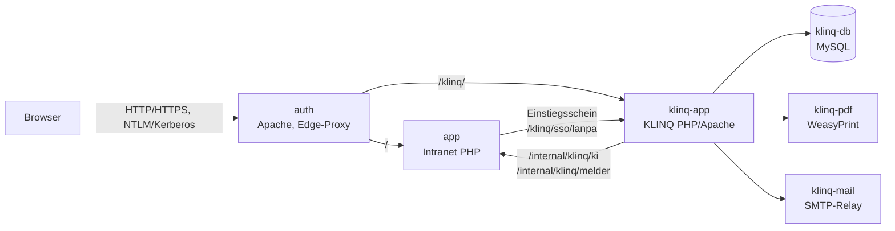

# KLINQ im Intranet (Help Desk, Asset-Management, Statistiken)

KLINQ ist eine eigenständige Anwendung für Help Desk, Asset-Management und
Auswertungen. Sie bleibt technisch selbstständig – eigener Container, eigene
Datenbank, eigene Oberfläche – und wird über das Intranet aufgerufen:

* Der `auth`-Container stellt KLINQ unter `/klinq/` auf demselben Host bereit
  und übernimmt die Windows-Anmeldung. KLINQ bringt dafür **keine eigene
  Kerberos-, AD-Join- oder SSO-Funktion** mehr mit.
* Die Anmeldung in KLINQ erfolgt über einen kurzlebigen, signierten
  Einstiegsschein, den das Intranet beim Aufruf der Kachel ausstellt.
* Wer Help-Desk-Agent, Asset-Management oder Statistiken nutzen darf, wird im
  Adminbereich des Intranets über **AD-Gruppen** vergeben.
* Die Seite `/stoerung` (Störmeldung IT) steht **jeder** über SSO angemeldeten
  Person offen – ohne Gruppenzuordnung.

Technische Einzelheiten (Routen, Schein-Aufbau, Rollenauflösung, Schnittstellen)
stehen in [klinq-referenz.md](klinq-referenz.md).

---

## 1. Einrichtung

### 1.1 Voraussetzungen

* Das Intranet läuft mit dem `auth`-Container als Einstiegspunkt.
* Für die automatische Anmeldung ist SSO eingerichtet
  (siehe [installation.md](installation.md), Abschnitt zur Windows-Anmeldung).
  Ohne SSO funktioniert KLINQ ebenfalls, dann meldet der `auth`-Container den
  Benutzer per Abfrage an (`Require valid-user`).

### 1.2 Geheimnis erzeugen

Beide Seiten (Intranet und KLINQ) lesen dasselbe Geheimnis. Es signiert den
Einstiegsschein und die internen Abfragen:

```bash
openssl rand -base64 32
```

### 1.3 `.env` ergänzen

```dotenv
# KLINQ aktivieren (Profil "klinq" wird zusätzlich gestartet)
COMPOSE_PROFILES=klinq
KLINQ_ENABLED=true
KLINQ_SSO_SECRET=<Ergebnis aus Schritt 1.2>
```

Alle weiteren Werte sind optional und haben Arbeitsvorgaben. Die wichtigsten:

| Variable | Vorgabe | Bedeutung |
| --- | --- | --- |
| `KLINQ_SSO_SECRET` | – | Gemeinsames Geheimnis (mindestens 32 Zeichen). Pflicht. |
| `KLINQ_DB_PASSWORD` | `DB_PASSWORD` | Passwort der KLINQ-Datenbank. |
| `KLINQ_APP_KEY` | abgeleitet | Schlüssel für in KLINQ gespeicherte Zugangsdaten. |
| `KLINQ_COMPANY_NAME` | leer | Firmenname auf Etiketten und Protokollen. |
| `KLINQ_ADMIN_PASSWORD` | leer | Lokales Notfallkonto; wird nur ohne vorhandene Benutzer angelegt. |
| `KLINQ_SMTP_*` | leer | SMTP-Relay für Entnahme-/Retourennachweise. |
| `KLINQ_SERVICE` | `klinq-app` | Containername für die Adressprüfung der internen Schnittstellen. |

Die vollständige Liste steht in `.env.example` und in der
[Referenz](klinq-referenz.md#15-umgebungsvariablen).

### 1.4 Starten

```bash
docker compose --profile klinq up -d --build
```

Beim ersten Start legt KLINQ sein Schema an. Das dauert einige Minuten
(`start_period` der Erreichbarkeitsprüfung: 180 Sekunden).

### 1.5 Im Adminbereich freischalten

1. **Administration → KLINQ → Status**: Erreichbarkeit prüfen
   („Jetzt prüfen“). Hier erscheinen auch Pfad, Geheimnis-Status und die
   Fassung der Anbindung.
2. **Administration → KLINQ → Berechtigungen**: AD-Gruppen zuordnen
   (Abschnitt 3).
3. **Administration → KLINQ → Kachel**: Kachel für die Startseite anlegen
   (Abschnitt 4).
4. **Administration → KLINQ → KI**: optional KI-Endpunkt hinterlegen
   (Abschnitt 6).

---

## 2. Architektur



| Dienst | Aufgabe |
| --- | --- |
| `auth` | Einziger Einstiegspunkt. Übernimmt die Windows-Anmeldung, entfernt gefälschte `X-Remote-User`-Header, leitet `/klinq/` an `klinq-app` weiter. Ist KLINQ gestoppt, erscheint `/klinq-nicht-verfuegbar`. |
| `klinq-app` | KLINQ selbst (Apache + PHP). Enthält Help Desk, Asset-Management, Auswertungen und die Anbindung an das Intranet (`app/Services/Lanpa/`). |
| `klinq-db` | Eigene MySQL-Instanz von KLINQ, nur im internen Netz `klinq_backend`. |
| `klinq-pdf` | HTML → PDF für Übergabeprotokolle. Nur intern erreichbar. |
| `klinq-mail` | SMTP-Relay für Entnahme- und Retourennachweise. Ausgehender Weg über `klinq_egress`. |
| `app` | Intranet: stellt den Einstiegsschein aus, liefert Designfarben und die internen Schnittstellen. |

**Warum kein eigener Proxy und kein eigenes Zertifikat?** KLINQ liegt wie Office
auf dem Host des Intranets (Same-Origin). Der `auth`-Container entfernt beim
Weiterleiten den Unterpfad `/klinq`; KLINQ ergänzt ihn über
`KLINQ_BASE_PATH=/klinq` wieder in seinen Antworten.

---

## 3. Berechtigungen über AD-Gruppen

Im Adminbereich unter **KLINQ → Berechtigungen** werden AD-Gruppen zugeordnet.
Die Gruppen kommen aus der SSO-Sitzung des `auth`-Containers; die Zuordnung
selbst liegt in der `settings`-Tabelle des Intranets.

| Zuordnung | Wirkung in KLINQ |
| --- | --- |
| Administration (Vollzugriff) | Rolle `admin` – alle Bereiche |
| Help-Desk-Administration | Rolle `helpdesk_admin` |
| Help-Desk-Leitung | Rolle `helpdesk_lead` |
| Help-Desk-Agenten | Rolle `helpdesk_agent` |
| Asset-Management | Rolle `assetmanagement` |
| Statistiken (Auswertungen) | Berechtigungsgruppe `statistik` |
| Ticketaufruf (Verlauf) | Berechtigungsgruppe `ticketaufruf` |

Regeln:

* **Die höchste zutreffende Rolle gewinnt** (Admin vor Help-Desk-Administration
  vor Leitung vor Agent vor Asset-Management vor Nur-Lesen).
* Berechtigungsgruppen (Statistiken, Ticketaufruf) sind unabhängig von der Rolle
  und werden zusätzlich vergeben.
* Wer in keiner der Gruppen ist, erhält `klinq_default_role`
  (Vorgabe: `readonly` – Anmeldung und eigene Tickets, keine Verwaltung).
* Mehrere Gruppen pro Feld sind zulässig, getrennt durch Komma oder Semikolon.
  Groß-/Kleinschreibung wird nicht unterschieden.
* Die Werte werden beim **Einstieg** ausgewertet und mit dem Schein übergeben.
  Änderungen greifen mit dem nächsten Aufruf der Kachel.

> **Wichtig:** Die AD-Gruppen müssen im `auth`-Container tatsächlich in der
> SSO-Sitzung ankommen. Enthält die Sitzung keine Gruppen, bleibt es bei
> `klinq_default_role`. Die Diagnose dazu steht im Status der Anbindung
> (Abschnitt 8).

---

## 4. Kachel und Navigation

### 4.1 Kachel auf der Startseite

**KLINQ → Kachel → Kachel anlegen** erzeugt einen Navigationspunkt:

| Feld | Wert |
| --- | --- |
| Typ | intern |
| Ziel | `/klinq-starten` |
| Symbol | Schraubenschlüssel |

Sichtbarkeit und Reihenfolge werden anschließend wie bei jeder anderen Kachel
über **Navigation** gepflegt (Benutzer, AD-Gruppen). Nur wer die Kachel sieht,
kann KLINQ über sie betreten; der Direktaufruf von `/klinq-starten` prüft
dieselbe Freigabe.

### 4.2 Navigationselement „Störmeldung IT“

Ein vorhandener Navigationspunkt (z. B. „Störmeldung IT“) lässt sich auf die
KLINQ-Meldeseite umstellen: **Navigation → Eintrag bearbeiten → Ziel** und dort
**„KLINQ-Meldeseite (Störmeldung IT)“** wählen. Der Eintrag zeigt dann auf
`/stoerung`.

Die Auswahl erscheint nur, wenn `KLINQ_ENABLED=true` gesetzt ist.

---

## 5. Störmeldung IT (`/stoerung`)

* Jede über SSO angemeldete Person darf die Seite aufrufen – ohne
  Gruppenzuordnung, ohne Kachel-Freigabe.
* Beim Aufruf stellt das Intranet einen Schein mit `report_only` aus und
  übergibt die Melderdaten: Anmeldename, Anzeigename, E-Mail, Telefon,
  Mobilnummer, Abteilung, Funktion, IP-Adresse und Rechnername.
* Die Daten stammen aus der SSO-Sitzung des `auth`-Containers, ergänzt um das
  Telefonbuch des Intranets.
* Abschalten: **KLINQ → Berechtigungen → „Störmeldung für alle angemeldeten
  Personen freigeben“** deaktivieren (`klinq_quick_report_open=0`). Danach
  antwortet `/stoerung` mit „nicht gefunden“.
* Angelegt wird das Ticket unter dem Systemkonto
  `HELPDESK_QUICK_REPORT_SYSTEM_USER` (Vorgabe `admin`). Fehlt es – im Intranet
  der Normalfall, weil es kein lokales Konto `admin` gibt –, legt
  `bin/migrate.php` es beim Containerstart ohne Passwort mit der Rolle
  `helpdesk_agent` an. Ein Konto mit demselben Namen kann sich nicht anmelden;
  meldet sich später ein gleichnamiger AD-Benutzer über SSO an, übernimmt die
  Anmeldung den Datensatz.

---

## 6. KI-Endpunkt konfigurieren

**KLINQ → KI**. Der Endpunkt wird zentral im Intranet gepflegt und von KLINQ
über die interne Schnittstelle abgerufen; die KI-Verwaltung in KLINQ selbst ist
dann nur lesend.

| Feld | Beispiel |
| --- | --- |
| Bezeichnung | `KLINQ-KI` |
| Adresse | `http://ki-server:11434/v1` (OpenAI-kompatibel) |
| Modell | `llama3.1:8b` |
| Zeitlimit | `60` Sekunden (5–900) |
| API-Schlüssel | leer lassen, wenn der Endpunkt keinen verlangt |

„Verbindung testen“ prüft die Modellliste und stellt eine Testfrage. Ein
API-Schlüssel kann zusätzlich als Umgebungswert `KLINQ_AI_API_KEY` hinterlegt
werden; dieser hat Vorrang und wird im Formular nicht angezeigt.

---

## 7. Designfarben

KLINQ bleibt optisch eigenständig, übernimmt aber Akzentfarbe, Linien und
gedämpfte Texte des Intranets. Das Intranet liefert die Werte unter
`/klinq-design.css`; KLINQ bindet sie zusammen mit `css/themes/lanpa.css` ein.
Ohne Anbindung gelten unverändert die eigenen Farben von KLINQ.

Die Farben folgen dem Design des Intranets – inklusive Dunkelmodus. Wird dort
die Akzentfarbe geändert, ist in KLINQ nichts nachzuziehen (Cache: 5 Minuten).

---

## 8. Betrieb

### 8.1 Status und Diagnose

**KLINQ → Status** zeigt:

* Erreichbarkeit (Ergebnis von `/health`, 30 Sekunden zwischengespeichert),
* öffentlichen Pfad und Adresse, Containername,
* ob `KLINQ_SSO_SECRET` gesetzt ist,
* Gültigkeitsdauer des Einstiegsscheins,
* Anzahl der vergebenen Gruppen.

### 8.2 Logs

```bash
docker compose --profile klinq logs -f klinq-app
docker compose logs -f auth        # Proxy und Anmeldung
```

Das Intranet protokolliert jeden Einstieg (`KLINQ betreten.`) mit Benutzer,
Ziel und Rolle.

### 8.3 Neustart und Updates

```bash
docker compose --profile klinq up -d --build klinq-app
```

Der `auth`-Container erkennt neue Container-Adressen und lädt Apache innerhalb
weniger Sekunden neu; ein Neustart von `auth` ist nicht nötig.

### 8.4 Sicherung

Zu sichern sind das Volume `klinq_db` (Datenbank) sowie `klinq_uploads`,
`klinq_logs` und `klinq_labels`. Die Intranet-Datenbank enthält nur die
Zuordnung der AD-Gruppen und die KI-Einstellungen.

### 8.5 Deaktivieren

```dotenv
KLINQ_ENABLED=false
COMPOSE_PROFILES=office   # bzw. ohne klinq
```

Nach `docker compose up -d` verschwinden Kachel und Navigationseintrag aus der
Auswahl, `/klinq-starten` und `/stoerung` antworten mit „nicht gefunden“, und
der `auth`-Container leitet `/klinq/` nicht mehr weiter.

---

## 9. Fehlersuche

| Beobachtung | Ursache | Abhilfe |
| --- | --- | --- |
| „KLINQ ist derzeit nicht verfügbar“ (503) | Container gestoppt oder nicht erreichbar | `docker compose --profile klinq ps`, dann `up -d`; Status im Adminbereich prüfen. |
| Endlos-Weiterleitung zwischen `/klinq/login` und `/klinq-starten` | `KLINQ_SSO_SECRET` fehlt oder unterscheidet sich | Beide Seiten neu starten, gleiches Geheimnis prüfen. |
| „Für KLINQ fehlt die Freigabe“ (403) | Kachel vorhanden, aber für die Person nicht freigegeben | **Navigation** → Kachel → Sichtbarkeit. |
| „Die Störmeldung ist derzeit nicht freigegeben“ (404) | `klinq_quick_report_open=0` | **KLINQ → Berechtigungen**. |
| Alle landen in „Nur Lesen“ | SSO-Sitzung enthält keine Gruppen | SSO-Diagnose im Intranet prüfen; Gruppenname exakt wie im AD eintragen. |
| KI-Funktionen in KLINQ nicht verfügbar | Endpunkt nicht konfiguriert oder nicht erreichbar | **KLINQ → KI** → „Verbindung testen“; Server-Logs von `klinq-app`. |
| Farben weichen ab | `/klinq-design.css` nicht erreichbar | Direkt im Browser aufrufen; der Wert muss CSS sein, kein HTML. |
| Kein Rechnername im Ticket | `X-Remote-User` fehlt oder Vertrauenswert aus | `HELPDESK_QUICK_REPORT_TRUST_USER_HEADER=true` in `docker-compose.yml` prüfen (ist gesetzt). |

Weitere Meldungen und ihre Bedeutung stehen in der
[Referenz](klinq-referenz.md#17-fehlersuche).
