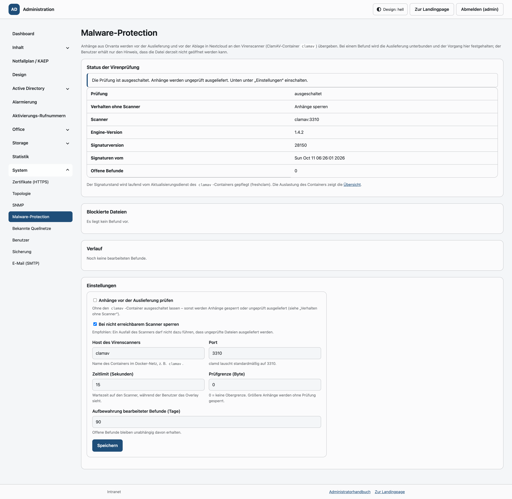
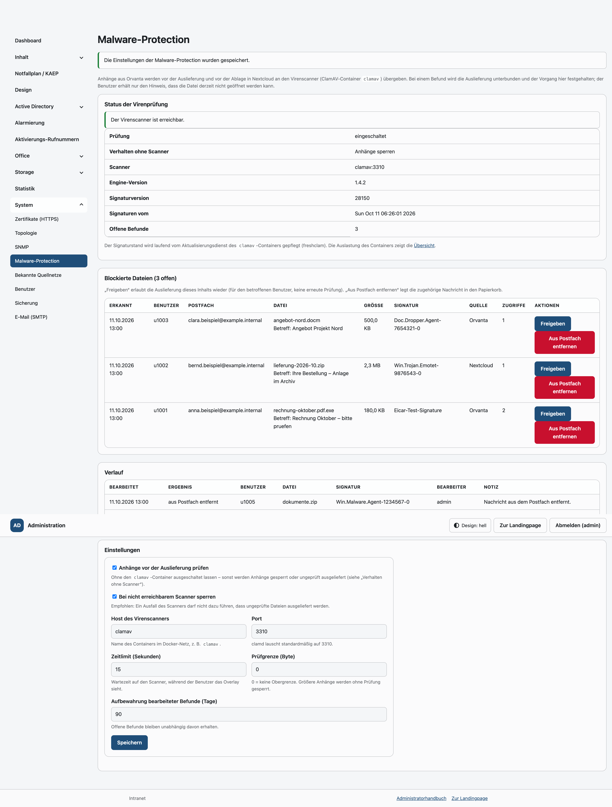
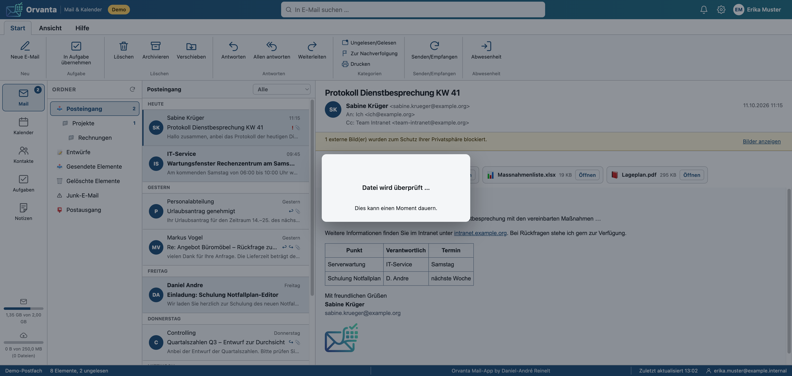
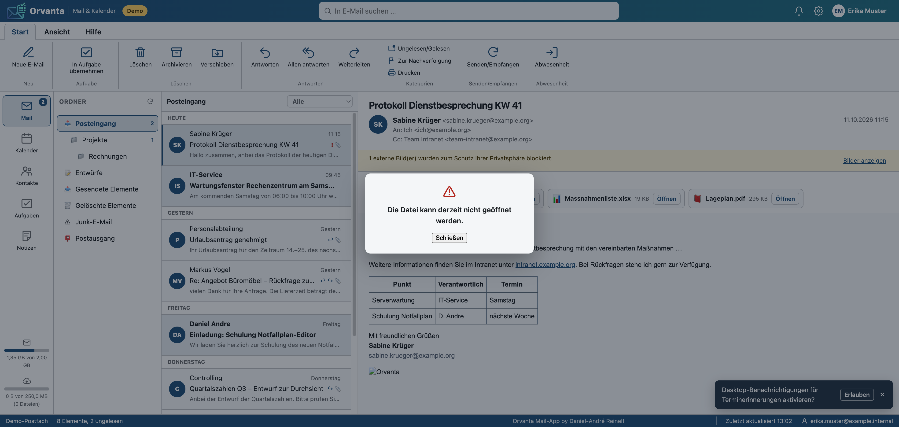

# Malware-Protection (Virenprüfung der Anhänge)

Anhänge aus Orvanta werden vor der Auslieferung an den Benutzer und vor der
Ablage in Nextcloud an einen **ClamAV-Container** (`clamav`) übergeben. Ein
Befund unterbindet die Auslieferung; der Vorgang erscheint im Adminbereich
unter **System → Malware-Protection**, wo er freigegeben oder aus dem Postfach
entfernt werden kann.

Die Prüfung ist **standardmäßig abgeschaltet**. Ohne den Container `clamav`
startet die Anwendung unverändert; erst mit dem Schalter „Anhänge vor der
Auslieferung prüfen“ greift die Prüfung.

---

## 1. Überblick

```
Orvanta (Anhang öffnen / nach Nextcloud) ─► OrvantaAttachmentService
                                                     │
                                                     ▼
                                            MalwareScanService
                                              ├─ freigegeben (uid + sha256)? ──► ausliefern
                                              ├─ Prüfgrenze überschritten?   ──► sperren
                                              └─ ClamdScanner (TCP INSTREAM)
                                                        │
                                                        ▼
                                                  clamav (clamd, 3310)
                                                        ▲
                                              freshclam (Signaturaktualisierung)
```

- **`MalwareScanService`** kennt nur Kennung, Dateiname und Inhalt. Die
  Entscheidung (ausliefern oder sperren) treffen die aufrufenden Dienste anhand
  des Ergebnisses.
- **`ClamdScanner`** überträgt den Inhalt per `INSTREAM` an clamd (Längenfeld je
  Block, abschließend die Länge 0). Der Signaturstand kommt aus `VERSION`.
  Es werden **keine Dateien geschrieben**; befundete Inhalte werden nicht
  gespeichert, sondern nur gemeldet.
- Schlüssel eines Befunds ist das Paar aus **Office-Kennung und
  Inhaltsprüfsumme** (`uid` + `sha256`): derselbe Inhalt wird in allen
  Postfächern eines Benutzers nur einmal geführt und muss auch nur einmal
  freigegeben werden.

## 2. Docker-Setup

Der Dienst `clamav` in `docker-compose.yml` baut `docker/clamav/Dockerfile`
(Basis `alpine:3.21` + `clamav` und `tini`):

| Datei | Zweck |
| --- | --- |
| `docker/clamav/Dockerfile` | Image; `EXPOSE 3310` nur zur Dokumentation, **kein** Port-Mapping; Healthcheck per `clamdscan --ping 1` |
| `docker/clamav/entrypoint.sh` | lädt beim ersten Start die Signaturdatenbank, startet `freshclam` als Daemon und `clamd` im Vordergrund (SIGTERM über `tini`) |
| `docker/clamav/clamd.conf` | TCP 3310, `StreamMaxLength`, Analyseumfang, `DetectPUA no`, `AlertExceedsMax`/`AlertEncrypted` |
| `docker/clamav/freshclam.conf` | Signaturquellen (`database.clamav.net`, `db.de.clamav.net`), Prüfintervall, `NotifyClamd` (RELOAD ohne Neustart) |

Betriebliche Eigenschaften:

- **Kein Port nach außen.** Die Anwendung erreicht clamd über `CLAMAV_HOST` /
  `CLAMAV_PORT` im internen Netz `malware`, in dem nur `app` und `clamav`
  liegen: clamd kennt keine Anmeldung und nimmt Steuerbefehle wie `SHUTDOWN`
  von jedem Teilnehmer an. Ausgehende Verbindungen für die
  Signaturaktualisierung laufen über das Netz `malware_egress`.
- **Vollständige Prüfung oder Befund.** `CLAMAV_MAX_STREAM_LENGTH` setzt
  `StreamMaxLength`, `MaxScanSize` und `MaxFileSize` gemeinsam. Mit
  `AlertExceedsMax yes` meldet clamd Inhalte, die eine Grenze überschreiten
  (Größe, Verschachtelung, Dateien im Archiv), als Befund
  `Heuristics.Limits.Exceeded.*`; mit `AlertEncrypted yes` verschlüsselte
  Archive und Dokumente als `Heuristics.Encrypted.*`. Solche Anhänge erscheinen
  als Befund und können nach Prüfung freigegeben werden.
- **`read_only: true`** mit `tmpfs` für `/tmp`, `/run` und `/var/log/clamav`.
  Die mitgelieferten Konfigurationen werden beim Start nach `/run/clamav`
  kopiert und dort angepasst; nur `/var/lib/clamav` (Volume `clamav_data`) ist
  beschreibbar.
- **Protokoll auf die Container-Ausgabe:** bewusst ohne `LogFile` /
  `UpdateLogFile` – clamd kann `/dev/stdout` im Container nicht öffnen; im
  Vordergrund schreibt es ohne `LogFile` direkt auf die Ausgabe, freshclam
  erhält `--stdout`.
- Bewusst **kein** `clamav/clamav`-Image: das offizielle Image erscheint nur für
  `linux/amd64`, während Alpine ClamAV für amd64 und arm64 nativ mitliefert.

```bash
docker compose up -d --build clamav   # Start (erster Start lädt die Signaturen, einige Minuten)
docker compose logs -f clamav         # Fortschritt und Signaturstand
```

Der Signaturstand ist über den Healthcheck und den Adminbereich sichtbar; die
Container-Auslastung (CPU und Arbeitsspeicher) erscheint als Kachel
**„Virenscanner (ClamAV)“** auf dem Admin-Dashboard (`monitor`-Container, siehe
[`agentsindex.md`](../agentsindex.md) Abschnitt 12 und `.env.example`,
Abschnitt „Kennzahlen der übrigen Container“).

## 3. Einrichtung

1. `php scripts/migrate.php` (Migration `056_malware_protection.sql`).
2. `docker compose up -d --build clamav` – beim ersten Start werden die
   Signaturen geladen; der Container meldet erst danach `healthy`.
3. Adminbereich → **System → Malware-Protection**
   (`/admin/malware-protection`): Stand der Virenprüfung prüfen (Scanner,
   Engine-Version, Signaturversion, Datum).
4. **„Anhänge vor der Auslieferung prüfen“** einschalten und „Bei nicht
   erreichbarem Scanner sperren“ eingeschaltet lassen (empfohlen).
5. Optional die Prüfgrenze (`malware_max_bytes`) an die Anhangsgrößen anpassen.

## 4. Ablauf der Prüfung

**Anhang öffnen** (Orvanta Mail):

1. Der Client ruft `POST /api/orvanta/anhang/link` auf und zeigt dabei das
   Overlay „Datei wird überprüft …“.
2. Der Server holt den Inhalt, prüft ihn (bzw. erkennt eine bereits erteilte
   Freigabe) und antwortet mit dem signierten Kurzzeit-Link **oder** mit einem
   Fehler `malware` / `malware_unavailable`.
3. Ohne Befund schließt der Client das Overlay und öffnet den Link.
4. Mit Befund zeigt das Overlay „Die Datei kann derzeit nicht geöffnet werden.“
   – **ohne weitere Details** (keine Signatur, kein Dateiname, keine
   Empfehlung). Der Befund steht im Adminbereich.

**Nach Nextcloud übertragen** (`POST /api/orvanta/anhang/nextcloud`): gleicher
Ablauf; mit Befund wird nichts abgelegt (`source = orvanta-nextcloud`).

Weitere Regeln:

- Ein Inhalt, den die Administration freigegeben hat, wird für denselben
  Benutzer **nicht erneut** geprüft.
- Ist der Scanner nicht erreichbar oder die Prüfung nicht möglich, entscheidet
  „Bei nicht erreichbarem Scanner sperren“ (`malware_fail_closed`): mit Schalter
  wird gesperrt (Grund `Prüfung nicht möglich`), ohne Schalter ausgeliefert.
- Anhänge oberhalb der Prüfgrenze werden **ohne Prüfung gesperrt**.
- Je Benutzer und Inhalt gibt es höchstens einen **offenen** Befund; weitere
  Zugriffe zählen `hits` hoch. Leere Angaben (z. B. Abruf durch den
  DocumentServer) überschreiben eine bekannte Zuordnung zu Postfach und
  Nachricht nicht, und „Prüfung nicht möglich“ verdrängt keine bereits
  erkannte Signatur. Nach **Entfernen** entsteht bei einem erneuten Fund ein
  neuer offener Befund.

## 5. Datenmodell (`malware_scans_log`)

Migration `056_malware_protection.sql`, Zugriff über
`App\Repositories\MalwareScanRepository`.

| Spalte | Bedeutung |
| --- | --- |
| `status` | `blocked` (Befund, Auslieferung unterbunden), `released` (freigegeben), `removed` (Nachricht aus dem Postfach entfernt) |
| `uid`, `mailbox` | Office-Kennung und Postfach, aus dem der Anhang stammt |
| `message_id`, `subject` | Nachricht im Mail-Backend und Betreff (Anzeige; leer bei Archivanhängen) |
| `attachment_id`, `filename`, `content_type`, `size_bytes` | Anhang, Dateiname, MIME-Typ, Größe |
| `sha256` | Prüfsumme des Inhalts – Schlüssel der Freigabe (zusammen mit `uid`) |
| `signature`, `engine` | Signaturname (z. B. `Eicar-Test-Signature`) und Engine-Kennung beim Befund |
| `source` | `orvanta` (Öffnen) oder `orvanta-nextcloud` (Übertragung) |
| `hits`, `first_seen_at`, `last_seen_at` | Anzahl abgewiesener Zugriffe auf denselben Inhalt sowie erster und letzter Zugriff |
| `action_at`, `action_by`, `action_note` | Zeitpunkt, Kennung und Notiz der Bearbeitung |

Indizes: `idx_malware_scans_status (status, id)`,
`idx_malware_scans_content (uid, sha256, status)`,
`idx_malware_scans_last_seen (last_seen_at)`.

**Aufbewahrung:** `malware_log_retention_days` (Standard 90 Tage) räumt
**bearbeitete** Befunde beim Schreiben auf. Offene Befunde bleiben unabhängig
davon erhalten.

## 6. Adminbereich (System → Malware-Protection)

| Bereich | Inhalt |
| --- | --- |
| Status der Virenprüfung | Schalterzustand, Verhalten ohne Scanner, Scanneradresse, Engine-Version, Signaturversion, Datum der Signaturen, Anzahl offener Befunde |
| Blockierte Dateien | offene Befunde mit Dateiname, Postfach, Signatur, Größe, Fundort und Anzahl der Zugriffe; je Zeile **Freigeben** (Auslieferung wieder erlaubt, keine erneute Prüfung) und **Entfernen** (Nachricht über den Mailweg des Benutzers in den Papierkorb) |
| Verlauf | bearbeitete Befunde mit Status, Bearbeiter, Zeitpunkt und Notiz |
| Einstellungen | Schalter und Grenzen (siehe Abschnitt 8) |

Beide Aktionen sind POST-Routen mit CSRF-Prüfung und verlangen eine
Bestätigung. „Entfernen“ wird nur angeboten, wenn der Befund Postfach und
Nachricht kennt; Archiv- und Kalenderanhänge (Termine werden bewusst nicht
gelöscht) haben keine Nachrichtenkennung. Die Freigabe eines Befunds
„Prüfung nicht möglich“ fragt ausdrücklich nach, weil der Inhalt danach für
den Benutzer ungeprüft bleibt.

## 7. Oberfläche (Overlay)

`public/assets/js/orvanta.js` (Abschnitt „Malware-Protection: Prüf-Overlay“),
`public/assets/css/orvanta.css` (`.ov-scan*`):

- **Während der Prüfung:** Karte mit Fortschrittsanimation und dem Text
  „Datei wird überprüft …“. Das Overlay liegt im öffnenden Fenster, nicht im
  Vorschaufenster, weil dieses während der Prüfung noch leer ist. Eine
  Mindestanzeigedauer (`SCAN_MIN_MS = 450`) verhindert ein Aufblitzen bei sehr
  kurzen Prüfungen.
- **Ohne Befund:** Das Overlay schließt sich automatisch, danach wird die Datei
  geöffnet bzw. in Nextcloud gespeichert.
- **Mit Befund:** neutrale Meldung „Die Datei kann derzeit nicht geöffnet
  werden.“ mit Schaltfläche „Schließen“; ein zuvor geöffnetes Vorschaufenster
  wird geschlossen. Der Client erhält keine weiteren Details.
- Bei `prefers-reduced-motion` werden die Animationen beruhigt
  (Spinner langsamer, Balken statisch).

| Adminbereich | Befunde |
| --- | --- |
|  |  |

| Prüfung läuft | Befund |
| --- | --- |
|  |  |

## 8. Einstellungen und Variablen

Alle Werte stehen in der Tabelle `settings` und sind im Adminbereich
änderbar; die Umgebungsvariablen (siehe `.env.example`, `config/malware.php`)
sind nur die Vorgabe.

| Einstellung | Variable | Standard | Bedeutung |
| --- | --- | --- | --- |
| `malware_protection_enabled` | – | `0` | Prüfung ein-/ausgeschaltet |
| `malware_host` | `CLAMAV_HOST` | `clamav` | Adresse des clamd-Dienstes |
| `malware_port` | `CLAMAV_PORT` | `3310` | Port von clamd |
| `malware_timeout` | `CLAMAV_TIMEOUT` | `15` | Zeitlimit einer Prüfung in Sekunden (der Benutzer wartet auf das Ergebnis) |
| `malware_fail_closed` | – | `1` | bei nicht erreichbarem Scanner sperren |
| `malware_max_bytes` | `CLAMAV_MAX_BYTES` | `0` | größte geprüfte Datei in Byte (0 = ohne Grenze); muss zu `StreamMaxLength` in `docker/clamav/clamd.conf` passen |
| `malware_log_retention_days` | – | `90` | Aufbewahrung bearbeiteter Befunde in Tagen |
| – | `CLAMAV_MAX_STREAM_LENGTH` | `100M` | Obergrenze eines `INSTREAM`-Auftrags im Container |
| – | `CLAMAV_FRESHCLAM_CHECKS` | `24` | Abstand der Signaturaktualisierung in Stunden |

## 9. Betrieb und Fehlersuche

| Symptom | Ursache und Abhilfe |
| --- | --- |
| Status zeigt „Der Virenscanner ist nicht erreichbar“ | Container `clamav` läuft nicht oder ist nicht `healthy`: `docker compose ps clamav`, `docker compose logs clamav`. Der erste Start lädt die Signaturen und dauert einige Minuten. |
| Alle Anhänge werden gesperrt, Status ist aber grün | Prüfgrenze zu klein (`malware_max_bytes`) oder `StreamMaxLength` im Container kleiner als der Anhang. |
| „Your ClamAV installation is OUTDATED!“ im Protokoll | Die Alpine-Paketversion ist älter als die aktuelle ClamAV-Version; die Signaturen werden trotzdem geladen. Kosmetisch. |
| Anhänge werden ungeprüft ausgeliefert | `malware_protection_enabled` ist aus oder `malware_fail_closed` ist aus und der Scanner antwortet nicht. |
| Signaturstand veraltet | Ausgehende Verbindungen des Containers prüfen; `docker compose logs clamav` zeigt die Versuche von freshclam. Ein manuelles Update ist mit `docker compose exec clamav freshclam --stdout` möglich. |
| Nachricht lässt sich nicht entfernen | Im Befund fehlen `uid`, `mailbox` oder `message_id` (z. B. Archivanhänge); der Befund bleibt offen und muss manuell bewertet werden. |

Die Entscheidungen protokolliert die Anwendung im Anwendungsprotokoll:
„Prüfung nicht möglich“, „Auslieferung eines Anhangs unterbunden“ und
„Befund bearbeitet“ (jeweils ohne Dateiinhalte).

## 10. Tests

Die Prüfung ist ohne Container testbar: `tests/Unit/MalwareScanTest.php` deckt
`MalwareScanService`, `MalwareScanRepository` und `MalwareController` mit einer
Demo-Implementierung von `App\Contracts\MalwareScannerInterface` ab (siehe
`tests/AGENTS.md`).

```bash
php tests/run.php
```

Die Tests decken den abgeschalteten Zustand, saubere und leere Inhalte,
Befunde, Freigaben, die Prüfgrenze, das Verhalten ohne erreichbaren Scanner
(`malware_fail_closed`), die Aufbewahrung und die Admin-Aktionen ab.
