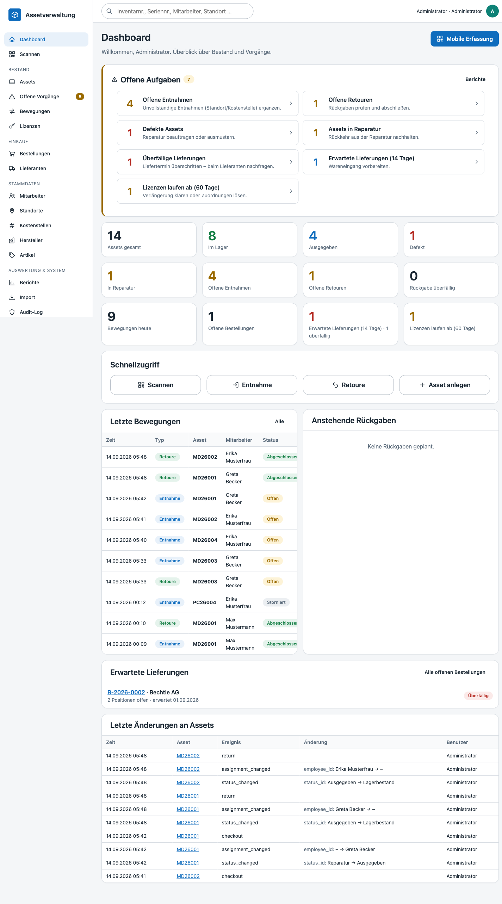

# KLINQ

KLINQ ist eine multifunktionale Web-Anwendung für die IT. Sie vereint mehrere Module unter einem Dach –
aktuell **Assetverwaltung** und **Help Desk**, weitere Funktionen folgen. Zwischen den Modulen wird in der
Oberfläche über ein Dropdown in der Kopfzeile gewechselt.

- **Assetverwaltung**: Inventar- und Assetverwaltung für IT-Hardware (PCs, Mobilgeräte, Netzwerkkomponenten,
  Zubehör) mit QR-Etiketten, mobiler Erfassung (PWA, offlinefähig), optionaler elektronischer Signatur am
  Desktop, Active-Directory-Anbindung, Windows-SSO über das Intranet (LANPA), Einkauf/Wareneingang, Lizenzen, Historie,
  Audit-Log und rollenbasierter Benutzerverwaltung mit zusätzlichen Berechtigungsgruppen.
- **Help Desk** (optional abschaltbar): vollständiges IT-Ticketsystem mit Status-Workflow, SLA-Fristen und
  Eskalation, Ticketregeln, Benutzerportal für Endanwender, anonymem Störungsmeldeformular, E-Mail-Eingang
  per IMAP sowie einer Wissensdatenbank.

**Technologie:** PHP 8.4, MySQL 8.4, Vanilla JavaScript, HTML, CSS – ohne Frameworks, ohne CDNs, ohne externe Laufzeitabhängigkeiten.
Betrieb vollständig in Docker; ein separater Python-Container (WeasyPrint) erzeugt die PDF-Archive der Übergabeprotokolle.



## Schnellstart

```bash
cp .env.example .env          # Passwörter anpassen (DB_PASSWORD, DB_ROOT_PASSWORD, ADMIN_PASSWORD)
docker compose up --build -d  # Migrationen laufen automatisch beim Start
```

Anwendung: <http://localhost:8080> – Anmeldung mit `ADMIN_USERNAME` / `ADMIN_PASSWORD` aus der `.env`.

Alternativ ohne Docker (Debian/Ubuntu, inkl. SSL-Zertifikat): `sudo bin/install.sh`, siehe [Docker-freie Installation](docs/installation.md#docker-freie-installation-binstallsh).

Alle Konfigurationsoptionen (Datenbank, AD/LDAP, Anbindung an das Intranet LANPA, Mail-/PDF-Dienst, Uploads,
Help Desk inkl. IMAP-Postfach und Störungsmeldeformular) sind in [`.env.example`](.env.example) beschrieben.
Der Scheduler im App-Container erledigt AD-Sync sowie die Help-Desk-Jobs (Eskalation/Auto-Close,
Mailabholung) automatisch; alternativ per Cron auf dem Host: `php bin/sync-ad.php`,
`php bin/helpdesk.php process`.

## Dokumentation

- [Installation & Betrieb](docs/installation.md)
- [Architektur](docs/architektur.md)
- [Datenmodell](docs/datenmodell.md)
- [AD-Synchronisation](docs/ad-sync.md)
- [Windows-SSO über das Intranet (LANPA)](docs/windows-sso.md)
- [Assets & Inventarnummern](docs/assets.md)
- [Etiketten & QR-Codes](docs/labels.md)
- [Bestandsmanagement – Entnahme & Retoure](docs/movements.md)
- [Einkauf – Bestellungen & Wareneingang](docs/einkauf.md)
- [Lizenzen – Verwaltung & Assetzuordnung](docs/lizenzen.md)
- [Übergabeprotokoll – Artikelstamm, digitale Unterschrift & Vorlagen-Baukasten](docs/uebergabeprotokoll.md)
- [Offline-Betrieb – PWA, Warteschlange & Synchronisation](docs/offline.md)
- [Berichte & Dashboard – Auswertungen & CSV-Export](docs/berichte.md)
- [Import – Altbestand aus CSV übernehmen](docs/import.md)
- [Audit-Log & Benutzerverwaltung](docs/audit.md)
- [Help Desk – Ticketsystem, Serviceportal & Wissensdatenbank](docs/helpdesk.md)
- [Help Desk – KI-Unterstützung („Mit KI verbessern“)](docs/helpdesk-ki.md)
- [Backup & Wiederherstellung](docs/backup.md)

Die gesamte Dokumentation gibt es zusätzlich als PDF mit Inhaltsverzeichnis: [docs/handbuch.pdf](docs/handbuch.pdf).
Neu erzeugen nach Änderungen an den Markdown-Dateien:

```bash
pip install weasyprint==63.1 markdown   # nur für den Build nötig
python3 bin/build-docs-pdf.py
```

## Tests

```bash
php tests/run.php --unit                 # Unit-Tests (ohne Datenbank)
docker compose exec app php tests/run.php # alle Tests inkl. Integration (Test-Datenbank)
```
