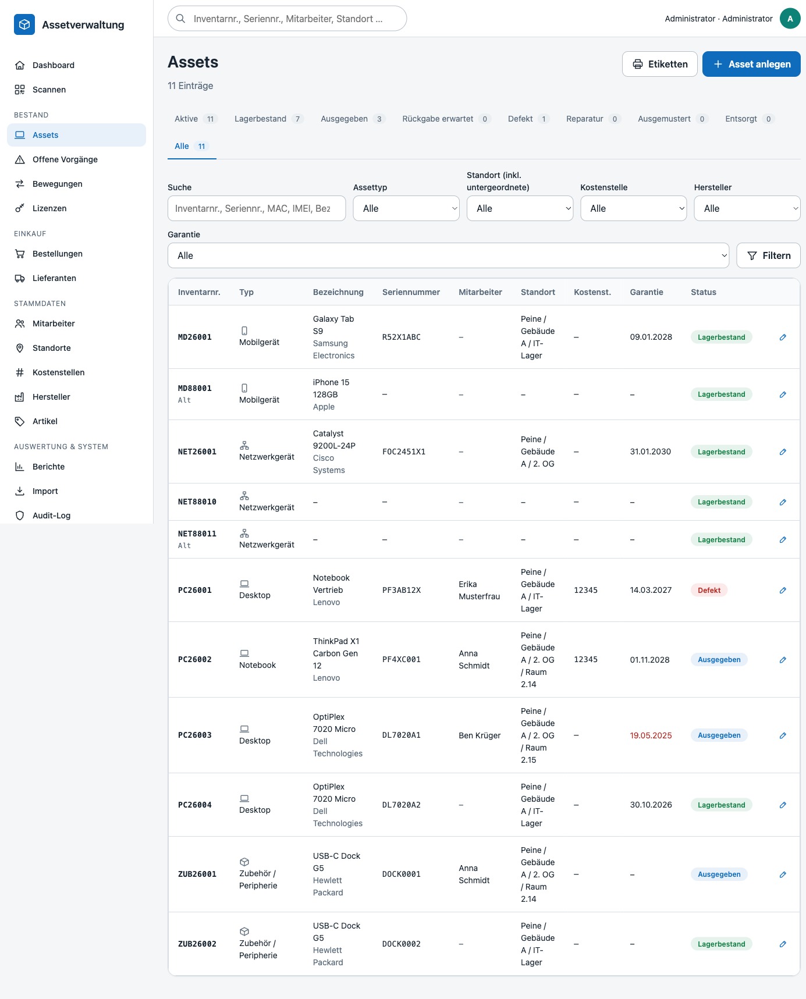
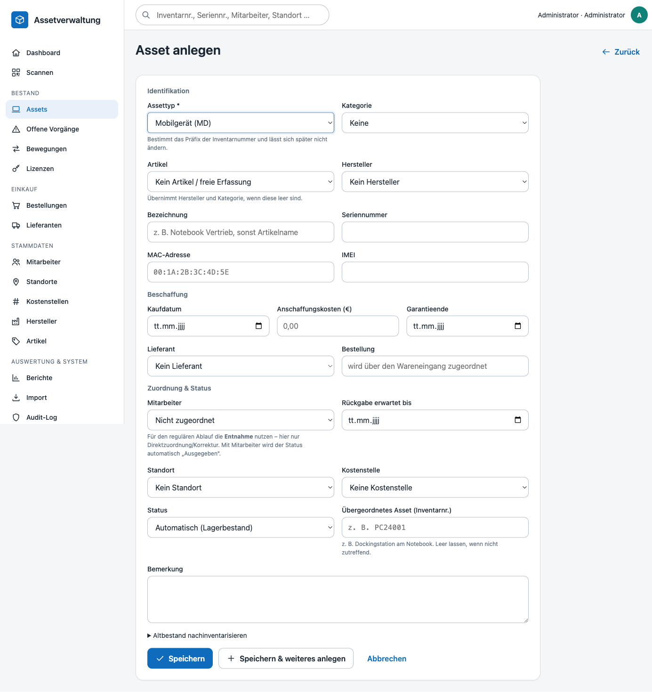
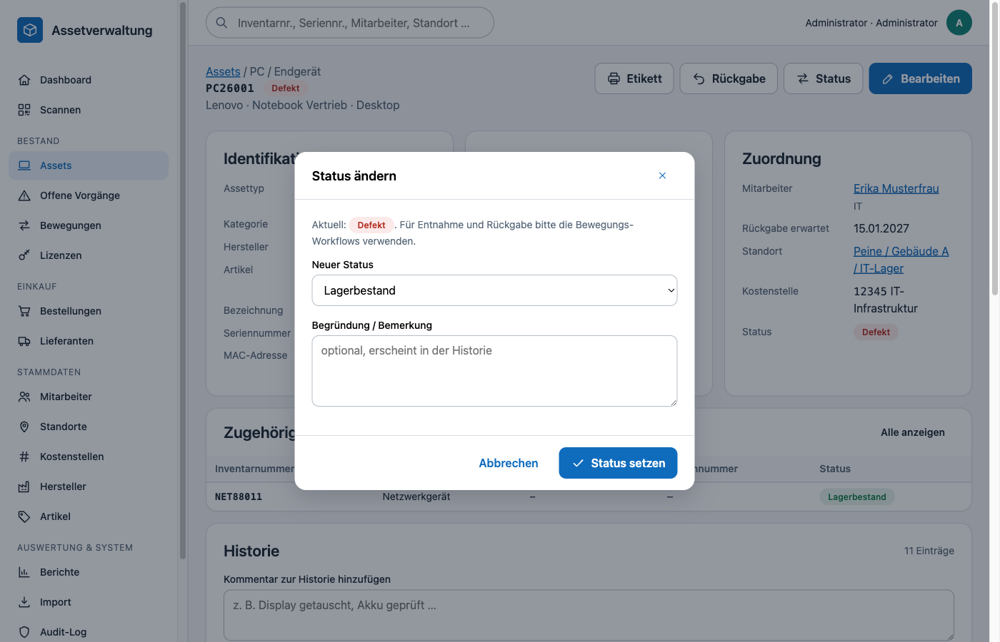
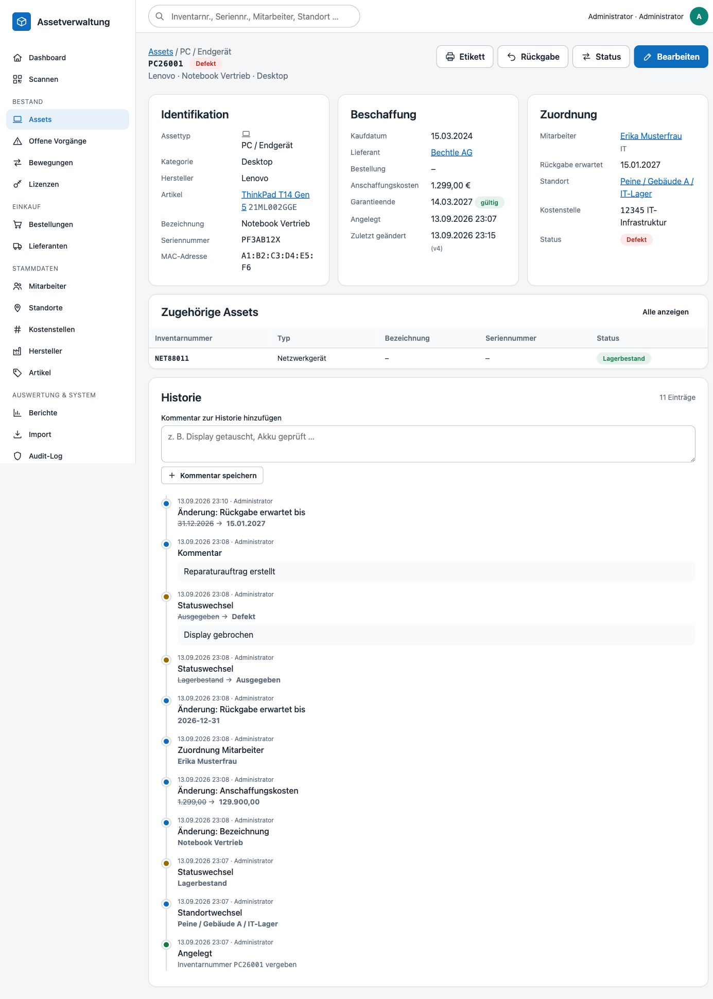
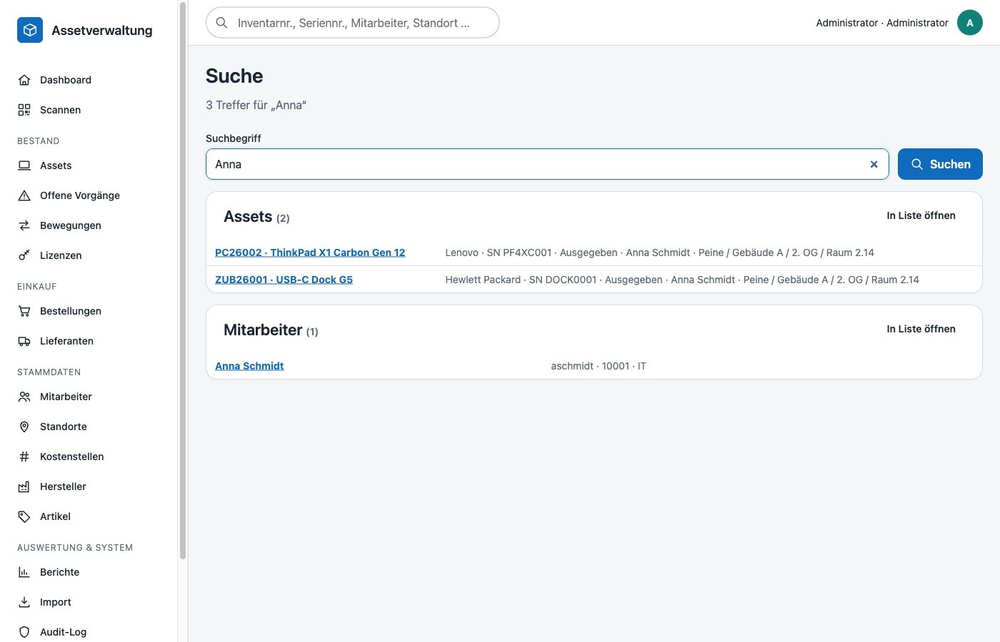
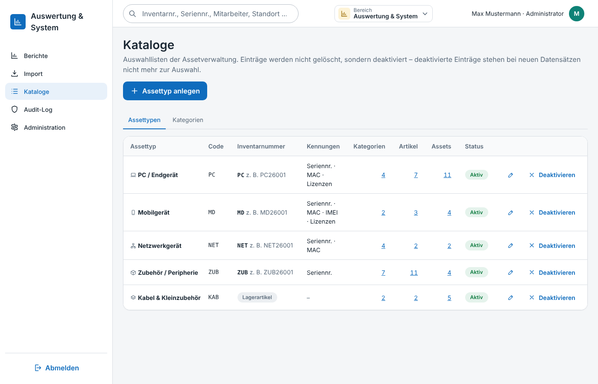
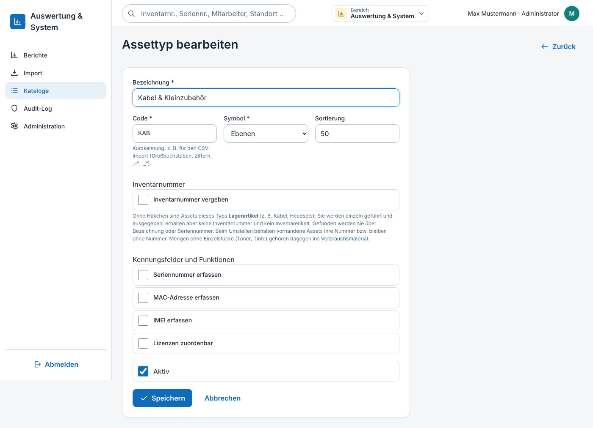
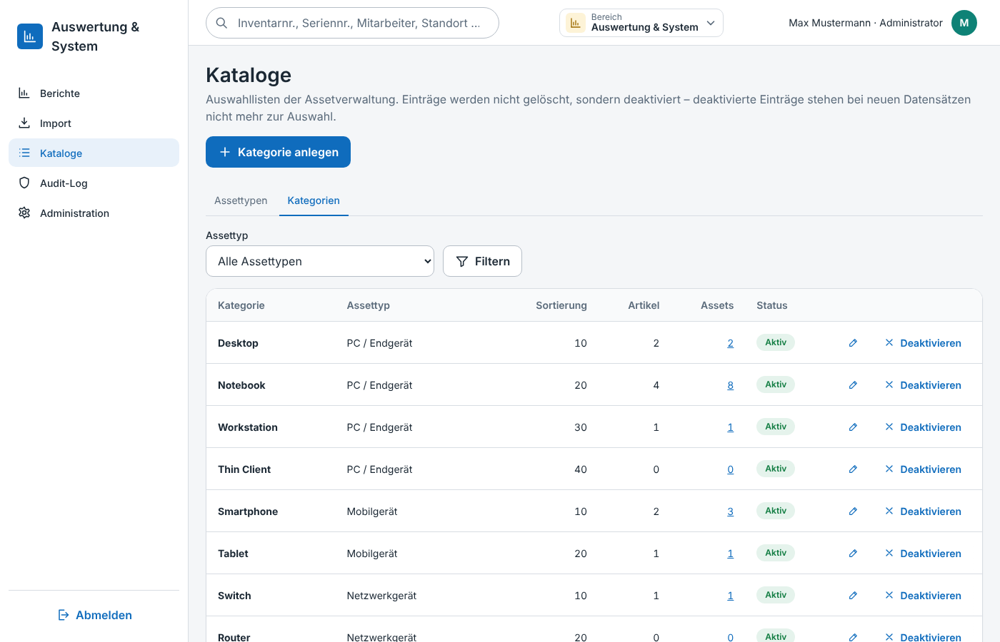
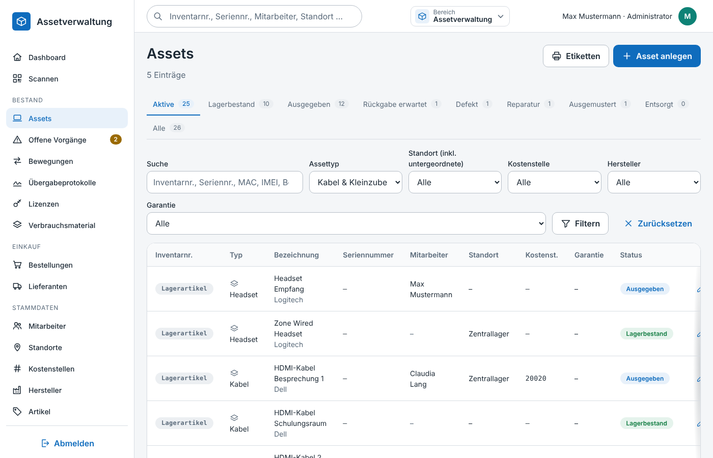
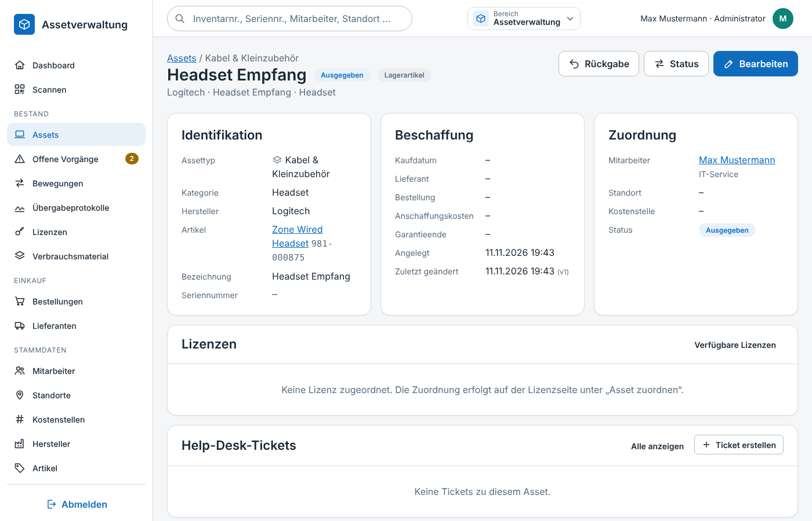

# Assets (Inventar)

Das Asset ist das zentrale Objekt der Anwendung. Jedes physische Gerät erhält genau eine Inventarnummer, die auf dem Etikett steht und über die gesamte Lebensdauer erhalten bleibt. Sie kann in begründeten Ausnahmefällen (z. B. falsch bedrucktes Etikett) im Asset geändert werden; die Änderung ist nur mit Pflichtangabe eines Grundes möglich und wird in der Historie dokumentiert.

## Inventarnummern

| Bestandteil | Bedeutung | Beispiel |
|---|---|---|
| Präfix | Buchstabenkürzel des Assettyps (`asset_types.inventory_prefix`; nur bei Typen mit Inventarnummer, siehe [Lagerartikel](#lagerartikel-assets-ohne-inventarnummer)) | `PC`, `MD`, `NET`, `ZUB` |
| Jahr | zweistelliges Jahr der Anlage | `26` |
| Laufnummer | mindestens dreistellig, pro Präfix **und** Jahr fortlaufend; ab 1000 wird sie länger (kein Überlauf) | `001` … `999`, `1000` |
| Altbestand | Jahreskennung `88` für nachinventarisierte Geräte ohne bekanntes Anschaffungsjahr | `PC88001` |

Regeln:

- Die Vergabe läuft transaktional über `inventory_sequences` (`SELECT … FOR UPDATE`), sodass parallel angelegte Assets niemals dieselbe Nummer erhalten.
- Wurden Nummern manuell oder per Import vergeben, springt die Sequenz automatisch hinter die höchste vorhandene Nummer (`InventoryNumberService::next`).
- Manuelle Nummern sind nur bei „Altbestand nachinventarisieren“ möglich. Sie müssen dem Format `PRÄFIXJJNNN` entsprechen und mit dem Präfix des gewählten Assettyps beginnen (`assets.inventory_number` ist UNIQUE).
- Der Assettyp ist nach dem Anlegen unveränderlich, weil er das Präfix bestimmt.
- **Bearbeiten**: Die Inventarnummer lässt sich im Bearbeiten-Formular ändern. Voraussetzung sind die Berechtigung `assets.manage`, ein **Grund** (`inventory_number_reason`, Pflichtfeld) sowie eine freie Nummer mit passendem Präfix und gültigem Format. Die Änderung erzeugt einen Historieneintrag `inventory_number_changed` mit altem/neuem Wert und dem Grund (`asset_history.note`); das Audit-Log protokolliert zusätzlich den Grund. Die laufende Nummer der Sequenz bleibt unberührt – höhere Nummern werden bei der nächsten Vergabe automatisch übersprungen.

## Erfassung

- **Typabhängige Felder**: MAC-Adresse und IMEI werden nur eingeblendet, wenn der Assettyp sie vorsieht (`has_mac_address`, `has_imei`).
- **Artikel (Pflicht)**: Jedes Asset verweist auf einen zuvor angelegten Stammartikel (Stammdaten → Artikel). Die Auswahl erfolgt über ein Textfeld mit Vervollständigung (`GET /api/articles/search`, Suche nach Name, Artikelnummer, Hersteller); freie Eingaben sind nicht möglich. Assettyp, Hersteller und Kategorie werden vom Artikel abgeleitet. Das gilt auch für den CSV-Import (Spalte *Artikel* ist Pflicht) und den Wareneingang (Positionen, die Assets erzeugen, benötigen einen Artikel).
- **Artikelstamm**: Artikel werden wie Hersteller phonetisch auf Dubletten geprüft (Kölner Phonetik über `normalized_name`/`phonetic_key`, Live-Hinweis über `GET /api/articles/check`, Bestätigung beim Speichern). Die Checkbox **„Relevant für Übergabeprotokoll“** legt fest, ob Assets dieses Artikels im [Übergabeprotokoll](uebergabeprotokoll.md) des Mitarbeiters erscheinen. Die Checkbox **„Verbrauchsmaterial“** mit *Mindestbestand* und *Aktuellem Bestand* kennzeichnet Artikel, die nicht inventarisiert werden: Sie erzeugen im Wareneingang keine Assets, sondern erhöhen nur ihren Lagerbestand, und erscheinen bei Unterschreitung in den [Bestellvorschlägen](einkauf.md).
- **Normalisierung**: Seriennummern werden für den Dublettenvergleich in Großbuchstaben ohne Leer-/Trennzeichen gespeichert (`serial_number_normalized`), MAC-Adressen als `AA:BB:CC:DD:EE:FF`, IMEI als 14–16 Ziffern. Beträge akzeptieren deutsches (`1.299,00`) und englisches (`1,299.00`) Format.
- **Dubletten**: Seriennummern sind je Assettyp eindeutig, MAC-Adresse und IMEI global. Während der Eingabe prüft `GET /api/assets/check` live und zeigt den Treffer an; der Server lehnt Dubletten beim Speichern zusätzlich ab.
- **Speichern & weiteres anlegen** behält Typ, Artikel, Hersteller, Standort, Kostenstelle, Lieferant und Kaufdaten als Vorbelegung – für die Erfassung ganzer Lieferungen.

## Status und automatische Ableitung

| Code | Name | verfügbar | Endstatus |
|---|---|---|---|
| `in_stock` | Lagerbestand | ✔ | |
| `issued` | Ausgegeben | | |
| `return_expected` | Rückgabe erwartet | | |
| `defective` | Defekt | | |
| `repair` | Reparatur | | |
| `retired` | Ausgemustert | | ✔ |
| `disposed` | Entsorgt | | ✔ |

- Wird ein Mitarbeiter zugeordnet und der Status ist „verfügbar“, wechselt er automatisch auf **Ausgegeben**; wird die Zuordnung entfernt, zurück auf **Lagerbestand**.
- Ein Wechsel in einen verfügbaren oder finalen Status löscht Mitarbeiterzuordnung und Rückgabefrist.
- Endstatus (Ausmustern/Entsorgen) erfordert die Berechtigung `assets.retire`. Ausgemusterte Assets bleiben mit vollständiger Historie erhalten, verschwinden aber aus der Standardansicht („Aktive“).

## Detailansicht und Historie

Jede Änderung erzeugt Einträge in `asset_history` – mit Klartext (alter → neuer Wert), Zeitstempel und handelnder Person:

| `event_type` | Auslöser |
|---|---|
| `created` | Anlage, inkl. vergebener Inventarnummer |
| `status_changed` | Statuswechsel (manuell oder automatisch) |
| `assignment_changed` | Mitarbeiterzuordnung geändert |
| `location_changed` / `cost_center_changed` | Standort bzw. Kostenstelle geändert |
| `field_changed` | Sonstige Felder (Bezeichnung, Seriennummer, Preis …) |
| `inventory_number_changed` | Inventarnummer geändert (alter/neuer Wert, Grund in `note`) |
| `note` | Freier Kommentar aus der Detailansicht |

Bearbeitungen verwenden **optimistisches Locking** (`assets.version`): Speichert eine zweite Person zwischenzeitlich, wird die Änderung abgewiesen und die Seite zum Neuladen aufgefordert – stille Überschreibungen sind ausgeschlossen.

## Liste, Filter und Suche

- Status-Tabs (Aktive, Lagerbestand, Ausgegeben, …, Alle) mit Trefferzahlen; Filter nach Typ, Standort (inklusive untergeordneter Standorte), Kostenstelle, Hersteller und Garantiestatus.
- Volltextsuche über Inventarnummer, Seriennummer, MAC, IMEI, Bezeichnung, Artikel, Mitarbeiter und Standort.
- Sortierbare Spalten, Paginierung, Direktlink zum Etikettendruck der gefilterten Menge.
- Die globale Suche in der Kopfzeile (`/search`, JSON unter `/api/search`) findet Assets, Mitarbeiter, Standorte und Artikel gruppiert; eine exakt eingegebene Inventarnummer öffnet das Asset direkt.

## Kataloge: Assettypen und Kategorien

Assettypen und Kategorien sind bearbeitbare Kataloge unter **Auswertung & System → Kataloge** (`/catalogs`, nur Admins mit `settings.manage`). Die Seite hat je Katalog einen Tab:

- **Assettypen** (`/catalogs?tab=asset-types`): Bezeichnung, Code (Großbuchstaben/Ziffern/`-`/`_`, eindeutig, z. B. für den CSV-Import), Inventarnummern-Präfix (1–6 Buchstaben, eindeutig), Symbol, Sortierung, Kennungsfelder (Seriennummer, MAC-Adresse, IMEI) und „Lizenzen zuordenbar“. Das **Präfix ist gesperrt, sobald Assets des Typs existieren**, weil deren Inventarnummern damit beginnen. Die Liste zeigt je Typ die Anzahl Kategorien, Artikel und Assets.
- **Inventarnummer vergeben**: Standardmäßig an; nur dann wird das Präfix-Feld angezeigt und ist Pflicht. Ohne Häkchen ist der Typ ein Typ für **Lagerartikel** (siehe unten); ein Präfix ist dann nicht nötig.
- **Kategorien** (`/catalogs?tab=asset-categories`, filterbar nach Assettyp): Assettyp, Bezeichnung (eindeutig je Assettyp), Sortierung. Der **Assettyp einer Kategorie ist gesperrt, sobald Assets oder Artikel sie verwenden**, weil Kategorie und Typ eines Datensatzes zusammenpassen müssen.

Einträge werden nicht gelöscht, sondern **deaktiviert**: Deaktivierte Typen und Kategorien stehen bei neuen Assets, Artikeln und Bestellpositionen nicht mehr zur Auswahl. Beim Bearbeiten eines Assets oder Artikels bleibt eine bereits gewählte, inzwischen deaktivierte Kategorie (bzw. beim Artikel der Assettyp) auswählbar und wird nicht stillschweigend entfernt. Alle Änderungen landen im Audit-Log (`asset_type`, `asset_category`).

Der Seeder (`database/seeders/001_defaults.sql`) spielt die Standardtypen (PC, MD, NET, ZUB) und -kategorien nur in eine **leere** Tabelle ein; im Katalog umbenannte oder deaktivierte Einträge werden bei späteren Migrationsläufen nicht überschrieben oder neu angelegt.

## Lagerartikel (Assets ohne Inventarnummer)

Für Dinge, die einzeln geführt, aber nicht inventarisiert werden sollen (z. B. Kabel, Kleinzubehör), wird beim Assettyp das Häkchen **„Inventarnummer vergeben“** entfernt (`asset_types.requires_inventory_number = 0`). Assets dieses Typs heißen in der Oberfläche **Lagerartikel**:

- Sie erhalten **keine Inventarnummer** (`assets.inventory_number` bleibt `NULL`, es wird keine Sequenz verbraucht); eine manuell eingegebene Nummer wird abgewiesen, auch im CSV-Import.
- Sie sind sonst vollwertige Assets: Status, Standort, Mitarbeiter, Historie, Entnahme/Rückgabe, Übergabeprotokoll, Lizenzen, Ticket-Verknüpfung.
- In Tabellen steht statt der Nummer „Lagerartikel“, in Überschriften die Bezeichnung bzw. der Artikel und die Seriennummer (`AssetService::label()`).
- Für Links, Scan-Eingaben, Formularfelder und den Offline-Modus gilt die Ersatzkennung **`#<Asset-ID>`** (`AssetService::code()`), die `MovementService::resolveAsset()` auflöst; Seriennummern funktionieren wie gewohnt.
- **Kein Inventaretikett**: Lagerartikel werden beim Etikettendruck übersprungen, die Schaltfläche „Etikett“ entfällt.
- **Umstellen eines Typs** ändert vorhandene Assets nicht: Bereits vergebene Nummern bleiben erhalten, Assets ohne Nummer bleiben ohne Nummer (auch nach dem Einschalten der Pflicht – beim Bearbeiten darf das Feld dann leer bleiben). Das Präfix ist gesperrt, sobald Assets mit Inventarnummer existieren.

Abzugrenzen ist **Verbrauchsmaterial** (Artikel mit „Verbrauchsmaterial“, z. B. Toner, Tinte): Dafür entstehen gar keine Einzel-Assets, sondern nur ein Lagerbestand je Artikel – siehe [Verbrauchsmaterial](einkauf.md#verbrauchsmaterial-und-bestellvorschläge-ordersreplenishment).

## Berechtigungen

| Berechtigung | Wirkung |
|---|---|
| `assets.view` | Liste, Detail, Suche |
| `assets.manage` | Anlegen, Bearbeiten, Statuswechsel, Kommentare |
| `assets.retire` | Ausmustern / Entsorgen |
| `settings.manage` | Kataloge Assettypen und Kategorien pflegen (Auswertung & System → Kataloge) |

## Relevante Klassen

- `App\Services\AssetService` – Validierung, Normalisierung, Statuslogik, Historie
- `App\Services\InventoryNumberService` – Nummernvergabe
- `App\Services\SearchService` – globale Suche
- `App\Repositories\AssetRepository`, `AssetHistoryRepository`, `AssetStatusRepository`
- `App\Controllers\AssetController`, `SearchController`
- Verbrauchsmaterial: `App\Controllers\ConsumableController`, `ArticleService::setStock()`, `ArticleRepository::consumables()`, Views `resources/views/consumables/`, Routen `routes/modules/consumables.php`
- Kataloge: `App\Controllers\CatalogController`, `App\Services\AssetCatalogService`, `App\Repositories\AssetTypeRepository`, Views `resources/views/catalogs/`, Routen `routes/modules/catalogs.php`
- Tests: `tests/Unit/InventoryNumberTest.php`, `tests/Unit/AssetNormalizerTest.php`, `tests/Integration/AssetServiceIntegrationTest.php`, `tests/Integration/AssetCatalogIntegrationTest.php`
