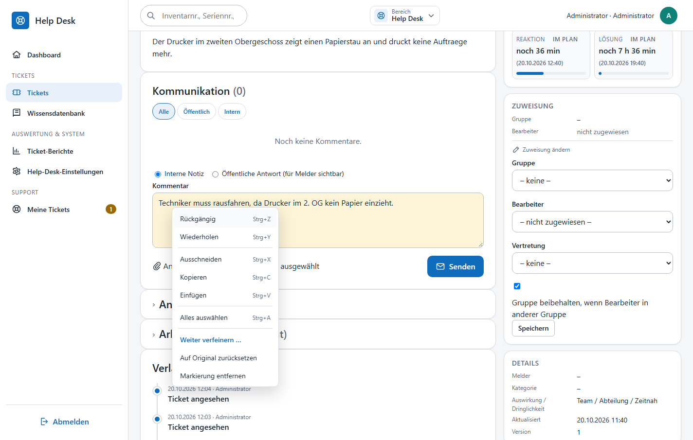
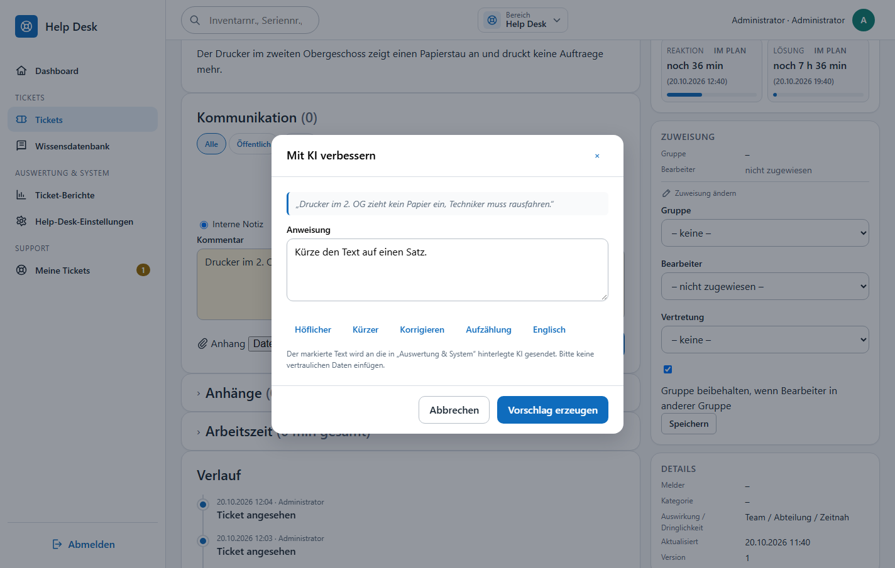
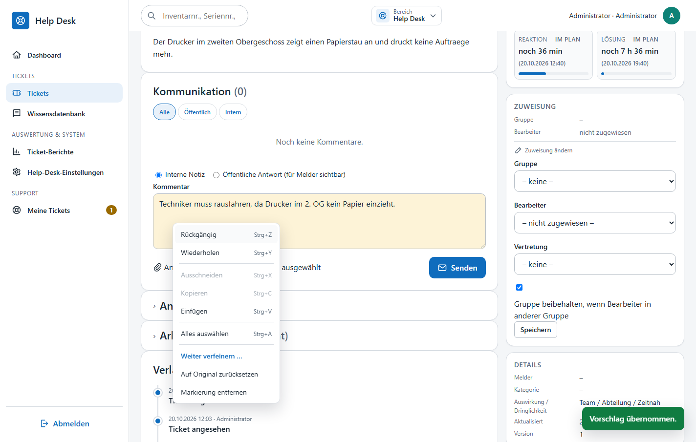
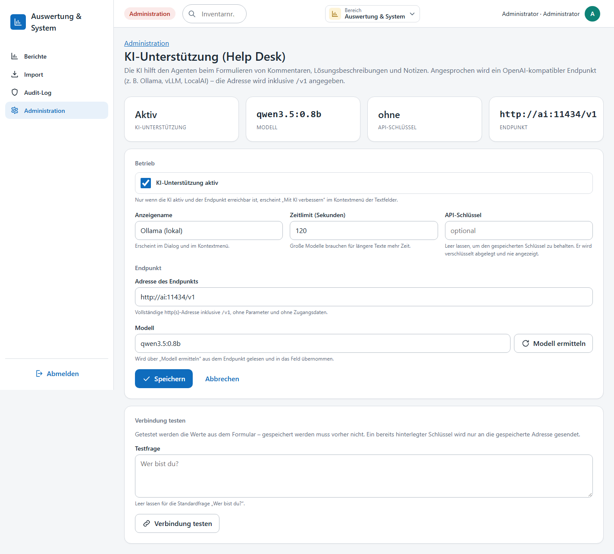
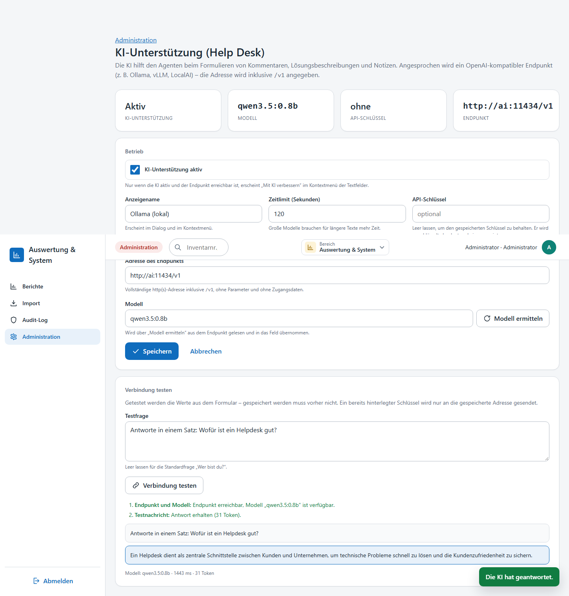

# Help Desk – KI-Unterstützung („Mit KI verbessern“)

Die Agentenoberfläche des Help Desk bringt ein eigenes Kontextmenü für alle bearbeitbaren Textfelder mit
(Rückgängig, Ausschneiden, Kopieren, Einfügen, Alles auswählen) und darüber hinaus **„Mit KI verbessern“**:
Ein markierter Absatz wird nach einer kurzen Anweisung umformuliert. Angesprochen wird ein
**OpenAI-kompatibler Endpunkt** (Ollama, vLLM, LocalAI, LM Studio, Azure-OpenAI-Gateway …) – die Anwendung
selbst enthält kein Modell.



## Wo das Kontextmenü erscheint

| Seite | Felder |
|---|---|
| `/helpdesk/tickets/{id}` (Ticketdetail) | Kommentar/Antwort (Tonalität folgt dem gewählten Kommentartyp „Interne Notiz“/„Öffentliche Antwort“), Kommentar beim Statuswechsel, Lösungsbeschreibung beim Schließen, Notiz zur Übergabe an die 2. Ebene |
| `/helpdesk/tickets/new` und `/helpdesk/tickets/{id}/edit` | Betreff, Beschreibung |

Das Menü wird per Rechtsklick oder per <kbd>Menü</kbd>-Taste (Kontextmenütaste) auf dem Feld geöffnet und
lässt sich mit den Pfeiltasten, <kbd>Enter</kbd>/<kbd>Leertaste</kbd> und <kbd>Esc</kbd> bedienen.
Es ersetzt das Browser-Menü nur in diesen Feldern; gesperrte (`readonly`) Felder bleiben unberührt.

| Eintrag | Kürzel | Wirkung |
|---|---|---|
| Rückgängig / Wiederholen | `Strg+Z` / `Strg+Y` | Rückgängig/Wiederholen im Feld |
| Ausschneiden | `Strg+X` | Markierung in die Zwischenablage |
| Kopieren | `Strg+C` | Markierung in die Zwischenablage |
| Einfügen | `Strg+V` | Zwischenablage an der Cursorposition (Rückfall auf das Browser-Verhalten, wenn der Browser den Lesezugriff verweigert) |
| Alles auswählen | `Strg+A` | gesamtes Feld markieren |
| Mit KI verbessern … | – | öffnet den Dialog (nur wenn die KI aktiv und erreichbar ist **und** Text markiert wurde) |

Auf macOS zeigt das Menü `⌘` statt `Strg`.

## „Mit KI verbessern“ im Ablauf

1. Text im Feld markieren – ohne Markierung bietet das Menü „Mit KI verbessern“ nicht an.
2. Kontextmenü → **Mit KI verbessern …** (bei bereits überarbeitetem Text: **Weiter verfeinern …**).
3. Im Dialog die Anweisung eingeben oder einen Vorschlag antippen
   (**Höflicher**, **Kürzer**, **Korrigieren**, **Aufzählung**, **Englisch**) und **Vorschlag erzeugen** wählen.
4. Der Vorschlag ersetzt genau die Markierung; der Bereich bleibt als KI-Text gemerkt.



Ein überarbeiteter Bereich lässt sich anschließend im Kontextmenü weiterbearbeiten:

| Eintrag | Wirkung |
|---|---|
| Weiter verfeinern … | öffnet den Dialog erneut mit dem bisherigen Ergebnis als Grundlage |
| Auf Original zurücksetzen | stellt den ursprünglichen Text wieder her |
| Markierung entfernen | vergisst die Zuordnung, der Text bleibt stehen |



Grenzwerte: 8.000 Zeichen markierter Text, 1.000 Zeichen Anweisung, 1.200 Ausgabe-Tokens.
Anweisungen und erzeugte Texte werden **nicht** gespeichert; sie stehen nur im Browser und im Speicher des
Anfrage-Threads.

## Konfiguration: Administration → „KI-Unterstützung (Help Desk)“

Die Seite liegt unter `/admin/helpdesk-ai` und benötigt das Recht `settings.manage`
(Administration → Karte „KI-Unterstützung (Help Desk)“). Oben zeigen vier Kennzahlen den Zustand
(Aktiv/Inaktiv, Modell, API-Schlüssel gesetzt, Endpunkt).



| Feld | Bedeutung |
|---|---|
| KI-Unterstützung aktiv | Nur wenn aktiv **und** der Endpunkt erreichbar ist, erscheint „Mit KI verbessern“ im Kontextmenü |
| Anzeigename | erscheint im Dialog und im Kontextmenü (z. B. `Ollama (lokal)`) |
| Zeitlimit (Sekunden) | 5–900; große Modelle brauchen für längere Texte mehr Zeit |
| API-Schlüssel | optional; wird verschlüsselt (`APP_KEY`) gespeichert und nie angezeigt. Leer lassen = gespeicherten Schlüssel behalten, Häkchen „Gespeicherten Schlüssel löschen“ entfernt ihn |
| Adresse des Endpunkts | vollständige `http(s)`-Adresse **inklusive `/v1`**, ohne Parameter und ohne Zugangsdaten, z. B. `http://ki-server:11434/v1` |
| Modell | Modellname am Endpunkt, z. B. `qwen3.5:0.8b` |

### Modell ermitteln

Der Knopf **Modell ermitteln** fragt `GET {Adresse}/models` ab, trägt das erste gefundene Modell in das
Modellfeld ein und füllt eine Auswahlliste für weitere Modelle. Gespeichert wird erst mit **Speichern**.

### Verbindung testen

Der Test arbeitet mit den **Werten aus dem Formular** – vorher speichern ist nicht nötig. Die Testfrage ist
frei wählbar (Standard: „Wer bist du?“). Angezeigt werden die geprüften Schritte (Adresse, Zugangsdaten,
Modell, Antwort), die Frage, die Antwort des Modells sowie Modellname, Tokenzahl und Dauer.



Typische Meldungen: `401/403` – Zugangsdaten prüfen; `404` – Adresse ohne `/v1` oder Modell unbekannt;
Zeitüberschreitung – Zeitlimit erhöhen; „Die KI hat eine ungültige Antwort geliefert“ – Endpunkt antwortet
nicht im OpenAI-Format (siehe Abschnitt zu denkenden Modellen).

## Betrieb ohne Internet und Datenschutz

- Es werden keine Ticketinhalte dauerhaft an das Modell übergeben: gesendet wird nur der markierte Absatz,
  bei Bedarf ergänzt um Betreff (max. 300 Zeichen) und Ticketnummer als kurzen Kontext.
- Gespeichert wird ausschließlich die Konfiguration (`system_settings`, Präfix `helpdesk.ai.`); der
  API-Schlüssel verschlüsselt. Änderungen erscheinen im Audit-Log.
- Ist der Endpunkt nicht erreichbar, bleibt „Mit KI verbessern“ aus dem Menü verschwunden – das Ticketsystem
  funktioniert unverändert weiter. Die Erreichbarkeit wird höchstens alle 60 Sekunden neu geprüft.

## Test mit Docker: Ollama und ein kleines Modell

Für Entwicklung und Tests bringt das Repository einen Ollama-Container mit:

```bash
docker compose --profile ai up -d          # startet "ai" (Ollama) und einmalig "ai-model" (Modell laden)
docker compose logs -f ai-model            # Ende: "success"
docker compose exec -T ai ollama list      # geladenes Modell anzeigen
```

- Im Compose-Netz lautet der Endpunkt `http://ai:11434/v1`, vom Host `http://localhost:11434/v1`
  (Port über `AI_PORT`).
- Geladen wird `AI_MODEL` (Standard `qwen3.5:0.8b`); `AI_KEEP_ALIVE` (Standard `10m`) hält das Modell im
  Speicher.
- In der `.env` des App-Containers sind die Standardwerte hinterlegt, die als Vorgabe dienen, solange in der
  Administration nichts gespeichert ist:

  | Variable | Beispiel | Bedeutung |
  |---|---|---|
  | `HELPDESK_AI_ENABLED` | `true` | KI-Unterstützung einschalten |
  | `HELPDESK_AI_NAME` | `Ollama (lokal)` | Anzeigename |
  | `HELPDESK_AI_URL` | `http://ai:11434/v1` | Endpunkt inklusive `/v1` |
  | `HELPDESK_AI_MODEL` | `qwen3.5:0.8b` | Modellname |
  | `HELPDESK_AI_TIMEOUT` | `120` | Zeitlimit in Sekunden |
  | `HELPDESK_AI_API_KEY` | leer | optionaler Schlüssel |

- In der Administration „Modell ermitteln“ und „Verbindung testen“ ausführen – mit dem Testcontainer
  erscheint als Modell `qwen3.5:0.8b`.

### Grenzen winziger Modelle

Ein Modell mit 0,8 Milliarden Parametern reicht, um die Integration vollständig zu prüfen (Verbindung,
Modellermittlung, Testfrage, „Mit KI verbessern“, Verfeinern, Zurücksetzen). Die Textqualität ist begrenzt:
Kurze Anweisungen wie „Kürze den Text auf einen Satz“ liefern brauchbare Ergebnisse, freiere Anweisungen
gelegentlich Unsinn oder eine unveränderte Antwort. Für den produktiven Einsatz ein größeres Modell
hinterlegen – die Anwendung muss dafür nicht angepasst werden.

## Denkende Modelle (Reasoning)

Modelle mit aktivierter Denkphase (z. B. Qwen3-Thinking-Varianten) liefern über die
OpenAI-Schnittstelle von Ollama oft eine **leere** Antwort: Das Token-Budget geht in `message.reasoning`
statt in `message.content`. Die Anwendung sendet deshalb immer `reasoning_effort: "none"` und wiederholt die
Anfrage einmal ohne dieses Feld, falls der Endpunkt es mit `400`/`422` ablehnt. Zusätzlich wird eine Antwort,
die nur aus Denktext besteht, als Fehler behandelt statt als leerer Vorschlag übernommen.

## Technik

- **Konfiguration**: `app/Services/Helpdesk/AiSettingsService.php` (Präfix `helpdesk.ai.`, verschlüsselter
  Schlüssel, `runTest()`, `fetchModels()`), Transport `app/Services/Helpdesk/Ai/AiChatClient.php` /
  `AiChatResponse.php`, Fachlogik `app/Services/Helpdesk/HelpdeskAiService.php` (Prompt-Aufbau je Feld,
  `cleanOutput()`, Erreichbarkeits-Cache in `storage/tmp/helpdesk-ai-availability.json`).
- **Oberfläche**: `resources/views/admin/helpdesk_ai.php`, `public/js/helpdesk-ai-admin.js` (Modell ermitteln,
  Verbindungstest), `public/js/helpdesk-ai.js` (Kontextmenü, Dialog, Textbereiche), Styles in
  `public/css/pages/helpdesk.css`.
- **Routen**: `GET|POST /admin/helpdesk-ai`, `POST /admin/helpdesk-ai/models`, `POST /admin/helpdesk-ai/test`
  (Recht `settings.manage`) sowie `POST /api/helpdesk/ai/verbessern` (`routes/modules/helpdesk.php`).
- **Tests**: `tests/Unit/HelpdeskAiChatTest.php` prüft die Antwortauswertung (Inhalt, Denktext, Fehlerfälle,
  Wiederholung ohne `reasoning_effort`). Ausführen: `docker compose exec -T app php tests/run.php --filter=HelpdeskAiChat`.
- **Migration**: keine eigene Migration – die Einstellungen liegen in `system_settings`.
