# Help Desk – Ticketsystem, Serviceportal & Wissensdatenbank

Das Help-Desk-Modul ergänzt KLINQ um ein vollständiges IT-Ticketsystem: Störungen, Serviceanfragen, Änderungen und Probleme werden als **Tickets** mit Nummer, Status-Workflow, Priorität aus Auswirkung × Dringlichkeit, SLA-Fristen, Zuständigkeit (Agent/Gruppe/Vertretung), Kommentaren, Anhängen, Arbeitszeiten, Verknüpfungen zu Assets/Mitarbeitern und einer lückenlosen Historie geführt. Endanwender melden Anliegen über ein **Serviceportal**, Lösungen landen in einer **Wissensdatenbank**. Alles läuft im bestehenden Stack (PHP 8.4, MySQL, keine Frameworks, CSP-konform, jede Route mit Berechtigung, Audit-Log).

## Überblick

| Bereich | Pfad | Zielgruppe |
|---|---|---|
| Help-Desk-Dashboard | `/helpdesk` | Agenten, Leitung |
| Ticketliste, Detail, Anlage | `/helpdesk/tickets` | Agenten |
| Berichte & CSV-Export | `/helpdesk/reports` | Leitung |
| Wissensdatenbank (Pflege) | `/helpdesk/knowledge` | Agenten |
| Administration (Typen, Status, Prioritäten, Kategorien, SLA, Gruppen, Vorlagen, Regeln) | `/helpdesk/admin` | Help-Desk-Admin |
| Serviceportal (eigene Tickets, neue Anfrage, Wissensartikel) | `/portal` | alle Mitarbeitenden |
| JSON-Endpunkte (Suche, Vorschläge, Vorlagen, Assets des Melders) | `/api/helpdesk/…` | Oberfläche |

Der Modulschalter `HELPDESK_ENABLED=false` blendet Navigation, Dashboard-Kacheln, Ticket-Treffer in der globalen Suche und den Scheduler-Job aus; die Routen selbst bleiben durch ihre Berechtigungen geschützt.

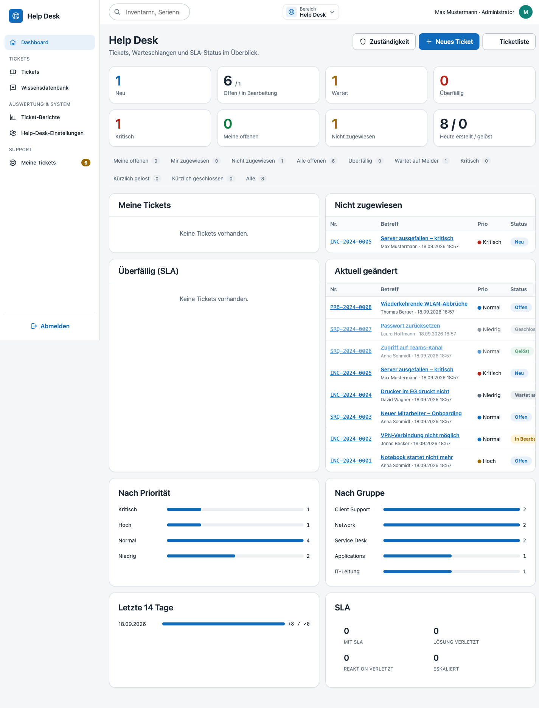

### Bereichswechsel in der Oberfläche

Help Desk und Assetverwaltung sind zwei eigenständige Module mit je eigenem Dashboard (`/dashboard` bzw. `/helpdesk`, für reine Portalnutzer `/portal`). In der Topbar steht mittig zwischen Suchfeld und Benutzeranzeige ein Dropdown, über das der Bereich gewechselt wird; die Seitenleiste zeigt immer nur die Navigationseinträge des gewählten Moduls. Das Dropdown erscheint nur, wenn der Benutzer beide Bereiche betreten darf (`helpdesk.view` oder `portal.view` bei aktivem Modulschalter).

Modulzuordnung und Navigationseinträge stehen zentral in `app/Support/ModuleNavigation.php`; das Layout (`resources/views/partials/app_layout.php`) rendert sie nur noch. Das aktive Modul ergibt sich aus dem `activeNav`-Schlüssel der Seite (`helpdesk*`/`portal*` → Help Desk, sonst Assetverwaltung). Der Fenstertitel folgt dem Muster `KLINQ - <Modul>`.

KLINQ merkt sich je Benutzer das zuletzt geöffnete Modul: `users.last_module` wird in der `AuthorizationMiddleware` über `ModuleNavigation::moduleForPath()` gepflegt (nur bei einem Modulwechsel, nicht bei jedem Aufruf). Beim nächsten Start – Aufruf von `/`, Anmeldung oder Intranet-Einstieg ohne ausdrückliches Ziel – öffnet `ModuleNavigation::startUrl()` dieses Modul wieder. Ist der Help Desk abgeschaltet oder fehlt die Berechtigung (`helpdesk.view`/`portal.view`), bleibt `/dashboard` der Startpunkt. Neutrale Seiten (Profil, globale Suche, JSON-Endpunkte) und der Systembereich (Berichte, Import, Audit, Administration) ändern die Auswahl nicht.

## Ticket-Lebenszyklus

### Nummer

`PREFIX-JJJJ-NNNNNN` (z. B. `HD-2025-000042`), Präfix aus `HELPDESK_TICKET_PREFIX`. Die Vergabe läuft über `ticket_sequences` unter `SELECT … FOR UPDATE` je Jahr – kollisionsfrei auch bei parallelen Anlagen.

### Status-Workflow

Status sind Stammdaten (`ticket_statuses`) mit einer **Kategorie**, die das Verhalten bestimmt:

| Kategorie | Standardstatus | Bedeutung |
|---|---|---|
| `new` | Neu | eingegangen, noch nicht angenommen |
| `open` | In Bearbeitung | Agent arbeitet; erste Reaktion zählt für die Reaktions-SLA |
| `pending` | Pausiert (Gründe aus dem Statuskatalog, Kategorie „Wartend“) | SLA-Uhr pausiert (`sla_paused_at`, `sla_paused_minutes`), Ende in `paused_until` |
| `resolved` | Gelöst | Lösung eingetragen; Melder kann bestätigen oder wieder öffnen |
| `closed` | Geschlossen | endgültig (manuell oder automatisch nach `HELPDESK_AUTO_CLOSE_DAYS`) |
| `cancelled` | Abgebrochen | mit Begründung |

Erlaubte Übergänge stehen je Status als Liste (`allowed_transitions`). Regeln:

- **Gelöst** erfordert einen Lösungstext, **Abgebrochen** eine Begründung.
- **Wieder öffnen** (`helpdesk.reopen`; im Portal innerhalb `HELPDESK_REOPEN_DAYS`) erhöht `reopen_count` und setzt die SLA-Uhr fort.
- Jede Änderung prüft die **Version** (optimistische Sperre, 409 bei Konflikt) und schreibt ein Ereignis in `ticket_events` sowie einen Audit-Eintrag.
- Zusammengeführte Tickets (`merged_into_ticket_id`) sind schreibgeschützt; Kommentare, Anhänge, Watcher und Asset-Verknüpfungen wandern ins Zielticket. Der Zusammenführungsgrund steht in `close_reason` (z. B. „Duplikat (HD-2024-000123)“).

### Pausieren

Statt vieler gleichlautender Wartestände gibt es **einen** Statuswechsel „Pausieren“. Die auswählbaren Gründe sind die
aktiven Status des Statuskatalogs mit der Kategorie **Wartend** (`pending`, SLA pausiert) und werden in der
Help-Desk-Administration unter **Status** gepflegt. Der Grund ist der Zielstatus, das **Ende der Pausierung**
(Datum **und** Uhrzeit) ist Pflicht und wird im Dialog über ein Kalender-Overlay (`<input type="datetime-local">`) erfasst.
Der Seeder legt diese Standardgründe an:

| Code | Name |
|---|---|
| `waiting_feedback` | Warten auf Rückmeldung |
| `waiting_third_party` | Warten auf Dritte |
| `waiting_delivery` | Warten auf Lieferung |
| `waiting_internal` | Warten auf interne Rücksprache |

- Neue Gründe werden als Status mit Kategorie „Wartend“ angelegt; deaktivierte Gründe verschwinden aus der Auswahl,
  bestehende Pausierungen lassen sich weiterhin fortsetzen. Für die SLA-Gutschrift muss beim Status zusätzlich
  „SLA pausieren“ gesetzt sein.
- Das Ende liegt in `tickets.paused_until` (UTC) und muss in der Zukunft liegen.
- Erreicht der Scheduler (`php bin/helpdesk.php process`) das Pausenende, setzt er das Ticket automatisch auf **In Bearbeitung**,
  schreibt das Ereignis `resumed` und schickt die Statusbenachrichtigung. Pausierte Minuten werden dabei der SLA gutgeschrieben.
- Bei „Warten auf Rückmeldung“ (`waiting_feedback`) beendet eine Antwort des Melders (Kommentar oder E-Mail) die Pausierung
  ebenfalls sofort (Ereignis `resumed`).
- Zwischen Pausierungen kann direkt gewechselt werden; dabei wird das neue Pausenende gesetzt.
- Die Ansicht „Pausiert“ (`/helpdesk/tickets?view=paused`) und die Dashboard-Kachel fassen alle Gründe zusammen.

### Priorität, Auswirkung, Dringlichkeit

Die Priorität wird aus **Auswirkung** (1 = Unternehmen … 3 = Einzelperson) × **Dringlichkeit** (1 = sofort … 3 = niedrig) über eine 3×3-Matrix (`TicketPriorityMatrix`) vorgeschlagen; Agenten können sie überschreiben, Portalnutzer nicht (agentenspezifische Felder werden im Portal ignoriert).

### SLA

`ticket_slas` definieren je Priorität (optional je Typ/Kategorie) Reaktions- und Lösungszeit in Minuten, wahlweise nur innerhalb der **Servicezeiten** (Wochentage, Start/Ende) sowie eigene Warn-/Eskalationsschwellen in Prozent. Beim Anlegen und bei Prioritäts-/Kategoriewechsel werden `response_due_at`/`resolution_due_at` berechnet (`TicketSlaService`, Pausen werden herausgerechnet). Der Zustand (`ok → warning → breached`, `met` bei Erfüllung) wird laufend aktualisiert und in Liste, Detail (Fortschrittsbalken) und Dashboard angezeigt.

### Eskalation & Scheduler

`php bin/helpdesk.php process` (im Container automatisch alle `HELPDESK_ESCALATION_INTERVAL_MINUTES` Minuten über `docker/php/scheduler.sh`, alternativ Cron auf dem Host):

1. bewertet alle offenen Tickets neu (Warnung/Verletzung, Ereignis + Benachrichtigung einmalig je Stufe),
2. eskaliert verletzte Tickets (`escalation_level` +1, Meldung an Gruppenleitung/Sammelpostfach, Ereignis `escalated`),
3. schließt gelöste Tickets ohne Rückmeldung nach `HELPDESK_AUTO_CLOSE_DAYS` Tagen (Ereignis `closed`, Quelle `scheduler`),
4. beendet abgelaufene Zuständigkeiten und verarbeitet den 2nd-Level-Tagesabschluss (23:59 Uhr, interne Notiz „kein Kommentar erfolgt“).

Exit-Codes: `0` ok, `1` Fehler, `2` Modul deaktiviert.

### Zuständigkeit (1st/2nd Level Support)

Auf dem Dashboard (`/helpdesk`) übernimmt ein Agent per Schaltfläche „Zuständigkeit“ (Overlay) tagesweise den 1st- oder
2nd-Level-Support. Übernahmen werden in `helpdesk_support_shifts` erfasst (Historie je Datum/Level für Auswertungen;
je Datum/Level ist maximal ein Eintrag aktiv – eine erneute Übernahme beendet den vorherigen Eintrag). Die Zuständigkeit
endet automatisch täglich um 19:00 Uhr (`APP_TIMEZONE`) über den Scheduler (`SupportShiftService::endExpiredShifts`,
aufgerufen aus `HelpdeskSchedulerService::run` bzw. `php bin/helpdesk.php process`).

- **2nd Level übernehmen**: Alle offenen Tickets, die nicht vom aktuellen Tag stammen, werden automatisch dem neuen
  2nd Level zugewiesen (`TicketService::assign`, damit inkl. Timeline-Ereignis und Benachrichtigung).
- **Banner**: Solange der angemeldete Nutzer der heutige 1st Level ist und ein 2nd Level feststeht, zeigt das Dashboard
  oberhalb der Kennzahlen-Kacheln den Hinweis „Zuständiger 2nd Level für dich ist heute {Anzeigename}“.
- **Weiterleitung an den 2nd Level**: Im Ticketdetail kann der heutige 1st Level ein Ticket mit Pflichtkommentar an den
  2nd Level des Tages weiterreichen (`POST /helpdesk/tickets/{id}/assign-second-level`, `SupportShiftService::assignToSecondLevel`).
  Zuweisung und Kommentar werden als interne Notiz im Ticketverlauf erfasst.
- **Erinnerung & Tagesabschluss**: Wer den 2nd Level übernommen hat, sieht in der Kopfzeile (Glocke links neben dem
  Benutzernamen) alle offenen Tickets, die nicht vom heutigen Tag stammen und heute noch nicht durch ihn kommentiert
  wurden; ein Klick öffnet das jeweilige Ticket. Wird ein solches Ticket bis 23:59 Uhr (`APP_TIMEZONE`) nicht kommentiert,
  erzeugt der Scheduler (`php bin/helpdesk.php process`, `SecondLevelReminderService::createMissedComments`) automatisch
  eine interne Notiz „Zuständig am dd.mm.yyyy war {Anzeigename}, kein Kommentar erfolgt.“. Die Verarbeitung ist je Tag
  idempotent (`helpdesk_support_shifts.reminder_finalized_at`).

Routen: `POST /helpdesk/support-shift/claim` (Berechtigung `helpdesk.view`), `POST /helpdesk/tickets/{id}/assign-second-level`
(Berechtigung `helpdesk.assign`, zusätzlich serverseitig auf den heutigen 1st Level beschränkt).

## Ticketdetail (`/helpdesk/tickets/{id}`)

- **Kopf**: Nummer, Betreff, Status/Priorität/Typ, Melder (Mitarbeiter mit Abteilung, Standort, Telefon), betroffener Mitarbeiter, Zuständigkeit, Fälligkeiten, SLA-Balken.
- **Aktionen**: Status ändern (Dialog mit Lösung/Begründung), **Pausieren** (Grund + Pausenende über Kalender-Overlay), Übernehmen, Zuweisen (Agent/Gruppe/Vertretung), **Zusammenführen** (Overlay mit Suche, Grund und optionaler Info-E-Mail, siehe „Ticket zusammenführen“), Beobachten, Stornieren (`helpdesk.cancel`) und Löschen (`helpdesk.delete`). Stornieren und Löschen erscheinen nur mit der jeweiligen Berechtigungsgruppe.
- **Kommunikation**: öffentliche Kommentare (Melder sieht sie im Portal, E-Mail-Benachrichtigung) und **interne Notizen** (`helpdesk.internal_note`, nur Agenten). Für Agenten ist die **interne Notiz** vorausgewählt; öffentliche Antworten müssen bewusst gewählt werden. Anhänge je Kommentar oder direkt am Ticket, optional intern. Zusätzlich **„E-Mail senden“** – eine echte Nachricht an den Melder (siehe „E-Mail aus dem Ticket senden“).
- **Arbeitszeiten** (`helpdesk.worklog`): Minuten (in 15-Minuten-Schritten), Tätigkeit, Datum; Summe im Kopf. Der Bereich ist – wie **Anhänge** – aufklappbar und standardmäßig geschlossen.
- **Verknüpfungen**: Assets (mit Vorschlag der dem Melder zugeordneten Geräte), Beziehungen zu anderen Tickets (`related`, `duplicate_of`, `parent_of`, `problem_of`, `change_for` – jeweils mit Gegenrichtung), Wissensartikel (Vorschläge nach Betreff/Kategorie, „Artikel aus Lösung erstellen“).
- **Tags** mit Autovervollständigung, **Watcher** (zusätzliche Empfänger).
- **Seitenleiste**: kompakte Infoboxen (SLA, Zuweisung, Details, Tags, Assets, Beziehungen, Beobachter, Wissensdatenbank); die Bearbeitungsformulare sind jeweils hinter einem aufklappbaren Abschnitt zusammengefasst.
- **Beschreibungstext**: nach dem Anlegen nur noch mit `helpdesk.admin` änderbar. Für alle anderen Bearbeiter ist das Feld im Bearbeitungsformular schreibgeschützt; ein übermittelter Wert wird serverseitig verworfen (`TicketService::canEditDescription()`). Ergänzungen gehören in Kommentare bzw. interne Notizen.
- **Historie**: alle Ereignisse chronologisch mit Feldänderungen (alt → neu). Öffnet ein Agent das Ticket, wird das Ereignis `viewed` („Ticket angesehen“) erfasst; sichtbar ist es nur mit der Berechtigung „Darf Ticketaufruf auswerten“ (`helpdesk.view_history`) bzw. für Admins.

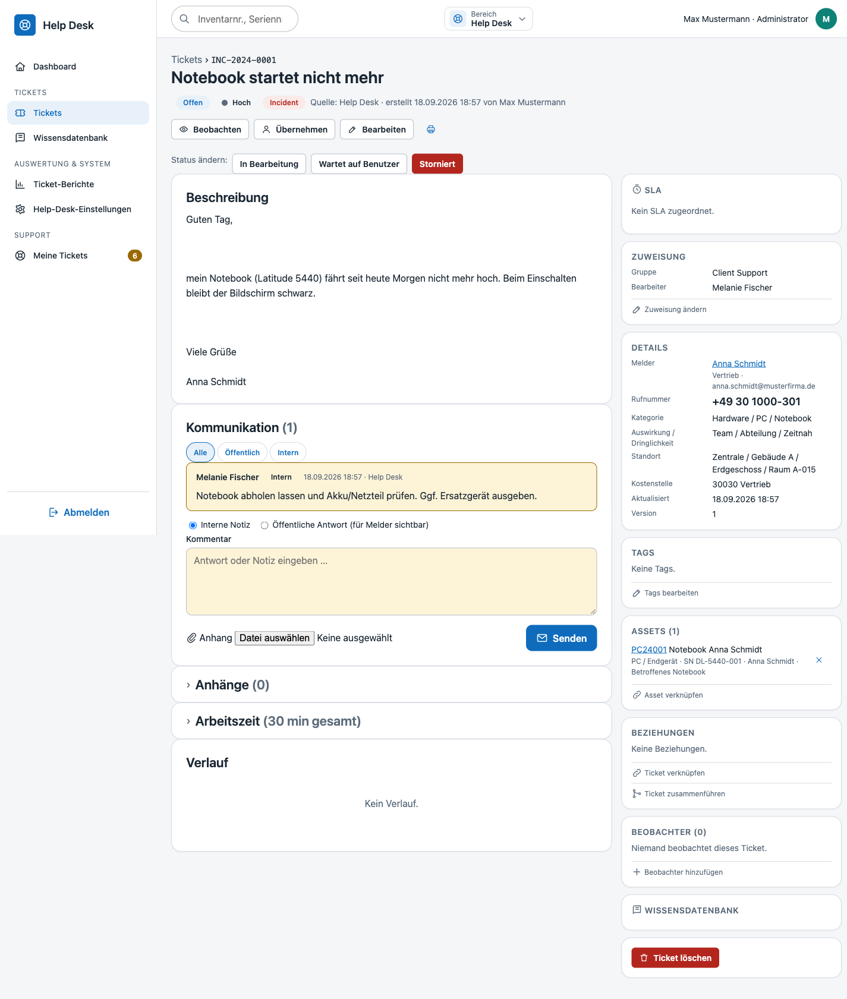

### Personenauswahl (Melder und Betroffene)

Die Felder **Melder** und **Betroffener Mitarbeiter** sind Auswahlfelder mit Suche. Gefüllt werden sie aus dem
**Telefonbuch des Intranets** (LANPA, alle Identitätsquellen) – also auch aus Personen, die nicht per AD-Sync nach KLINQ
gelangen. Die Suche läuft live über die interne Schnittstelle `GET /internal/klinq/telefonbuch`
(`PersonDirectoryService` → `LanpaBridge::phonebook()`), damit der Personenbestand nicht doppelt gepflegt wird.

- **Suchfelder**: Name (auch phonetisch), E-Mail, Benutzername, Abteilung und **Personalnummer** (Präfixsuche). Die
  Personalnummer stammt aus dem AD-Attribut `employeeNumber` (`LDAP_ATTR_PERSONNEL_NUMBER` im Intranet) und wird beim
  Übernehmen in den lokalen Mitarbeiter geschrieben (`employees.personnel_number`, höchstens 50 Zeichen, nur wenn
  gefüllt); die lokale Mitarbeitersuche findet sie danach ebenfalls.
- **Bekannte Personen** werden auf den lokalen Mitarbeiter abgebildet (Reihenfolge: objectGUID, E-Mail,
  Benutzername); die Auswahl liefert dessen ID, Tickets behalten ihren Fremdschlüssel.
- **Unbekannte Personen** erscheinen mit dem Hinweis „wird beim Auswählen übernommen“. Erst beim Auswählen legt
  `PersonDirectoryService::adopt()` einen lokalen Mitarbeiter an (`source = manual`, mit der objectGUID des
  Verzeichnisses, sofern vorhanden); Tippen allein füllt den Mitarbeiterbestand nicht. Die Stammdaten kommen dabei aus dem Intranet
  (`?id=…`), nicht aus der Anfrage. Der spätere AD-Abgleich erkennt den Datensatz an der objectGUID und stellt ihn auf
  `source = ad` um.
- **Lokale Mitarbeiter** bleiben zusätzlich wählbar (phonetische Suche), damit die Felder auch ohne erreichbares
  Intranet funktionieren.
- Endpunkte: `GET /api/helpdesk/people/search?q=…` (Berechtigung `helpdesk.view`) und
  `POST /api/helpdesk/people/adopt` mit `ref` = Telefonbuch-ID; die Oberfläche (`public/js/picker.js`) übernimmt die
  ID nach der Übernahme automatisch ins Feld.

### Liste (`/helpdesk/tickets`)

Ansichten *Meine*, *Meine Gruppe*, *Nicht zugewiesen*, *Alle offenen*, *SLA-kritisch*, *Gelöst*, *Alle*, dazu Volltext (Nummer, Betreff, Beschreibung, Melder), Filter nach Status, Priorität, Typ, Kategorie, Gruppe, Agent, Tag, Asset, Zeitraum; Sortierung nach Fälligkeit, Priorität, Aktualisierung, Nummer. CSV-Export (`helpdesk.export`) respektiert die aktiven Filter. Mit `helpdesk.merge` hat jede Zeile ein Auswahlkästchen; ab drei gewählten Tickets erscheint neben **CSV** die Schaltfläche **„Zusammenführen“** (siehe „Mehrere Tickets zusammenführen“).

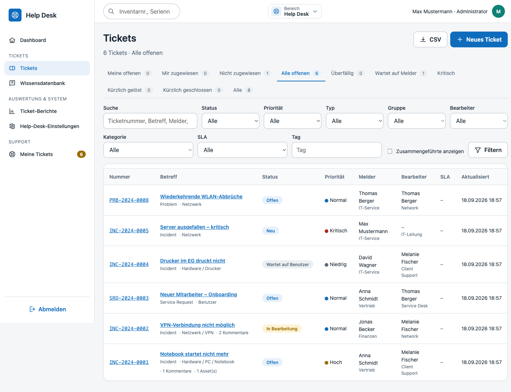

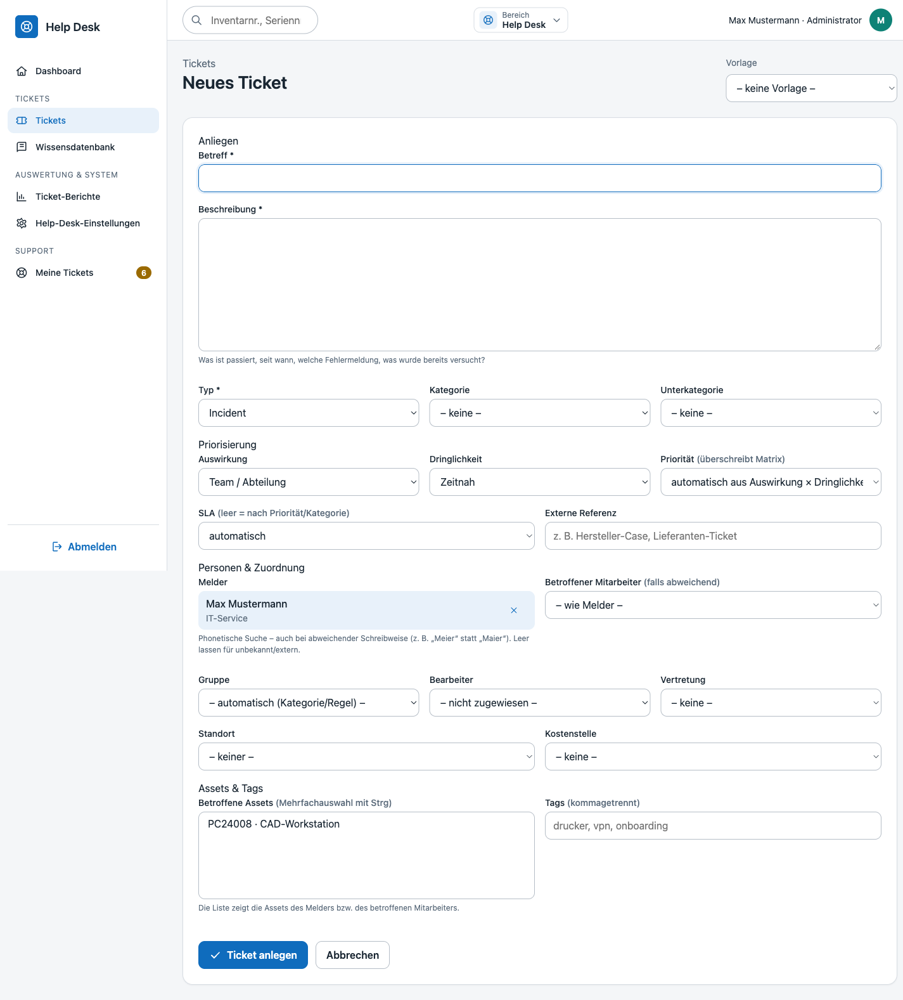

### Neues Ticket: klassisches Formular oder Assistent

`/helpdesk/tickets/new` bietet zwei Eingabemodi, umschaltbar über den Schalter im Seitenkopf:

- **Klassisch**: alle Felder in vier Feldgruppen auf einer Seite.
- **Assistent** (`?modus=assistent`): führt in acht Schritten durch das Formular – Vorlage/Betreff, Melder & Betroffener, Beschreibung, Typ/Kategorie/Unterkategorie, Auswirkung/Dringlichkeit/Priorität, Standort/Kostenstelle, Gruppe/Bearbeiter/Vertretung, Assets & Tags. Die Unterkategorie erscheint erst nach gewählter Kategorie.

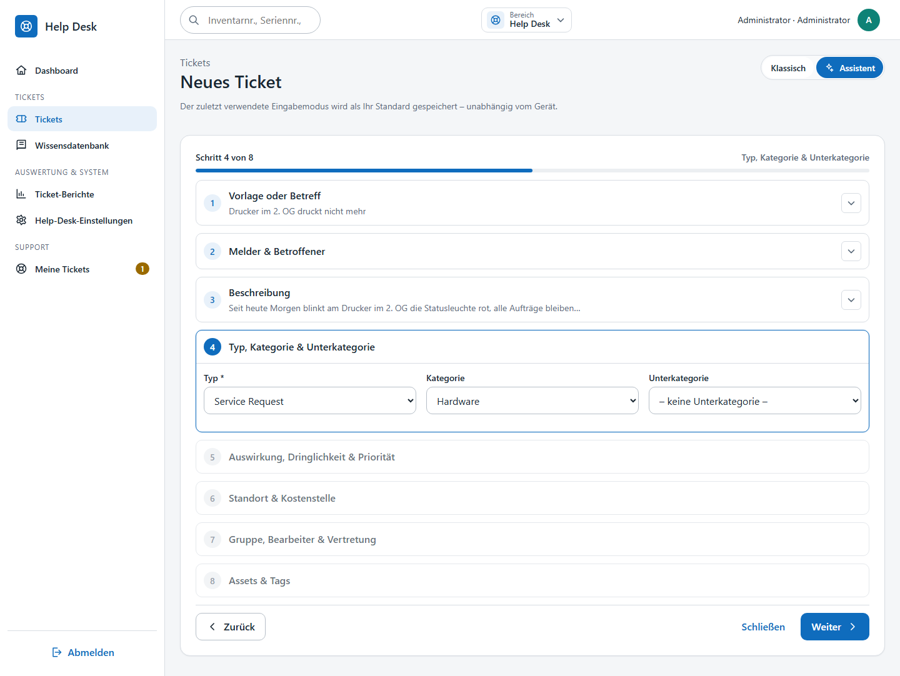

Beide Modi nutzen dieselben Felder (`views/helpdesk/tickets/_fields.php`) und denselben POST-Endpunkt; die serverseitige Validierung bleibt unverändert. Im Assistenten werden abgeschlossene Schritte oberhalb des aktuellen Schritts mit einer Zusammenfassung angezeigt und lassen sich aufklappen. Über „Zurück“ oder Klick auf einen Schritt lässt sich jederzeit wechseln, ohne Eingaben zu verlieren. Der Bearbeiter ist mit dem heutigen 2nd-Level-Support vorbelegt (`SupportShiftService::secondLevelUserIdToday()`), sonst „– nicht zugewiesen –“. Beim Verlassen über „Schließen“, den Moduswechsel oder die Navigation fragt der Assistent nach, bevor der Bearbeitungsfortschritt verloren geht (`public/js/helpdesk-wizard.js`).

#### Bevorzugter Eingabemodus je Benutzer

Der zuletzt verwendete Modus wird als **Benutzerpräferenz** in `users.ticket_form_mode` (`klassisch`/`assistent`) gespeichert – serverseitig, also unabhängig von PC oder Browser. `/helpdesk/tickets/new` ohne `modus`-Parameter öffnet den gemerkten Modus (Vorgabe: klassisch). Eine explizite Wahl über den Umschalter (`?modus=…`) und das erfolgreiche Absenden eines Tickets schreiben die Präferenz fort (`TicketController::resolveFormMode()`/`rememberFormMode()`, `UserRepository::ticketFormMode()`/`rememberTicketFormMode()`).

### Anhänge und Bilder in Beschreibung und Kommentaren

Beschreibung und Kommentare (intern wie extern, Agenten- und Portalansicht) sind **Rich-Text-Felder** mit Bildunterstützung:

- **Dateianhänge** laufen wie bisher über `DocumentService` (Tabelle `documents`, `entity_type = ticket`); im Assistenten und im klassischen Formular steht dafür ein Mehrfach-Upload im Schritt „Beschreibung“ bereit (`attachments[]`, maximal fünf Dateien je Vorgang, Whitelist/MIME-Prüfung wie in `config/uploads.php`). Beim Anlegen des Tickets werden die Dateien nach erfolgreicher Validierung mitgespeichert.
- **Bilder aus der Zwischenablage** werden per `STRG+V` direkt im Textfeld eingefügt (`public/js/helpdesk-media.js`), auch im öffentlichen Störungsformular. Das Skript skaliert auf maximal 1400 px Kantenlänge, komprimiert als JPEG auf höchstens ca. 900 KB und legt die Bilddaten als **base64-Data-URI** ab. Im Textfeld steht nur eine kurze Marke (`[Bild 1]`), das Bild erscheint als Vorschau unter dem Feld; beim Absenden ersetzt das Skript die Marke durch ``. So bleibt das Bild Teil des Textes und wird zusammen mit ihm in der Datenbank gespeichert. Screenshots, die nur als Base64-Text in der Zwischenablage liegen, werden ebenfalls erkannt.
- Die Ausgabe rendert `App\Support\RichText::toHtml()` (Helfer `rich_text()`), Textkontexte wie Benachrichtigungen, Wissensdatenbank und Merge-Protokoll nutzen `RichText::toPlain()`. Textgrenzen: `TicketService::MAX_TEXT_CHARS` (2 000 000 Zeichen) für Beschreibung und Kommentare.

### E-Mail aus dem Ticket senden

Agenten können aus einem Ticket heraus eine echte E-Mail an die **meldende Person** und optional an die **betroffene
Person** schicken. Die Schaltfläche **„E-Mail senden“** steht im Seitenkopf des Tickets (`helpdesk.comment`) und öffnet
ein Overlay mit dem Mail-Editor aus Orvanta – samt **Kontextmenü** und **KI-Unterstützung**.

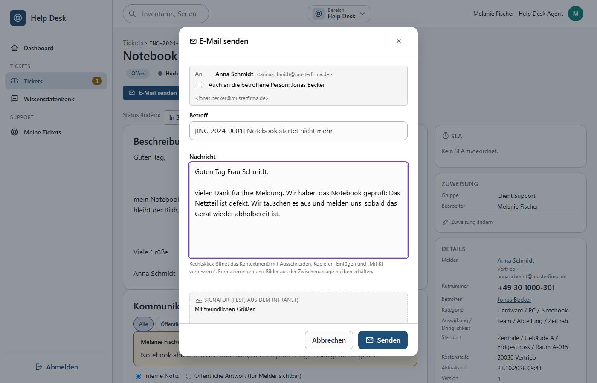

- **Empfänger**: Die meldende Person ist fest eingetragen. Die betroffene Person lässt sich über ein Kästchen
  hinzunehmen, sofern sie hinterlegt ist und eine **andere** Adresse hat. Fehlt eine Melderadresse oder ist der
  Mailversand abgeschaltet (`HELPDESK_NOTIFICATION_ENABLED=false`), ist die Schaltfläche deaktiviert und nennt den
  Grund im Tooltip. Zusammengeführte Tickets können keine Mail senden.
- **Betreff**: vorbelegt mit `[HD-JJJJ-NNNNNN] Betreff`, änderbar (höchstens 180 Zeichen).
- **Editor**: Rich-Text-Feld (`contenteditable`) mit den Tastenkürzeln des Browsers; eingefügte Formatierungen und Bilder
  aus der Zwischenablage bleiben erhalten. Der Text wird **serverseitig** durch `App\Support\HtmlSanitizer` gefiltert
  (Allowlist für Tags und Attribute, keine Skripte, keine `javascript:`-Ziele, `style` ohne `url()`/`position:fixed`);
  Bilder sind nur als `http(s)`- oder `data:image`-Quelle erlaubt.
- **Kontextmenü** (Rechtsklick in den Text): Rückgängig, Wiederherstellen, Ausschneiden, Kopieren, Einfügen, Alles
  auswählen sowie **„Mit KI verbessern …“** für den markierten Text und – nach einem Vorschlag – **„KI-Vorschlag weiter
  verfeinern …“**.

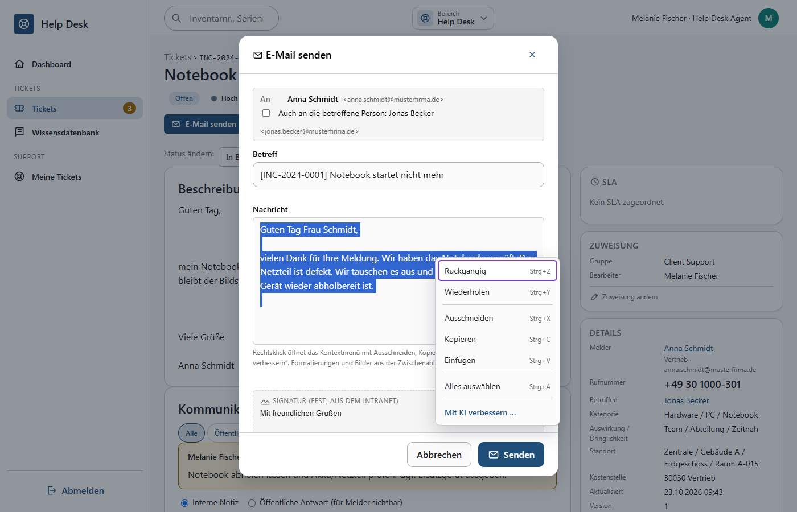

- **KI-Funktion**: Der Dialog entspricht dem Editor im Ticket (`/api/helpdesk/ai/verbessern`), verwendet aber den
  Modus `ticket_mail`, damit die KI den Ton einer Agentenantwort an die meldende Person trifft. Der **API-Schlüssel
  stammt aus den KLINQ-Einstellungen** (Intranet: KLINQ → KI, abgerufen über `GET /internal/klinq/ki`); ohne
  hinterlegten Schlüssel bleibt der KI-Eintrag ausgeblendet.

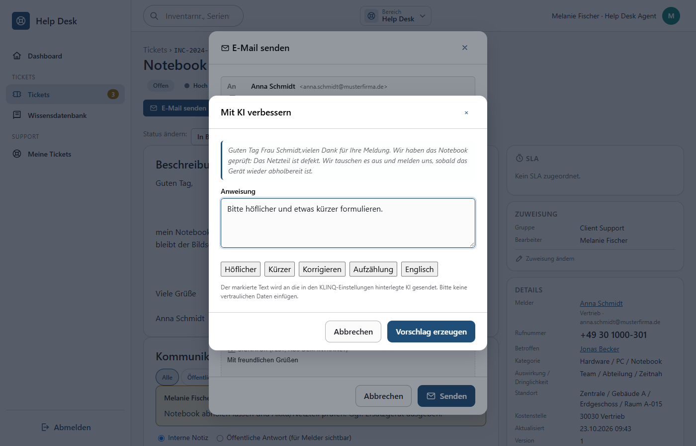

- **Signatur**: steht **schreibgeschützt im Editor** (Block mit `contenteditable="false"`, wie im Orvanta-Mail-Editor),
  fest, unveränderlich und **dieselbe wie in Orvanta** – sie wird nicht im Browser erzeugt, sondern beim Senden
  serverseitig angehängt (`GET /helpdesk/tickets/{id}/mail/signature` liefert nur die Anzeige im Editor; ein mitgesendeter
  Signaturblock wird verworfen). Quelle ist
  `GET /internal/klinq/signatur` im Intranet: Dort wird der Benutzername des angemeldeten Agenten auf den
  Telefonbucheintrag abgebildet (quellenunabhängig, Hauptquelle zuerst), die AD-Gruppen werden geladen und
  `OrvantaSignatureService::forUser()` rendert die Signatur. Ist im Intranet keine Signatur hinterlegt oder ist es
  nicht erreichbar, wird ohne Signatur gesendet.
- **Pausierung**: Im Dialog lässt sich zusätzlich wählen, ob und **wie lange** das Ticket pausiert wird, mit **Grund**
  (Pausierungsstatus aus dem Workflow) und **Pausierende** (Datum/Uhrzeit, Vorgabe: morgen 12:00). Die Pausierung wird
  nach dem Versand über `TicketService::changeStatus()` gesetzt; ein Fehler dabei wird als Warnung gemeldet, die Mail
  gilt trotzdem als gesendet.
- **Protokollierung**: Die Mail wird als **öffentlicher Kommentar** mit `source = email` am Ticket geführt (sichtbar im
  Portal und in der Historie, Ereignis `comment` mit `via = email`, `direction = out`), inklusive Empfängern und
  Betreff; zusätzlich Eintrag im Audit-Log. Eine eigene Benachrichtigung wird nicht ausgelöst – die Mail selbst ist die
  Information an den Melder.
- **Threading**: Jede Mail trägt `Message-ID`, `In-Reply-To`/`References` auf die Thread-Wurzel des Tickets und
  `X-Ticket-Number`; Antworten des Melders landen dadurch wieder im richtigen Ticket. Bewusst **ohne**
  `Auto-Submitted: auto-generated`, damit die Nachricht als persönliche Agentenmail gilt. Bei zwei Empfängern erhält
  jede Person eine eigene Nachricht (der Mailversand ist einzeilig), beide mit derselben `Message-ID`.
- **Technik**: `TicketMailService` (Validierung, Bereinigung, Versand, Kommentar, Pausierung), Routen
  `POST /helpdesk/tickets/{id}/mail` und `GET /helpdesk/tickets/{id}/mail/signature` (beide `helpdesk.comment`),
  Oberfläche `public/js/helpdesk-mail.js`. Anhänge werden noch nicht mitgesendet.

### Ticket zusammenführen

Ein Ticket lässt sich auf ein **bereits vorhandenes** Ticket zusammenführen (Berechtigung `helpdesk.merge`). Die
Schaltfläche **„Zusammenführen“** im Seitenkopf des Tickets öffnet ein Overlay – wie beim Senden einer E-Mail.

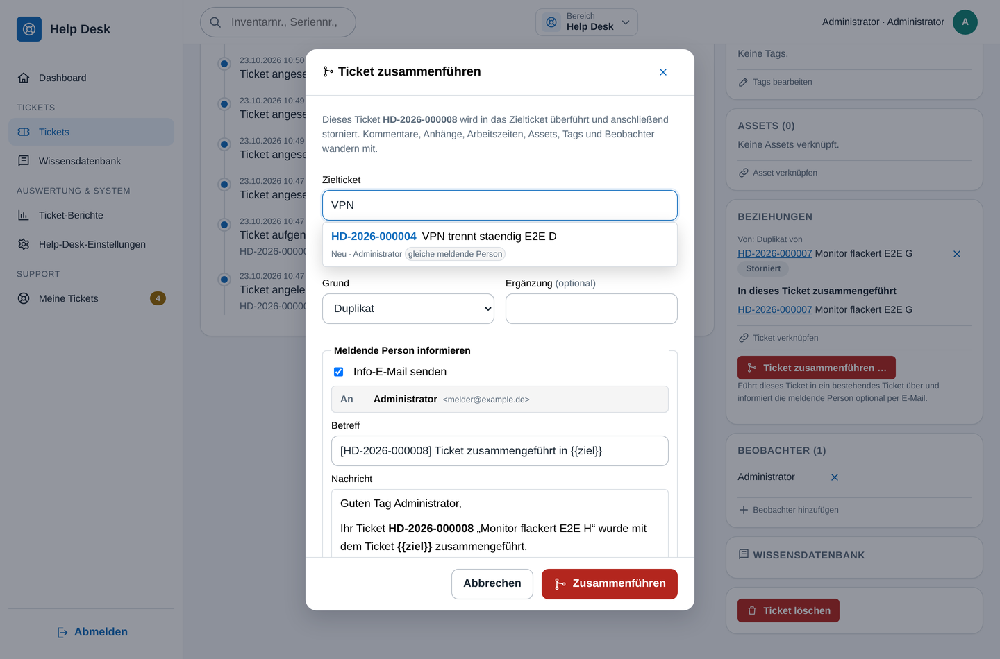

- **Suche**: Das Feld schlägt **offene Tickets** vor (Status der Kategorien *Neu*, *In Bearbeitung*, *Wartend*),
  bereits zusammengeführte und abgeschlossene Tickets sind ausgeschlossen, das Quellticket selbst ebenso. Ohne
  Suchbegriff erscheinen nur die offenen Tickets **derselben meldenden Person**; mit Suchbegriff kommen Treffer aus
  allen Tickets dazu (Ticketnummer, Betreff, Meldername, Melder-E-Mail). Tickets der meldenden Person stehen oben und
  sind mit **„gleiche Person“** gekennzeichnet (`GET /api/helpdesk/tickets/search?merge_for={id}&q=…` →
  `TicketRepository::suggestForMerge()`).
- **Ziel**: Auswahl per Klick oder Eingabe der Ticketnummer (z. B. `HD-2024-000123`); das Feld prüft beim Absenden,
  ob das Ziel existiert, nicht selbst zusammengeführt und nicht abgeschlossen ist.
- **Grund**: Pflichtauswahl aus `TicketMergeService::REASONS` – *Duplikat*, *Thema identisch*, *Gehört zum selben
  Vorgang*, *Versehentlich getrennt erfasst*, *Sonstiger Grund*. Optional ergänzt eine **Anmerkung** (höchstens 160
  Zeichen) den Grund. Der Grund landet im Abschlussgrund des Quelltickets (`close_reason`, z. B.
  „Duplikat (HD-2024-000123)“), in der internen Notiz am Zielticket, im Ereignis `merged` und im Audit-Log.
- **Info-E-Mail an den Melder** (Kästchen im Overlay, vorausgewählt): Betreff und Text sind **bearbeitbar** und mit
  Platzhaltern vorbelegt – `{{nummer}}` (Quellticket), `{{ziel}}` (Zielticket), `{{grund}}` (gewählter Grund mit
  Anmerkung). Die Platzhalter werden beim Senden serverseitig ersetzt, auch in einem bearbeiteten Text. Die
  Nachricht geht **ohne Agentensignatur** an die meldende Person (ein mitgeschickter Signaturblock wird verworfen) und
  trägt `Message-ID`, `In-Reply-To`/`References` auf den Thread des **Zieltickets** sowie `X-Ticket-Number`, damit
  Antworten im richtigen Ticket landen. Ist der Mailversand abgeschaltet oder fehlt die Melderadresse, ist das
  Kästchen deaktiviert und nennt den Grund im Tooltip; die Zusammenführung selbst funktioniert weiterhin.
- **Protokollierung**: Die Info-Mail wird als öffentlicher Kommentar am Zielticket geführt (`source = email`), ein
  Fehler beim Versand bricht die Zusammenführung nicht ab – er erscheint als Hinweis in der Rückmeldung
  (`merge_mail_error`).
- **Technik**: `TicketMergeService` (`REASONS`, `composeData()`, `merge()` mit `reason_code`, `reason_note`, `notify`,
  `mail_subject`, `mail_body_html`), `TicketMailService::mergeComposeData()`/`sendMergeNotice()`, Route
  `POST /helpdesk/tickets/{id}/merge`, Oberfläche `public/js/helpdesk-merge.js` (`<dialog id="merge-dialog">`).

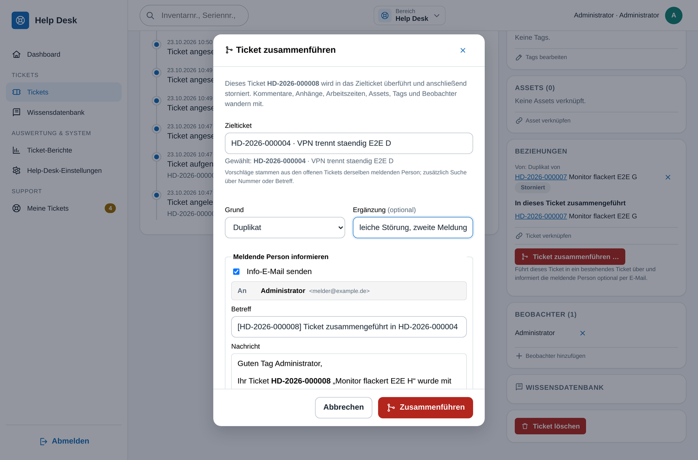

#### Mehrere Tickets zusammenführen (Sammelauswahl)

In der Ticketliste (`/helpdesk/tickets`) hat jede Zeile ein Auswahlkästchen (Spalte vor der Nummer, mit
„Alle auswählen“ im Kopf). Sobald **mehr als ein** Ticket ausgewählt ist, erscheint oben links neben **CSV** die
Schaltfläche **„Zusammenführen“** mit der Anzahl der gewählten Tickets. Sie öffnet ein Overlay, in dem genau eines der
ausgewählten Tickets als **Ziel** gewählt wird; die übrigen wandern per `TicketMergeService::mergeMany()` als Quellen
in dieses Ticket. Der Grund ist fest **Duplikat**; die Info-E-Mail an den Melder wird nicht versendet. Bereits
zusammengeführte Tickets sind nicht auswählbar, und einzelne Fehler (etwa ein inzwischen abgeschlossenes Ziel) brechen
die übrigen Zusammenführungen nicht ab – sie erscheinen als Warnhinweis. Technik: Route `POST /helpdesk/tickets/merge`
(`helpdesk.merge`), Oberfläche `public/js/helpdesk-merge-bulk.js` (`<dialog id="bulk-merge-dialog">`).

### Ticket-Berichte & Administration

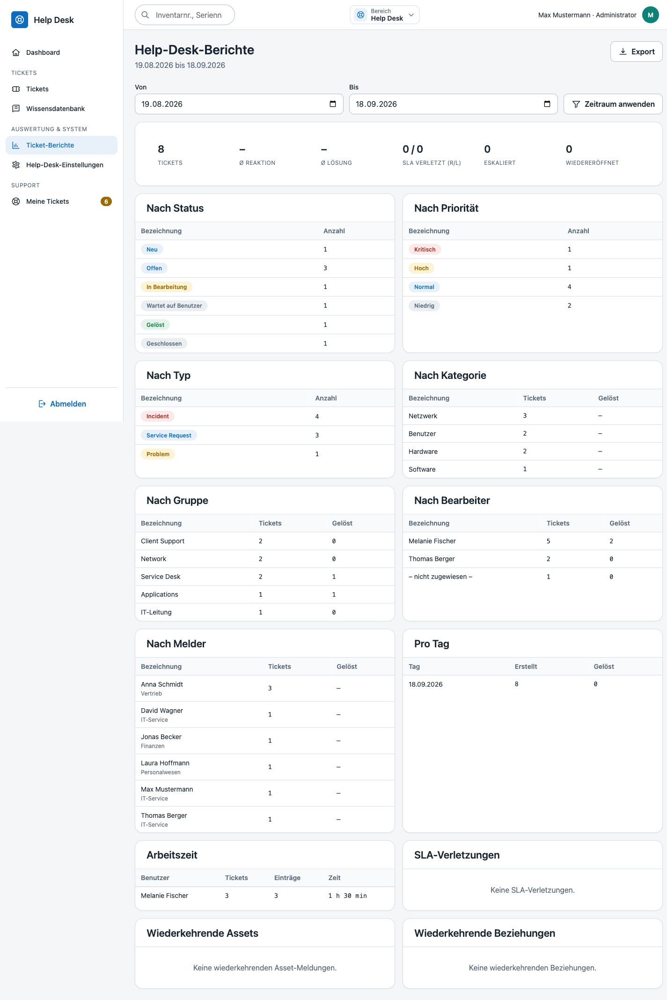

Unter **Help-Desk-Einstellungen** (`/helpdesk/admin`) werden Typen, Status, Prioritäten, Kategorien, SLA-Regeln, Gruppen, Vorlagen, Regeln und das Benachrichtigungsprotokoll gepflegt. Das **Störungsformular für Anwender** hat dort einen eigenen Reiter mit dem öffentlichen Link.

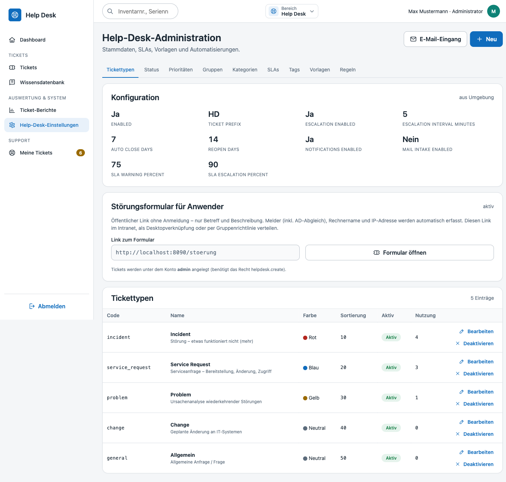

Im Reiter **Störungsformular** liegen der öffentliche Link und die **Sammelkonten** (AD-/SSO-Anmeldenamen, bei denen die Angabe eines zusätzlichen Benutzers Pflicht ist) samt anpassbarem Erklärungstext. Die Konten werden über eine Eingabezeile mit Autovervollständigung gepflegt: Beim Tippen (ab zwei Zeichen) schlägt `GET /api/helpdesk/quick-report/accounts/suggest` Anmeldenamen aus Intranet-Telefonbuch, aktivem Mitarbeiterbestand und lokalen KLINQ-Konten vor (`SharedAccountSuggestionService`, Berechtigung `helpdesk.admin`); ein Vorschlag oder eine freie Eingabe wird per Enter bzw. „Hinzufügen“ übernommen und erscheint als Eintrag unter der Zeile, wo er sich wieder entfernen lässt. Ohne JavaScript bleibt das Textfeld (ein Name pro Zeile) als Rückfallebene nutzbar.

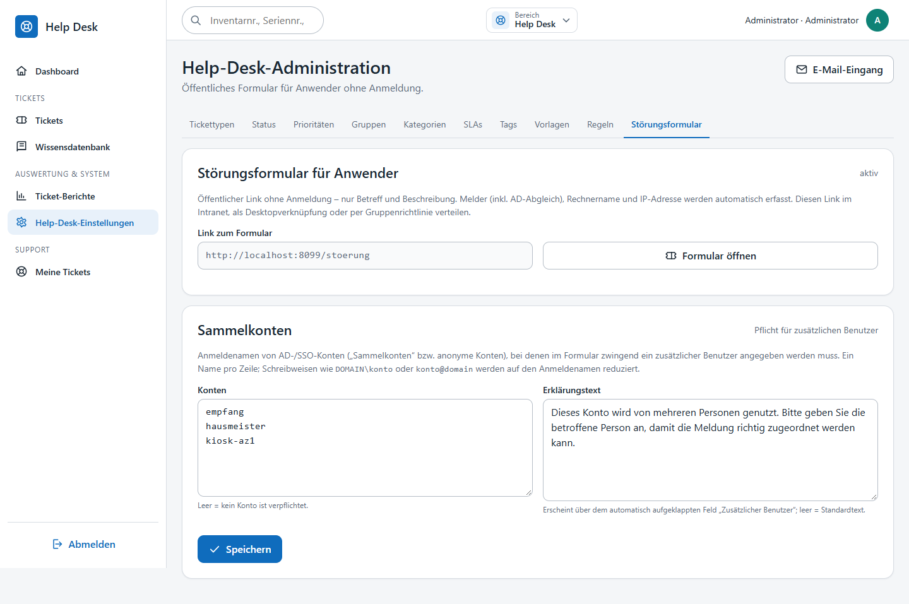

## Serviceportal (`/portal`)

Jeder angemeldete Benutzer mit `portal.view`/`portal.create` sieht ausschließlich **eigene** Tickets (als Melder oder betroffene Person, gematcht über `users.employee_id`). Neue Anfrage: Vorlage wählen (füllt Typ/Kategorie/Betreff/Beschreibung vor), Auswirkung/Dringlichkeit in Alltagssprache, eigene Geräte als Auswahl, Anhang. Im Detail: Kommentare schreiben, Anhänge hochladen, gelöste Tickets bestätigen oder innerhalb der Frist wieder öffnen. Interne Notizen und interne Anhänge sind für Portalnutzer unsichtbar (`TicketService::getVisible` filtert serverseitig).

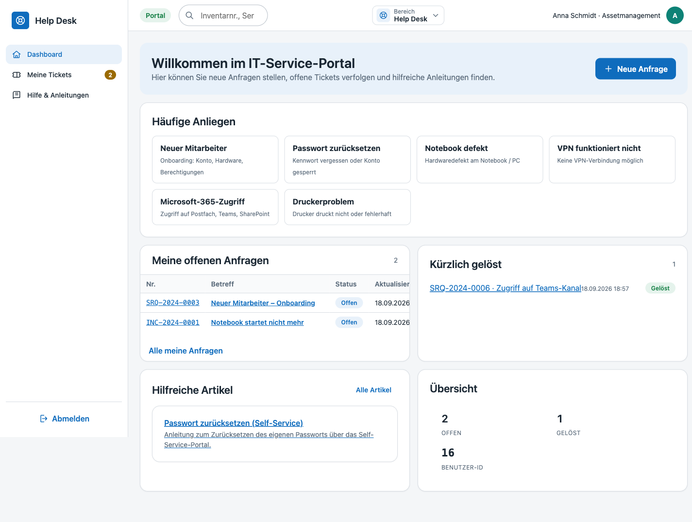

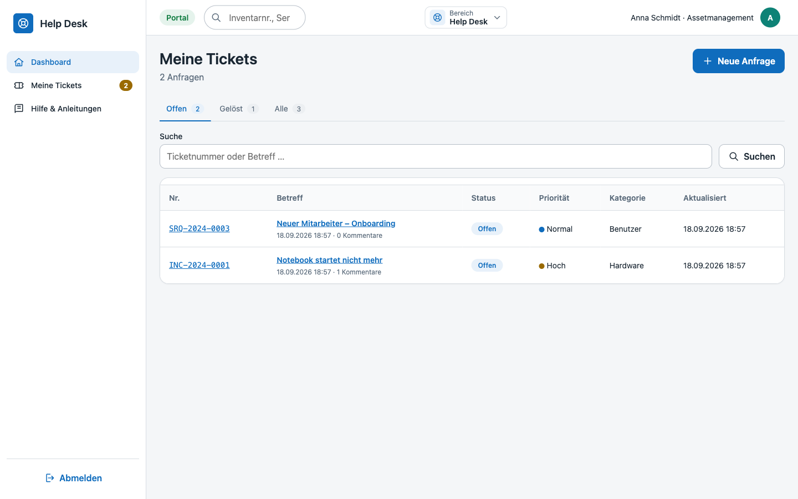

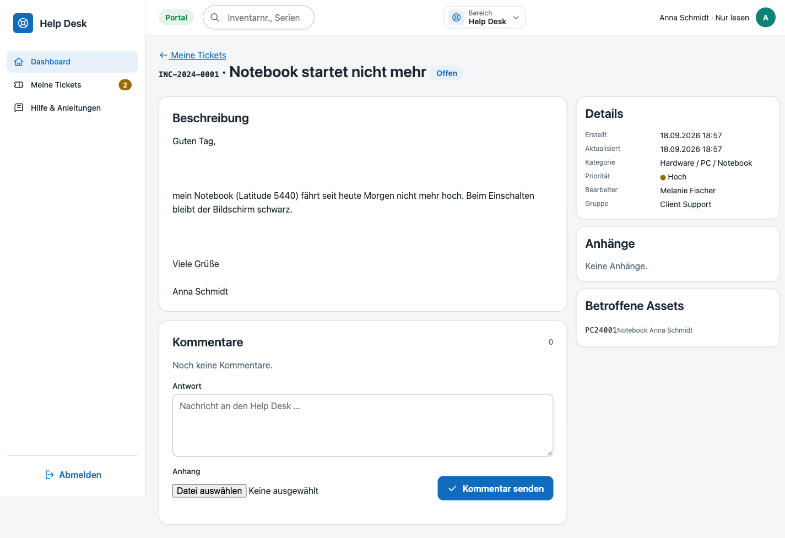

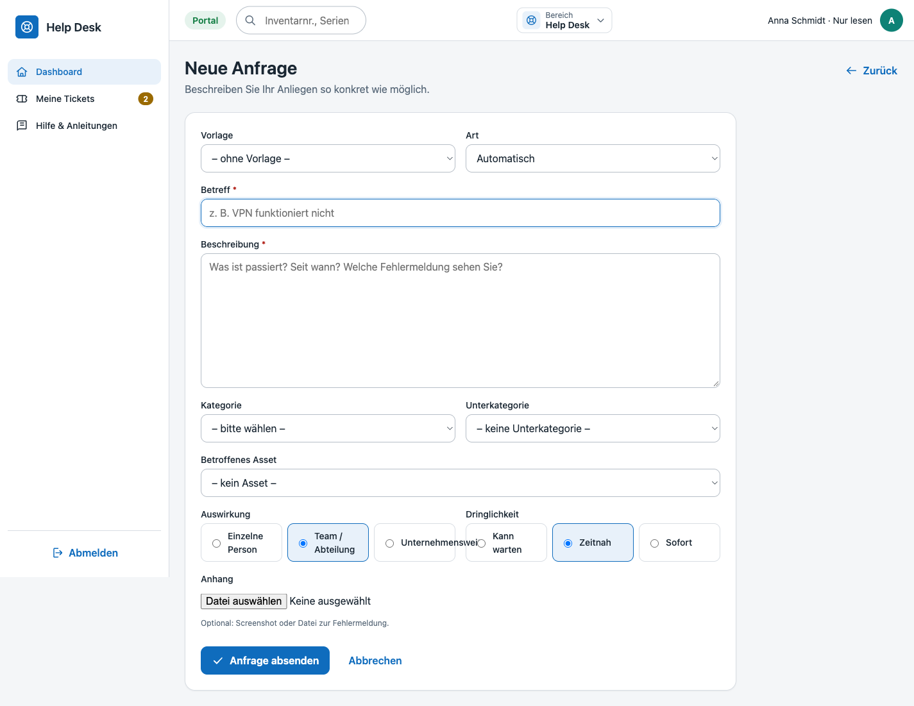

## Störungsmeldung für Anwender (`/stoerung`)

Bewusst minimales Formular für Personen, die sich **nicht** anmelden sollen oder wollen: **Betreff** und **Beschreibung**, dazu optional das aufklappbare Feld **Zusätzlicher Benutzer**. Alles Weitere ermittelt der Server selbst und zeigt es dem Melder transparent im Kasten „Automatisch erfasst“ an.

**Zusätzlicher Benutzer** (aufklappbar): Ist nicht der Melder selbst betroffen, lässt sich im Feld „Betroffener Mitarbeiter“ eine Person über die bekannte Autovervollständigung mit Vorschlagsliste auswählen (`/stoerung/benutzer`, Übernahme aus dem Telefonbuch über `/stoerung/benutzer/uebernehmen`). Die Auswahl landet als `tickets.affected_employee_id` im Ticket; ohne Auswahl wird wie bisher der Melder als betroffener Mitarbeiter eingetragen. Weil die Route ohne Anmeldung erreichbar ist, gelten dieselben Schutzmaßnahmen wie für das Formular (CSRF, Netzbeschränkung, Abschaltbarkeit) und zusätzlich eine eigene Obergrenze von 20 Telefonbuch-Übernahmen je Sitzung und Stunde.

**Sammelkonten** (anonyme Konten): In den Help-Desk-Einstellungen im Reiter **Störungsformular** wird ein Katalog an AD-/SSO-Anmeldenamen gepflegt (`QuickReportSettingsService`, `system_settings` mit Präfix `helpdesk.quick_report.`). Die Pflege erfolgt über eine Eingabezeile mit Vorschlagsliste (`SharedAccountSuggestionService`); gespeichert wird weiterhin eine Liste, ein Eintrag pro Zeile. Meldet sich ein Konto aus diesem Katalog, klappt das Feld „Zusätzlicher Benutzer“ automatisch auf, ist dann **Pflicht** und zeigt darüber den ebenfalls dort anpassbaren Erklärungstext (leer = Standardtext). Die Pflicht prüft `QuickReportController::store()` serverseitig; `DOMAIN\konto` und `konto@domain` werden auf den Anmeldenamen reduziert und ohne Beachtung der Groß-/Kleinschreibung verglichen. Startwerte lassen sich über `HELPDESK_QUICK_REPORT_SHARED_ACCOUNTS` (kommagetrennt) und `HELPDESK_QUICK_REPORT_SHARED_ACCOUNTS_HINT` vorgeben; die Datenbank hat Vorrang.

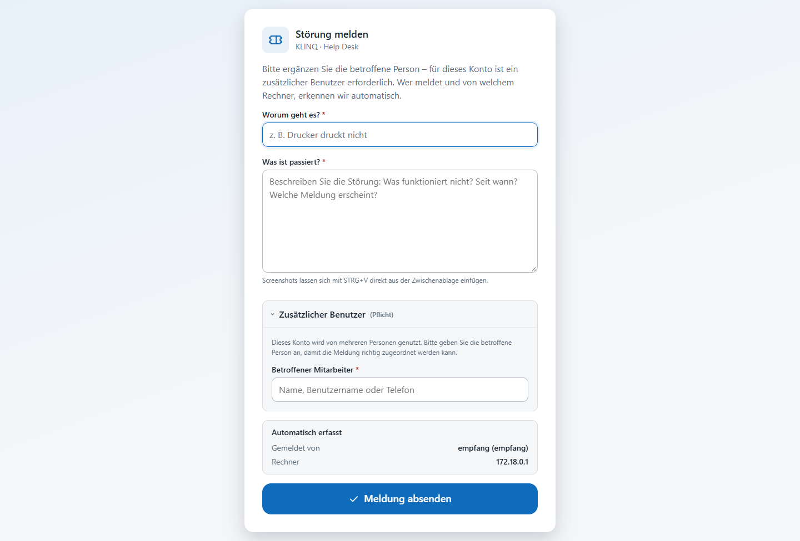
**Erkennung des Anwenders** (`ReporterIdentityService`, in dieser Reihenfolge):

1. **Intranet-Anmeldung (LANPA)**: Beim Aufruf über `/klinq/stoerung` stellt der `auth`-Container des Intranets die Windows-Anmeldung sicher und übergibt die Melderdaten signiert an KLINQ (`/sso/lanpa`, siehe [Windows-SSO](windows-sso.md)) – Anmeldename, Name, E-Mail, Telefon, Abteilung, Standort, Rechner und IP-Adresse stammen damit direkt aus dem Intranet (`detected_by = lanpa`).
2. **Proxy-Header** (Standard: `X-Remote-User`) – nur wenn `HELPDESK_QUICK_REPORT_TRUST_USER_HEADER=true`, da ein Header ohne vorgelagerten, vertrauenswürdigen Proxy fälschbar ist. `DOMAIN\benutzer` und `benutzer@domain.tld` werden auf den Anmeldenamen reduziert.
3. **App-Sitzung**: ist der Besucher zufällig in KLINQ angemeldet, wird sein Konto genutzt.

**AD/LDAP-Abgleich**: Der erkannte Anmeldename wird per `AdUserLookupService` live im Verzeichnis gesucht (`sAMAccountName`, Bind mit dem konfigurierten Dienstkonto aus `AD_*`). Gefunden werden Anzeigename, E-Mail, Telefon, Abteilung, Position, Standort und Personalnummer; über die Personalnummer wird das Ticket zusätzlich mit dem Mitarbeiterdatensatz verknüpft, sodass Assets, Kostenstelle und Standort im Ticket zur Verfügung stehen. Ist kein AD konfiguriert oder das Konto unbekannt, wird auf die Daten des App-Benutzers zurückgefallen; die Meldung schlägt nie an einem fehlenden Verzeichniseintrag fehl.

**Rechner**: Aus der Client-IP wird per Reverse-DNS der Rechnername ermittelt (`HELPDESK_QUICK_REPORT_RESOLVE_HOSTNAME`); ohne Auflösung wird nur die IP-Adresse erfasst. Beides steht im Ticketdetail unter „Automatisch erfasst“ und in den Spalten `tickets.reporter_host` / `reporter_ip`.

**Absicherung** der öffentlichen Route: CSRF-Token wie bei allen Formularen, optionale Netzbeschränkung (`HELPDESK_QUICK_REPORT_NETWORKS`, CIDR), Ratenbegrenzung je Browsersitzung (`HELPDESK_QUICK_REPORT_RATE_LIMIT`) und Abschaltbarkeit. Das Ticket wird unter einem Systemkonto angelegt (`HELPDESK_QUICK_REPORT_SYSTEM_USER`, braucht `helpdesk.create`) – über `CurrentUser::runAs()` nur für die Dauer der Anlage, ohne dass der anonyme Besucher dadurch Rechte oder eine angemeldete Sitzung erhält.

**Systemkonto**: Fehlt das konfigurierte Konto, legt `php bin/migrate.php` (läuft bei jedem Containerstart) es ohne Passwort mit der Rolle `helpdesk_agent` an – in Umgebungen mit Anmeldung über das Intranet gibt es kein lokales Konto `admin`, weil `ADMIN_PASSWORD` leer bleibt. Eine Anmeldung mit diesem Konto ist nicht möglich; meldet sich später ein gleichnamiger AD-Benutzer über SSO an, übernimmt die Anmeldung den Datensatz. Geprüft werden die wirksamen Rechte (Rolle **und** Berechtigungsgruppen, wie in `CurrentUser::can()`), nicht nur die Rolle. Schlägt das Anlegen dennoch fehl (Konto deaktiviert, Recht entzogen, Datenbankfehler), zeigt das Formular die Meldung „Die Meldung konnte nicht gespeichert werden …“ und die Ursache steht mit Kontext in `storage/logs/app-*.log`.

Tickets aus dem Formular tragen die Quelle `form` (Filter in der Ticketliste) und werden nach dem Absenden mit ihrer Ticketnummer bestätigt. Den Link zum Verteilen (z. B. als Verknüpfung auf dem Desktop oder als Startseite) zeigt die Administration in den **Help-Desk-Einstellungen** im Reiter **Störungsformular**.

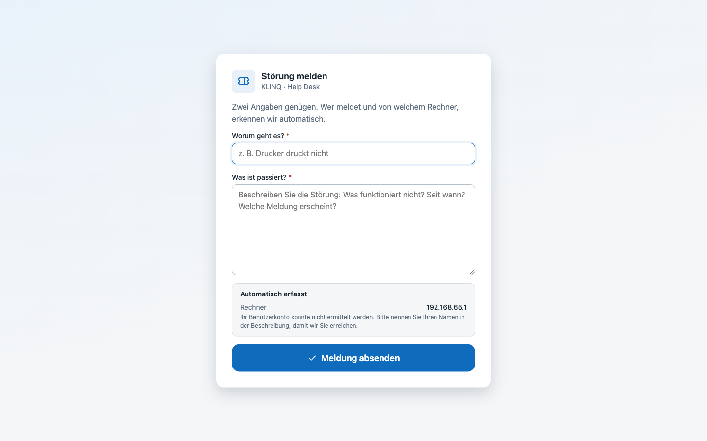

## Wissensdatenbank

`knowledge_articles` mit Titel, Zusammenfassung, Inhalt (Markdown-light: Absätze, Listen, `**fett**`, Code), Kategorie, Tags, Sichtbarkeit (`internal` = nur Agenten, `public` = auch Portal), Status (`draft`/`published`/`archived`), Aufrufzähler. Artikel lassen sich mit Tickets verknüpfen (`knowledge_article_tickets`); die Suche schlägt beim Anlegen im Portal und im Ticketdetail passende Artikel vor.

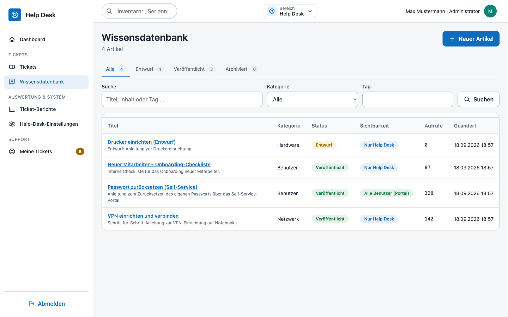

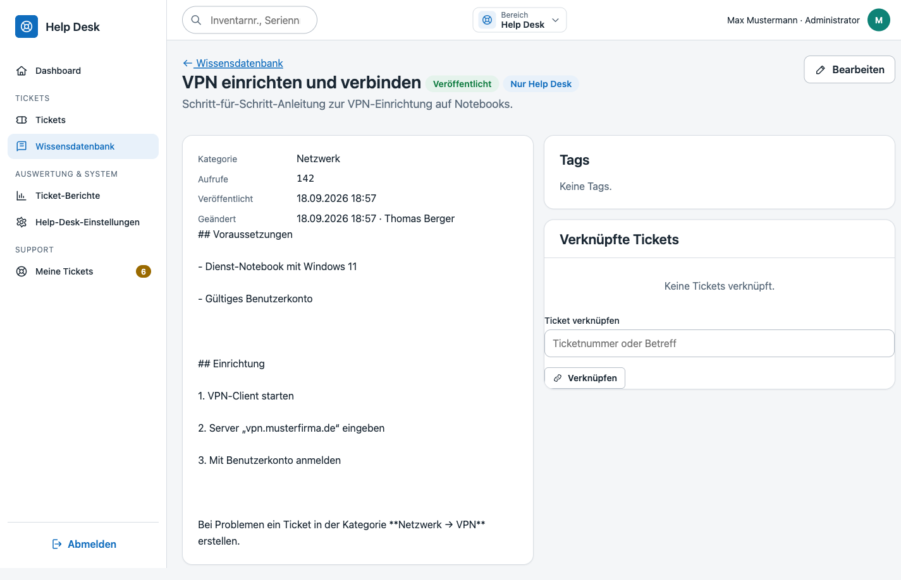

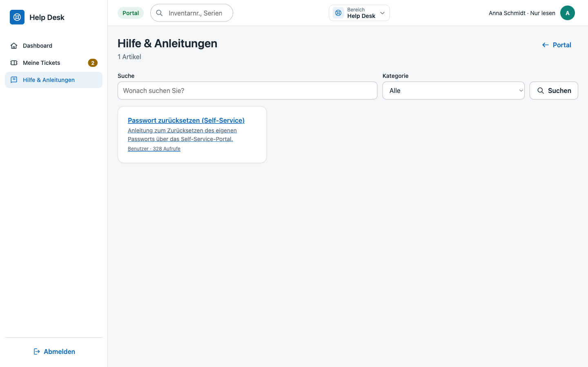

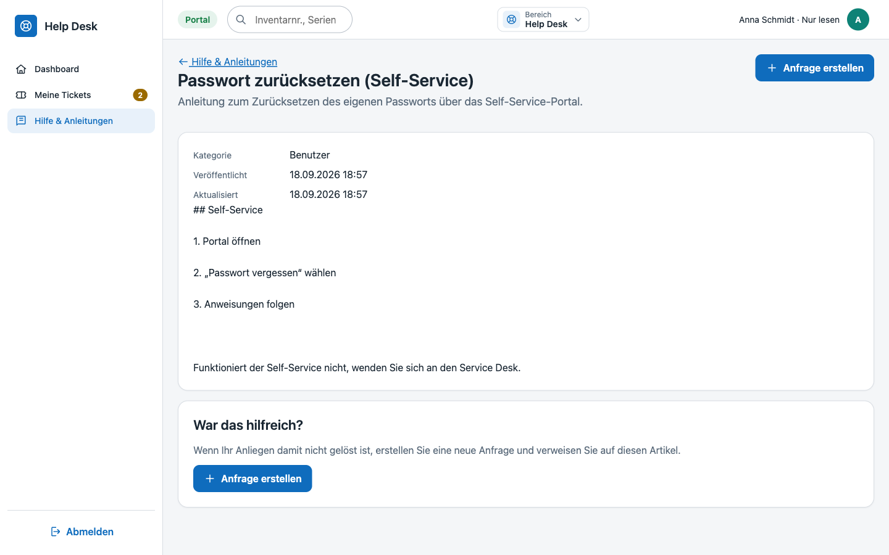

## Automatisierung

- **Vorlagen** (`ticket_templates`): vorbelegte Felder für Portal und Agenten, optional auf Rollen/Portal beschränkt.
- **Regeln** (`ticket_rules`): bei Ereignis (`created`, `updated`, `status_changed`, `comment_added`, `sla_warning`, `sla_breached`) werden Bedingungen (Typ, Kategorie, Priorität, Betreff enthält, Melder-Abteilung, Quelle …) geprüft und Aktionen ausgeführt (Gruppe/Agent setzen, Priorität, Tags hinzufügen, SLA zuweisen, Benachrichtigen). Reihenfolge über `sort_order`, Stopp nach Treffer optional; jede Anwendung erscheint als Ereignis `rule_applied`.
- **Benachrichtigungen** (`ticket_notifications`): Anlage, Zuweisung, Kommentar, Statuswechsel, SLA-Warnung/-Verletzung, Eskalation – per E-Mail über den `mail`-Container an Melder, Agent, Gruppe, Watcher und optional `HELPDESK_NOTIFICATION_INBOX`. Ausgang wird mit Status/Fehler protokolliert und ist in der Administration einsehbar. `HELPDESK_NOTIFICATION_ENABLED=false` schaltet den Versand ab.
- **E-Mail-Eingang** (`TicketMailIngestionService`): siehe Abschnitt „E-Mail-Eingang (IMAP) & Threading“.

## E-Mail-Eingang (IMAP) & Threading

Der Help Desk kann ein Postfach abholen und eingehende Nachrichten automatisch Tickets zuordnen. Es wird **keine PHP-Erweiterung** (`ext-imap`) benötigt – der IMAP-Client (`app/Services/Helpdesk/Mail/ImapMailboxClient.php`) spricht das Protokoll direkt über TLS-Sockets.

### Konfiguration in der Anwendung

Das Postfach wird vollständig in der Oberfläche eingerichtet: **Auswertung & System → Administration → E-Mail-Postfach (Help Desk)** (`/admin/helpdesk-mail`, Recht `settings.manage`). Dort werden gepflegt:

- **Betrieb**: Eingang aktiv, Abrufintervall in Minuten (0 = nur manuell), Nachrichten je Lauf, Zeitüberschreitung.
- **Postfach**: Postfachtyp (`imap` oder Verzeichnis mit `.eml`-Dateien), Server, Port, Verschlüsselung, Benutzername, Passwort, Zertifikatsprüfung.
- **Verzeichnisse**: abzufragendes Verzeichnis sowie der Schalter **„Abgearbeitete E-Mails verschieben“** samt Zielverzeichnis. Ohne Haken bleiben verarbeitete Nachrichten im Eingang und werden nur als gelesen markiert.
- **Ticketerstellung**: Systembenutzer (benötigt `helpdesk.create`), Standard-Tickettyp, Umgang mit unbekannten Absendern.

Zwei Schaltflächen unterstützen die Einrichtung: **Verbindung testen** meldet Erreichbarkeit und Anzahl der Nachrichten und liest die vorhandenen Postfachverzeichnisse als Auswahlvorschläge ein; **Jetzt abholen** startet einen Lauf sofort. Status (letzter Abruf, Ergebnis, Fehler) und die zuletzt verarbeiteten Nachrichten stehen auf derselben Seite.

Die Werte liegen in `system_settings` (Präfix `helpdesk.mail.`); das Passwort wird mit AES-256-GCM verschlüsselt abgelegt (`App\Support\Secret`, Schlüssel aus `APP_KEY`) und nie wieder angezeigt. Ein leeres Passwortfeld lässt das gespeicherte Passwort unverändert. Die `HELPDESK_MAIL_*`/`HELPDESK_IMAP_*`-Variablen dienen nur noch als **Startwerte**, solange in der Anwendung nichts gespeichert wurde. Änderungen werden im Audit-Log protokolliert (ohne Passwort).

> Wird `APP_KEY` nachträglich geändert, lässt sich ein gespeichertes Passwort nicht mehr entschlüsseln. Die Oberfläche weist darauf hin; das Passwort muss dann einmalig neu erfasst werden.

### Ausgehende Nachrichten

Jede Benachrichtigung trägt Threading-Kopfzeilen, damit Antworten der Empfänger eindeutig zugeordnet werden können:

| Kopfzeile | Wert |
|---|---|
| `Message-ID` | `<ticket-{id}.{ereignis}.{zufall}@{HELPDESK_MAIL_DOMAIN}>` – wird in `ticket_notifications.message_id` protokolliert |
| `In-Reply-To` / `References` | `<ticket-{id}@{domain}>` (stabile Thread-Wurzel je Ticket) – Mailprogramme fassen alle Mails eines Tickets zu einer Konversation zusammen |
| `X-Ticket-Number` | Ticketnummer |
| `Auto-Submitted: auto-generated` | verhindert Antwortschleifen mit Abwesenheitsassistenten |

Der Betreff enthält weiterhin `[HD-JJJJ-NNNNNN]` als für Menschen lesbaren Fallback.

Die von Agenten aus dem Ticket gesendete E-Mail („E-Mail aus dem Ticket senden“) nutzt dieselben Thread-Kopfzeilen,
lässt aber `Auto-Submitted` bewusst weg: Sie ist eine persönliche Nachricht des Agenten und soll nicht als automatisch
erzeugt gelten.

### Zuordnung eingehender Nachrichten

`TicketMailIngestionService::ingest()` versucht in dieser Reihenfolge, ein bestehendes Ticket zu finden (`ticket_inbound_mails.matched_by`):

1. **`reference`** – `In-Reply-To` und `References` (neueste zuerst) werden geprüft gegen
   - das eigene ID-Format `<ticket-{id}…@…>`,
   - protokollierte ausgehende Nachrichten (`ticket_notifications.message_id`),
   - Message-IDs früherer eingehender Mails (`tickets.mail_message_id`, `ticket_comments.mail_message_id`) – so wird auch „Antwort auf die eigene Erstmeldung“ richtig zugeordnet.
2. **`subject`** – Ticketnummer im Betreff (`PREFIX-JJJJ-NNNNNN`, Groß-/Kleinschreibung egal).
3. **`none`** – kein Treffer: neues Ticket mit dem in der Administration eingestellten Standard-Tickettyp, Quelle `email`.

Verweise auf zusammengeführte Tickets werden zum Zielticket weitergeleitet. Verweise auf gelöschte/unbekannte Tickets führen zu einem neuen Ticket.

### Absender und Wirkung

- Die Absenderadresse wird gegen `users.email` (aktive Konten) und `employees.email` aufgelöst. Mitarbeiter werden Melder (`requester_employee_id`), Benutzer ohne Mitarbeiterdatensatz `requester_user_id`, unbekannte Adressen werden als externer Melder in `tickets.requester_email` geführt (abschaltbar über „Unbekannte Absender zulassen“ in der Administration).
- Die **Herkunft bleibt am Datensatz sichtbar**: Ein per E-Mail eröffnetes Ticket speichert die echte Absenderadresse in `tickets.mail_from_address` (plus `mail_from_name`), jeder aus einer Mail erzeugte Kommentar in `ticket_comments.mail_from_address`. Ticketansicht und Portal zeigen dazu die Kennzeichnung „Per E-Mail eröffnet von …“ bzw. „Per E-Mail von …“; zusätzlich steht der Hinweis im Beschreibungstext.
- Kommentare aus E-Mails sind immer **öffentlich** (`source = email`) und werden dem tatsächlichen Absender zugeschrieben: Antworten des Melders beenden `waiting_feedback` (→ `in_progress`, SLA-Uhr läuft weiter) und öffnen gelöste Tickets wieder; Antworten von Agenten (Rolle mit `helpdesk.view`) zählen als Erstreaktion.
- Zitierte Vorgängernachrichten (Outlook-/Gmail-/Thunderbird-Trenner, `>`-Zeilen) und Signaturtrenner werden abgeschnitten; HTML-only-Mails werden in Text umgewandelt.
- Anhänge landen über `DocumentService` in der Dokumentenablage (Whitelist `ALLOWED_UPLOAD_EXTENSIONS`, MIME-Prüfung); abgelehnte Dateitypen werden protokolliert und übersprungen, die Nachricht wird trotzdem verarbeitet.
- **Ignoriert** werden Duplikate (gleiche `Message-ID`), automatische Nachrichten (`Auto-Submitted`, `X-Auto-Response-Suppress`, `Precedence: bulk/list`, `List-Unsubscribe`, Bounces/`multipart/report`, `mailer-daemon@`/`noreply@`) sowie Mails der eigenen Absenderadresse.
- Jede Nachricht wird in `ticket_inbound_mails` protokolliert (Aktion `created|comment|ignored|failed`, Zuordnungsart, Detail); Tickets/Kommentare erhalten Ereignisse mit `via = email`.

### Abholung

`php bin/helpdesk.php mail [--limit=N] [--due]` holt neue Nachrichten (`UNSEEN`, ohne Keyword `$HelpdeskFailed`) ab, verarbeitet sie und markiert sie als gelesen bzw. verschiebt sie in das in der Administration eingestellte Zielverzeichnis. Nicht verarbeitbare Nachrichten werden mit `$HelpdeskFailed` markiert und beim nächsten Lauf übersprungen. Im Container ruft `docker/php/scheduler.sh` den Job minütlich mit `--due` auf; ob tatsächlich abgeholt wird, entscheidet allein das in der Anwendung gepflegte Intervall. Exit-Codes: `0` ok, `1` Fehler, `2` deaktiviert oder noch nicht fällig.

Für Entwicklung und Tests existiert der Postfachtyp „Verzeichnis mit `.eml`-Dateien“: Dateien aus dem angegebenen Verzeichnis werden verarbeitet und nach `processed/` bzw. `failed/` verschoben.

Voraussetzungen: Der in der Administration gewählte Systembenutzer (Standard `admin`) muss aktiv sein und `helpdesk.create` besitzen; unter ihm werden Anlage und Kommentare ausgeführt (Audit), der fachliche Autor bleibt der Absender.

## Rollen & Berechtigungen

| Rolle | Umfang |
|---|---|
| **helpdesk_agent** | Tickets sehen/anlegen/bearbeiten/zuweisen/kommentieren, interne Notizen, schließen/wieder öffnen, zusammenführen, Arbeitszeiten, Berichte, Wissensdatenbank pflegen; plus alle Leserechte der Assetverwaltung |
| **helpdesk_lead** | zusätzlich eskalieren, SLA-Regeln, Export, Kategorien, Vorlagen |
| **helpdesk_admin** | zusätzlich `helpdesk.admin` (Typen, Status, Prioritäten, Gruppen, Regeln, Benachrichtigungsprotokoll) und `documents.manage` |
| **assetmanagement / lager / einkauf** | Portal (eigene Tickets anlegen und verfolgen) und Wissensartikel lesen, kein Agentenbereich |
| **readonly** | bewusst nur `*.view` – sieht das Portal und öffentliche Artikel, kann aber keine Tickets anlegen |
| **admin** | alles |

Rechte: `helpdesk.view|create|update|assign|comment|internal_note|close|reopen|merge|worklog|delete|cancel|escalate|sla|export|categories|templates|reports|admin`, `portal.view|create`, `knowledgebase.view|manage`. Jede Route in `routes/modules/helpdesk.php` trägt genau eine davon; `RouteInventoryTest` prüft das.

Zusätzlich zur Rolle werden vier Rechte nur über **Berechtigungsgruppen** je Benutzer vergeben (Admins haben sie über ihre Rolle): `helpdesk.reports` (Gruppe „Statistik“), `helpdesk.view_history` (Gruppe „Darf Ticketaufruf auswerten“), `helpdesk.delete` (Gruppe „Darf Tickets löschen“) und `helpdesk.cancel` (Gruppe „Darf Tickets stornieren“). Die Verlauf-Gruppe macht die Ereignisse `viewed` in der Ticket-Historie sichtbar, die beim Aufruf eines Tickets durch einen Agenten geschrieben werden.

**Stornieren und Löschen sind getrennte Rechte.** `helpdesk.close` erlaubt weiterhin Lösen und Schließen, aber nicht mehr das Stornieren; `helpdesk.cancel` gilt für jeden Übergang in den Status „Storniert“. Ohne die jeweilige Gruppe – und ohne Admin-Rolle – dürfen auch Help-Desk-Agenten, Leitungen und die Help-Desk-Administration keine Tickets löschen oder stornieren. Das Zusammenführen von Tickets storniert die Quelle intern (Systemvorgang) und benötigt deshalb kein `helpdesk.cancel`.

## Konfiguration (`.env`)

| Variable | Standard | Bedeutung |
|---|---|---|
| `HELPDESK_ENABLED` | `true` | Modul in Navigation, Dashboard, Suche und Scheduler aktiv |
| `HELPDESK_TICKET_PREFIX` | `HD` | Präfix der Ticketnummer |
| `HELPDESK_SLA_WARNING_PERCENT` | `75` | Warnschwelle in % der SLA-Zeit (Fallback je SLA-Regel) |
| `HELPDESK_ESCALATION_PERCENT` | `90` | Eskalationsschwelle in % |
| `HELPDESK_ESCALATION_ENABLED` | `true` | Scheduler-Job aktiv |
| `HELPDESK_ESCALATION_INTERVAL_MINUTES` | `5` | Intervall des Container-Schedulers (0 = aus) |
| `HELPDESK_AUTO_CLOSE_DAYS` | `7` | Gelöste Tickets automatisch schließen (0 = aus) |
| `HELPDESK_REOPEN_DAYS` | `14` | Frist für Wiedereröffnung durch Melder (0 = nie) |
| `HELPDESK_NOTIFICATION_ENABLED` | `true` | E-Mail-Versand |
| `HELPDESK_NOTIFICATION_INBOX` | leer | zusätzliches Sammelpostfach für neue Tickets/Eskalationen |
| `HELPDESK_MAIL_DOMAIN` | leer | Domain für `Message-ID`/Thread-Wurzel ausgehender Mails (leer = aus `MAIL_FROM_ADDRESS`/`APP_URL`) |

Die folgenden Variablen sind nur noch **Startwerte** für den E-Mail-Eingang: Sobald unter *Administration → E-Mail-Postfach* gespeichert wurde, gilt ausschließlich die in der Anwendung hinterlegte Konfiguration.

| Variable (Startwert) | Standard | Bedeutung |
|---|---|---|
| `HELPDESK_MAIL_ENABLED` | `false` | E-Mail-Eingang aktiv |
| `HELPDESK_MAIL_DRIVER` | `imap` | `imap` oder `file` (Entwicklung) |
| `HELPDESK_MAIL_FILE_PATH` | `storage/mail-inbox` | Ordner mit `.eml`-Dateien für den `file`-Treiber |
| `HELPDESK_IMAP_HOST` / `HELPDESK_IMAP_PORT` | leer / `993` | IMAP-Server |
| `HELPDESK_IMAP_ENCRYPTION` | `ssl` | `ssl` (993), `starttls` (143) oder `none` |
| `HELPDESK_IMAP_USERNAME` / `HELPDESK_IMAP_PASSWORD` | leer | Zugangsdaten (in der Anwendung verschlüsselt gespeichert) |
| `HELPDESK_IMAP_MAILBOX` | `INBOX` | abzuholender Ordner |
| `HELPDESK_IMAP_PROCESSED_MAILBOX` | leer | Zielordner für verarbeitete Mails (leer = nur als gelesen markieren) |
| `HELPDESK_IMAP_TIMEOUT` | `15` | Socket-Timeout in Sekunden |
| `HELPDESK_IMAP_VERIFY_PEER` | `true` | TLS-Zertifikat prüfen |
| `HELPDESK_MAIL_BATCH_SIZE` | `50` | Nachrichten je Lauf |
| `HELPDESK_MAIL_INTERVAL_MINUTES` | `2` | Abrufintervall in Minuten (0 = nur manuell) |
| `HELPDESK_MAIL_SYSTEM_USER` | `admin` | Konto, unter dem der Eingang Tickets anlegt (braucht `helpdesk.create`) |
| `HELPDESK_MAIL_ALLOW_UNKNOWN_SENDERS` | `true` | Unbekannte Absender dürfen Tickets eröffnen |
| `HELPDESK_MAIL_DEFAULT_TYPE` | `incident` | Tickettyp (Code) für Tickets aus E-Mails |

| Weitere Variable | Standard | Bedeutung |
|---|---|---|
| `HELPDESK_QUICK_REPORT_ENABLED` | `true` | Störungsformular `/stoerung` erreichbar |
| `HELPDESK_QUICK_REPORT_SYSTEM_USER` | `admin` | Konto, unter dem Meldungen angelegt werden (braucht `helpdesk.create`); fehlt es, legt `bin/migrate.php` es ohne Passwort mit der Rolle `helpdesk_agent` an |
| `HELPDESK_QUICK_REPORT_TYPE` | `incident` | Tickettyp (Code) für Meldungen aus dem Formular |
| `HELPDESK_QUICK_REPORT_TRUST_USER_HEADER` | `false` | Benutzernamen aus einem Proxy-Header übernehmen (nur mit vertrauenswürdigem Reverse-Proxy!) |
| `HELPDESK_QUICK_REPORT_USER_HEADER` | `X-Remote-User` | Name dieses Headers |
| `HELPDESK_QUICK_REPORT_RESOLVE_HOSTNAME` | `true` | Rechnername per Reverse-DNS aus der IP ermitteln |
| `HELPDESK_QUICK_REPORT_NETWORKS` | leer | Zugriff auf Netze beschränken (CIDR/IPs, kommagetrennt); leer = keine Einschränkung |
| `HELPDESK_QUICK_REPORT_RATE_LIMIT` | `10` | Meldungen je Browsersitzung und Stunde (0 = unbegrenzt) |
| `HELPDESK_QUICK_REPORT_SHARED_ACCOUNTS` | leer | Startwerte für den Katalog der Sammelkonten (AD-/SSO-Anmeldenamen, kommagetrennt); Pflege in der Administration, DB hat Vorrang |
| `HELPDESK_QUICK_REPORT_SHARED_ACCOUNTS_HINT` | leer | Startwert für den Erklärungstext über dem Pflichtfeld; leer = Standardtext |

## Integration in die Assetverwaltung

- Asset-Detail zeigt die letzten Tickets des Geräts und einen Link „Ticket erstellen“ (`/helpdesk/tickets/new?asset_id=`).
- Mitarbeiterdaten (Abteilung, Standort, Kostenstelle, Telefon) werden beim Melder eingeblendet; die dem Melder zugeordneten Assets werden als Verknüpfung vorgeschlagen (`/api/helpdesk/employees/{id}/assets`).
- Globale Suche liefert Tickets (Agenten: alle, sonst nur eigene); Dashboard zeigt „Meine offenen Tickets“ bzw. „Meine Anfragen“ mit Badge in der Navigation.
- Anhänge nutzen die bestehende `documents`-Ablage (`entity_type = ticket`), Audit-Einträge das bestehende `audit_logs`.

## KI-Unterstützung im Editor

Alle bearbeitbaren Textfelder des Help Desk (Kommentar, Lösung, interne Notiz, 2nd-Level-Notiz, Betreff, Beschreibung)
haben ein eigenes Kontextmenü mit Rückgängig/Wiederholen, Ausschneiden, Kopieren, Einfügen und Alles auswählen sowie
**„Mit KI verbessern“** für markierte Textabschnitte. Endpunkt, Modell und API-Key werden unter
**Auswertung & System → KI-Unterstützung (Help Desk)** gepflegt, inklusive Modell-Erkennung und Verbindungstest.
Details, Konfiguration und ein Testaufbau mit Ollama: [KI-Unterstützung im Help Desk](helpdesk-ki.md).

## Technik

- **Migration** `database/migrations/008_helpdesk.sql`, `009_helpdesk_mail.sql` (Threading-Spalten, `ticket_inbound_mails`), `010_helpdesk_quick_report.sql` (Quelle `form`, Melderspalten `reporter_username`/`reporter_host`/`reporter_ip`/`reporter_phone`/`reporter_department`), `012_helpdesk_mail_settings.sql` (`tickets.mail_from_address`/`mail_from_name`, `ticket_comments.mail_from_address`) und `015_helpdesk_support_shifts.sql` (`helpdesk_support_shifts`: tagesweise 1st-/2nd-Level-Zuständigkeit), `019_helpdesk_pause_until.sql` (Pausierstatus `waiting_feedback`/`waiting_third_party`/`waiting_delivery`/`waiting_internal`, `tickets.paused_until`), **Seeder** `database/seeders/003_helpdesk_defaults.sql` (Typen, Status, Prioritäten, SLA-Standardregeln, Beispielkategorien, Vorlagen).
- **Code**: `app/Repositories/Ticket*Repository.php`, `KnowledgeBaseRepository.php`, `HelpdeskSupportShiftRepository.php`; `app/Services/Helpdesk/` (`TicketService`, `TicketWorkflowService`, `TicketSlaService`, `TicketPriorityMatrix`, `TicketNumberService`, `TicketMergeService`, `TicketNotificationService`, `TicketRuleService`/`TicketRuleEvaluator`, `TicketReportService`, `TicketMailIngestionService`, `TicketMailService`, `KnowledgeBaseService`, `HelpdeskAdminService`, `HelpdeskSchedulerService`, `ReporterIdentityService`, `SupportShiftService`); `app/Services/Helpdesk/Mail/` (`MimeMessageParser`, `InboundMail`, `MailboxClientInterface`, `ImapMailboxClient`, `FileMailboxClient`); `app/Services/Ad/AdUserLookupService.php` (Einzelabfrage fürs Störungsformular), `app/Support/IpRange.php`, `app/Support/HtmlSanitizer.php` (Bereinigung des Mail-Editors); `app/Controllers/Helpdesk/` (inkl. `HelpdeskSupportShiftController`); Provider `app/Core/Providers/helpdesk.php`; Routen `routes/modules/helpdesk.php`; Views `resources/views/helpdesk/`; `public/js/helpdesk.js`, `public/js/helpdesk-mail.js`, `public/js/helpdesk-merge.js`, `public/js/helpdesk-merge-bulk.js`, `public/css/pages/helpdesk.css`, `public/css/pages/quick-report.css`.
- **Tests**: `tests/Unit/HelpdeskLogicTest.php` (Prioritätsmatrix, SLA-Berechnung mit Servicezeiten, Workflow-Übergänge, Regel-Auswertung, Rechte), `tests/Unit/HelpdeskMailParserTest.php` (MIME-Parser, RFC 2047/2231, Zitat-Erkennung, Auto-Reply-Erkennung, Ticketnummer/Message-ID), `tests/Integration/TicketServiceIntegrationTest.php` (Anlage, Nummernvergabe, Status, Zuweisung, Kommentare, Sichtbarkeit im Portal, Merge mit Grund/Anmerkung, Sammel-Zusammenführung mehrerer Quellen, Zusammenführungsvorschläge, Konflikte), `tests/Integration/HelpdeskAutomationIntegrationTest.php` (Regeln, Scheduler: Warnung/Verletzung/Eskalation/Auto-Close, Benachrichtigungen, Wissensdatenbank), `tests/Integration/HelpdeskMailIngestionIntegrationTest.php` (Ticket aus E-Mail, Threading über Betreff/`In-Reply-To`/`References`, Statuslogik, Merge-Weiterleitung, Duplikate, Auto-Replies, Anhänge), `tests/Unit/QuickReportTest.php` (Normalisierung des Windows-Kontos, Netzfreigaben, Systemkontext `runAs`), `tests/Unit/HtmlSanitizerTest.php` (Allowlist, Skripte, `javascript:`-Ziele, Bilder, `plain()`), `tests/Integration/TicketMailServiceIntegrationTest.php` (Agenten-Mail: Empfänger, Threading ohne `Auto-Submitted`, öffentlicher Kommentar, Signatur serverseitig – eine mitgesendete Signatur aus dem Editor wird verworfen, Pausierung, Validierung; Info-E-Mail zur Zusammenführung: Vorlage mit Platzhaltern, Versand an den Melder ohne Signatur, Threading auf das Zielticket, Protokollierung). Ausführen: `php tests/run.php --filter=Ticket` bzw. `--filter=Helpdesk`.

## Bekannte Einschränkungen

- Der IMAP-Client unterstützt `LOGIN` (Benutzername/Passwort), kein OAuth2/XOAUTH2; für Microsoft 365 wird ein App-Passwort bzw. ein Postfach mit Basic-Auth benötigt.
- Assets werden beim Anlegen mehrfach ausgewählt; nachträglich werden sie im Ticketdetail einzeln verknüpft/gelöst.
- `readonly` kann im Portal keine Tickets anlegen (Rolle bleibt bewusst reine Leserolle); Mitarbeitende brauchen eine Fachrolle oder eine Help-Desk-Rolle.
- Berichte basieren auf Live-Abfragen ohne Materialisierung; bei sehr großen Beständen empfiehlt sich ein Zeitraumfilter.
- Agenten-E-Mails werden ohne Anhänge versendet (nur Text und eingebettete Bilder); die Signatur kommt aus dem Intranet und steht schreibgeschützt im Editor.

## Sinnvolle Erweiterungen

IMAP-Anmeldung per OAuth2 (Microsoft 365/Google), Kundenzufriedenheitsabfrage nach Schließung, Kanban-Ansicht je Gruppe, wiederkehrende Tickets/Wartungspläne, Push-Benachrichtigungen (PWA), SLA-Kalender mit Feiertagen, Zeitbuchung auf Kostenstellen, Chat-/Teams-Webhook-Benachrichtigungen.
