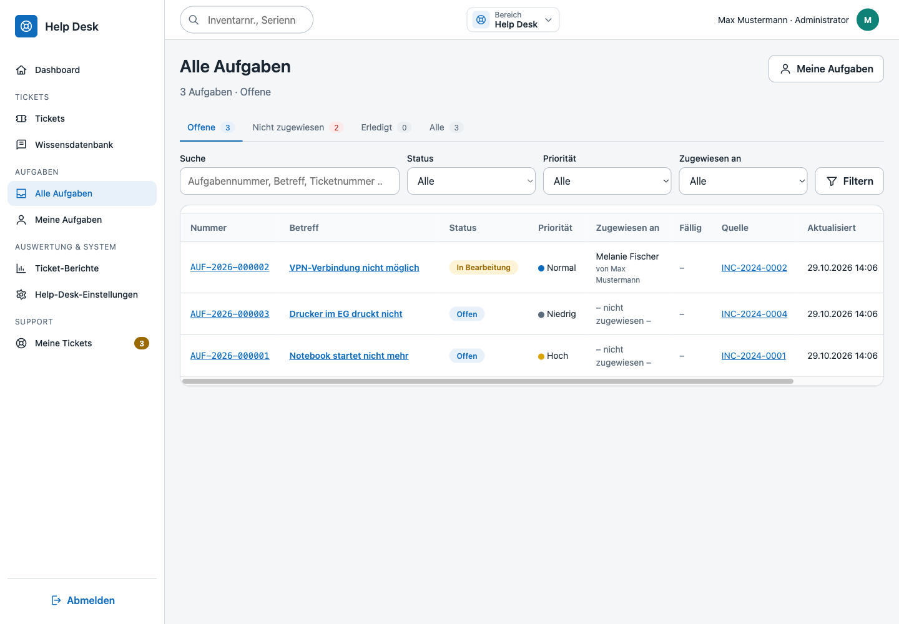
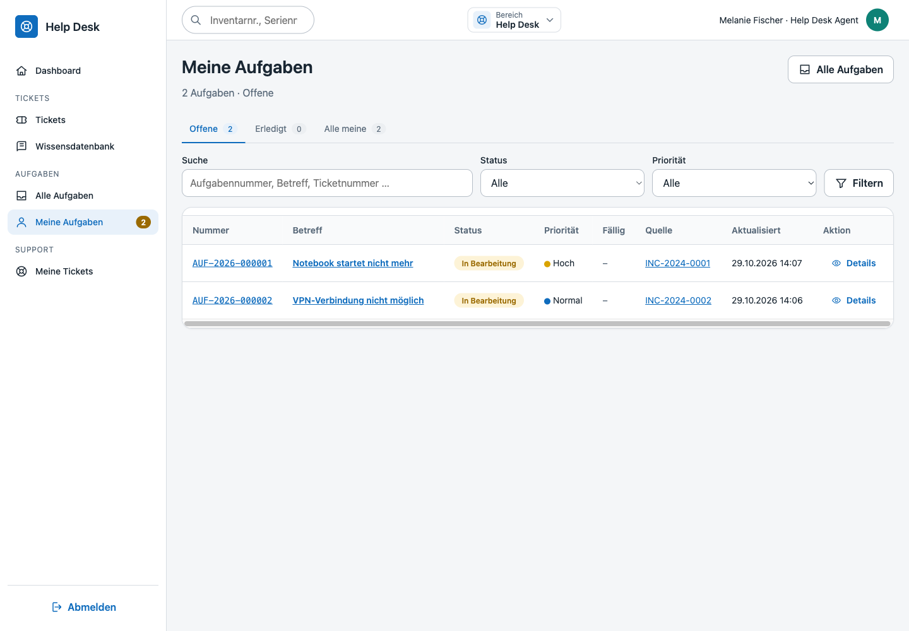
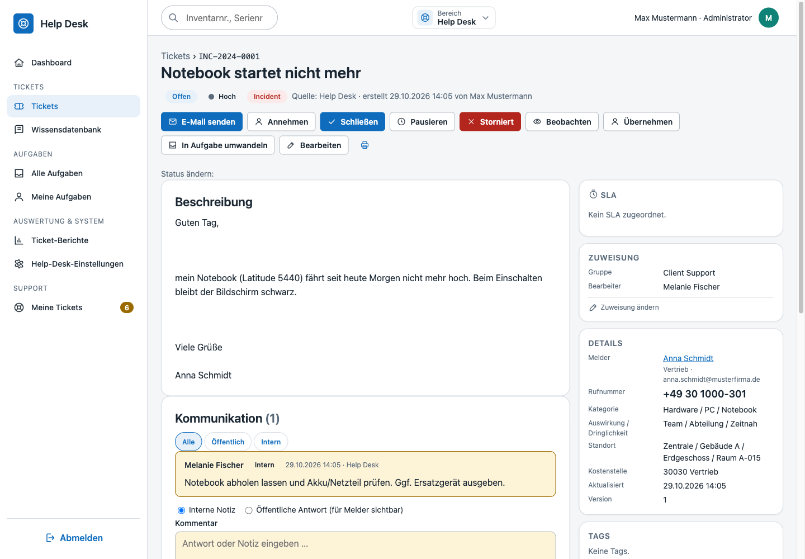
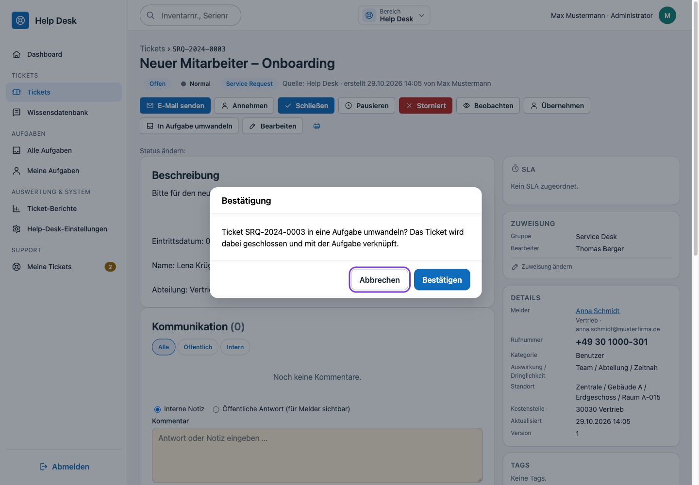
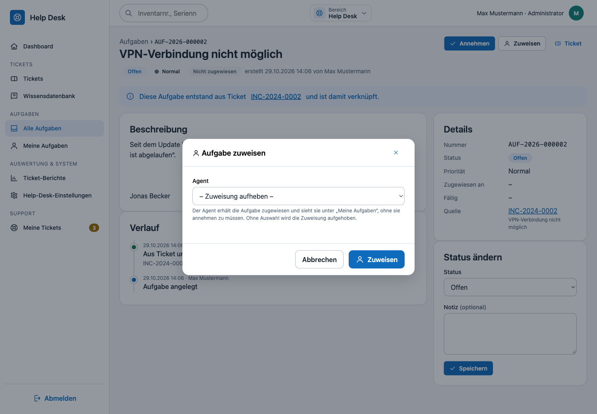
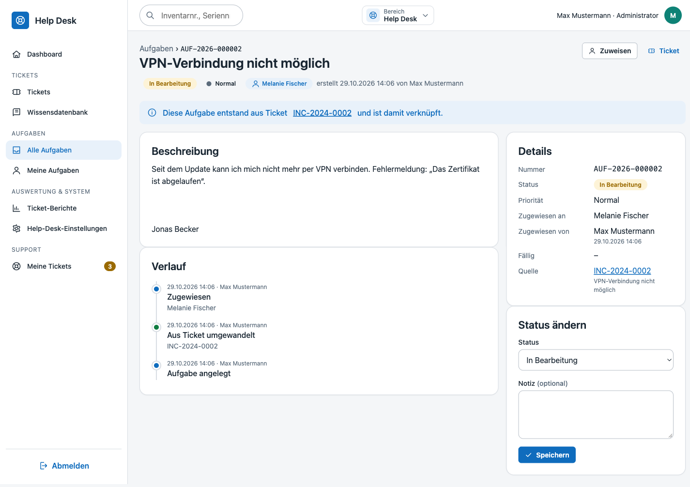

# Help Desk – Ticketsystem, Serviceportal & Wissensdatenbank

Das Help-Desk-Modul ergänzt KLINQ um ein vollständiges IT-Ticketsystem: Störungen, Serviceanfragen, Änderungen und Probleme werden als **Tickets** mit Nummer, Status-Workflow, Priorität aus Auswirkung × Dringlichkeit, SLA-Fristen, Zuständigkeit (Agent/Gruppe/Vertretung), Kommentaren, Anhängen, Arbeitszeiten, Verknüpfungen zu Assets/Mitarbeitern und einer lückenlosen Historie geführt. Endanwender melden Anliegen über ein **Serviceportal**, Lösungen landen in einer **Wissensdatenbank**. Alles läuft im bestehenden Stack (PHP 8.4, MySQL, keine Frameworks, CSP-konform, jede Route mit Berechtigung, Audit-Log).

## Überblick

| Bereich | Pfad | Zielgruppe |
|---|---|---|
| Help-Desk-Dashboard | `/helpdesk` | Agenten, Leitung |
| Ticketliste, Detail, Anlage | `/helpdesk/tickets` | Agenten |
| Berichte & CSV-Export | `/helpdesk/reports` | Leitung |
| Wissensdatenbank (Pflege) | `/helpdesk/knowledge` | Agenten |
| Aufgaben („Alle Aufgaben“, „Meine Aufgaben“) | `/helpdesk/aufgaben` | Agenten |
| Administration (Typen, Status, Prioritäten, Kategorien, SLA, Gruppen, Vorlagen, Regeln) | `/helpdesk/admin` | Help-Desk-Admin |
| Serviceportal (eigene Tickets, neue Anfrage, Wissensartikel) | `/portal` | alle Mitarbeitenden |
| JSON-Endpunkte (Suche, Vorschläge, Vorlagen, Assets des Melders) | `/api/helpdesk/…` | Oberfläche |

Der Modulschalter `HELPDESK_ENABLED=false` blendet Navigation, Dashboard-Kacheln, Ticket-Treffer in der globalen Suche und den Scheduler-Job aus; die Routen selbst bleiben durch ihre Berechtigungen geschützt.

### Bereichswechsel in der Oberfläche

Help Desk und Assetverwaltung sind zwei eigenständige Module mit je eigenem Dashboard (`/dashboard` bzw. `/helpdesk`, für reine Portalnutzer `/portal`). In der Topbar steht mittig zwischen Suchfeld und Benutzeranzeige ein Dropdown, über das der Bereich gewechselt wird; die Seitenleiste zeigt immer nur die Navigationseinträge des gewählten Moduls. Das Dropdown erscheint nur, wenn der Benutzer beide Bereiche betreten darf (`helpdesk.view` oder `portal.view` bei aktivem Modulschalter).

Modulzuordnung und Navigationseinträge stehen zentral in `app/Support/ModuleNavigation.php`; das Layout (`resources/views/partials/app_layout.php`) rendert sie nur noch. Das aktive Modul ergibt sich aus dem `activeNav`-Schlüssel der Seite (`helpdesk*`/`portal*` → Help Desk, sonst Assetverwaltung); fehlt das Modul für den Benutzer, gilt das erste verfügbare. Der Fenstertitel folgt dem Muster `KLINQ - <Modul>`.

Die Assetverwaltung ist an ausdrückliche Leserechte gebunden (`ModuleNavigation::ASSET_PERMISSIONS`: `dashboard.view`, `assets.view`, `movements.view`, `handover.view`, `licenses.view`, `orders.view`, `suppliers.view`, `employees.view`, `locations.view`, `costcenters.view`, `manufacturers.view`, `articles.view`, `documents.view`). Ohne eines dieser Rechte erscheint sie weder im Bereichswechsel noch in der Seitenleiste; Dashboard, globale Suche und alle Assetseiten antworten mit 403. Das betrifft insbesondere die Rolle **portal** (Personen ohne KLINQ-Berechtigung): Sie sieht ausschließlich ihren eigenen Help-Desk-Bereich.

KLINQ merkt sich je Benutzer das zuletzt geöffnete Modul: `users.last_module` wird in der `AuthorizationMiddleware` über `ModuleNavigation::moduleForPath()` gepflegt (nur bei einem Modulwechsel, nicht bei jedem Aufruf). Beim nächsten Start – Aufruf von `/`, Anmeldung oder Intranet-Einstieg ohne ausdrückliches Ziel – öffnet `ModuleNavigation::entryUrl()` dieses Modul wieder, sofern es verfügbar ist; sonst das erste verfügbare (Assetverwaltung, Help Desk, Auswertung & System). Fehlt die Berechtigung für das gemerkte Modul, landet ein Portalbenutzer damit im Serviceportal statt auf `/dashboard`. Dieselbe Auflösung nutzen Fehlerseiten (`resources/views/errors/error.php`) für ihren Zurück-Knopf und das Profil nach dem Passwortwechsel. Neutrale Seiten (Profil, globale Suche, JSON-Endpunkte) und der Systembereich (Berichte, Import, Audit, Administration) ändern die Auswahl nicht.

## Ticket-Lebenszyklus

### Nummer

`PREFIX-JJJJ-NNNNNN` (z. B. `HD-2025-000042`), Präfix aus `HELPDESK_TICKET_PREFIX`. Die Vergabe läuft über `ticket_sequences` unter `SELECT … FOR UPDATE` je Jahr – kollisionsfrei auch bei parallelen Anlagen.

### Status-Workflow

Status sind Stammdaten (`ticket_statuses`) mit einer **Kategorie**, die das Verhalten bestimmt:

| Kategorie | Standardstatus | Bedeutung |
|---|---|---|
| `new` | Neu | eingegangen, noch nicht angenommen |
| `open` | In Bearbeitung | Agent arbeitet; erste Reaktion zählt für die Reaktions-SLA |
| `pending` | Pausiert (Gründe aus dem Statuskatalog, Kategorie „Wartend“) | SLA-Uhr pausiert (`sla_paused_at`, `sla_paused_minutes`), Ende in `paused_until` |
| `resolved` | Gelöst | Lösung eingetragen; Melder kann bestätigen oder wieder öffnen |
| `closed` | Geschlossen | endgültig (manuell oder automatisch nach `HELPDESK_AUTO_CLOSE_DAYS`) |
| `cancelled` | Abgebrochen | mit Begründung |

Erlaubte Übergänge stehen je Status als Liste (`allowed_transitions`). Regeln:

- **Gelöst** erfordert einen Lösungstext, **Abgebrochen** eine Begründung.
- **Geschlossen** ist aus `new`, `open`, `in_progress` sowie aus jeder Pausierung direkt erreichbar
  (`TicketWorkflowService::TRANSITIONS`, `PAUSE_TRANSITIONS`) – der Umweg über „Gelöst“ entfällt. Der Dialog kennt
  optional einen Schließungsgrund (`close_reason`), einen **Fehlerursprung** (`error_origin`, siehe „Fehlerursprung“)
  und die Checkbox **„Melder über die Schließung informieren“** (siehe „Schließungs-E-Mail an den Melder“).
- **Wieder öffnen** (`helpdesk.reopen`; im Portal innerhalb `HELPDESK_REOPEN_DAYS`) erhöht `reopen_count` und setzt die SLA-Uhr fort.
- Jede Änderung prüft die **Version** (optimistische Sperre, 409 bei Konflikt) und schreibt ein Ereignis in `ticket_events` sowie einen Audit-Eintrag.
- Zusammengeführte Tickets (`merged_into_ticket_id`) sind schreibgeschützt; Kommentare, Anhänge, Watcher und Asset-Verknüpfungen wandern ins Zielticket. Der Zusammenführungsgrund steht in `close_reason` (z. B. „Duplikat (HD-2024-000123)“).

### Schließungs-E-Mail an den Melder

Beim Schließen eines Tickets fragt der Statusdialog zusätzlich **„Melder über die Schließung informieren“** ab
(Checkbox, standardmäßig gesetzt). Ist sie gesetzt und ein **Schließungstext** hinterlegt, erhält der Melder eine
E-Mail mit dem Schließungsgrund und der hinterlegten Lösung:

- Der Controller liest die Checkbox (`notify_requester`) nur für den Zielstatus `closed` aus und übergibt sie an
  `TicketService::changeStatus()`; der optionale Parameter steuert dort den gesamten Statusversand
  (`notifications->statusChanged()`).
- Schließt ein Agent direkt aus „In Bearbeitung“, wird der im Dialog erfasste Lösungstext zusätzlich in `resolution`
  gespeichert, damit der Platzhalter `{loesung}` gefüllt ist.
- Empfänger sind dieselben Meldeadressen wie bei der allgemeinen Statusmail (`requester_email`, `requester_user_email`);
  Adressen werden kleingeschrieben, dedupliziert und nur gültige E-Mail-Adressen berücksichtigt. Je Empfänger geht eine
  eigene Nachricht mit personalisierter Anrede über `TicketNotificationService::sendTo()` heraus (Ereignisschlüssel
  `status_closed_{version}`), sodass Protokollierung und Idempotenz greifen.
- Ist kein Schließungstext hinterlegt oder der Mailversand abgeschaltet, greift wie bisher die allgemeine
  Statusbenachrichtigung. Ist in den Help-Desk-Einstellungen im Reiter **Benachrichtigungen** der Schalter „Geschlossen“
  aus, entfällt jede Mail an den Melder – unabhängig von Checkbox und Vorlage.
- Der **Scheduler** (`autoClose()`) ruft den Versand direkt auf und nutzt damit ebenfalls den Schließungstext – ohne
  Checkbox, weil dort kein Agent entscheidet.

### Pausieren

Statt vieler gleichlautender Wartestände gibt es **einen** Statuswechsel „Pausieren“. Die auswählbaren Gründe sind die
aktiven Status des Statuskatalogs mit der Kategorie **Wartend** (`pending`, SLA pausiert) und werden in der
Help-Desk-Administration unter **Status** gepflegt. Der Grund ist der Zielstatus, das **Ende der Pausierung**
(Datum **und** Uhrzeit) ist Pflicht und wird im Dialog über ein Kalender-Overlay (`<input type="datetime-local">`) erfasst.
Der Seeder legt diese Standardgründe an:

| Code | Name |
|---|---|
| `waiting_feedback` | Warten auf Rückmeldung |
| `waiting_third_party` | Warten auf Dritte |
| `waiting_delivery` | Warten auf Lieferung |
| `waiting_internal` | Warten auf interne Rücksprache |

- Neue Gründe werden als Status mit Kategorie „Wartend“ angelegt; deaktivierte Gründe verschwinden aus der Auswahl,
  bestehende Pausierungen lassen sich weiterhin fortsetzen. Für die SLA-Gutschrift muss beim Status zusätzlich
  „SLA pausieren“ gesetzt sein.
- Das Ende liegt in `tickets.paused_until` (UTC) und muss in der Zukunft liegen.
- Erreicht der Scheduler (`php bin/helpdesk.php process`) das Pausenende, setzt er das Ticket automatisch auf **In Bearbeitung**,
  schreibt das Ereignis `resumed` und schickt die Statusbenachrichtigung. Pausierte Minuten werden dabei der SLA gutgeschrieben.
- Bei „Warten auf Rückmeldung“ (`waiting_feedback`) beendet eine Antwort des Melders (Kommentar oder E-Mail) die Pausierung
  ebenfalls sofort (Ereignis `resumed`).
- Zwischen Pausierungen kann direkt gewechselt werden; dabei wird das neue Pausenende gesetzt.
- Die Ansicht „Pausiert“ (`/helpdesk/tickets?view=paused`) und die Dashboard-Kachel fassen alle Gründe zusammen.

### Fehlerursprung

Beim **Schließen** erfasst der Dialog zusätzlich den **Fehlerursprung** (Dropdown, `tickets.error_origin`). Die
Auswahlliste ist ein Katalog in der Help-Desk-Administration (Reiter **Fehlerursprung**, verwaltet über
`ErrorOriginSettingsService`); der eingebaute Standardkatalog lautet „Anwender“, „Hardware-Fehler“, „Software-Fehler“,
„Netzwerk“.

- Die Angabe ist **optional** („– keine Angabe –“); ein übermittelter Wert muss im Katalog stehen, sonst antwortet
  `TicketService::changeStatus()` mit einem Validierungsfehler. Damit bleiben gelöschte Katalogwerte nicht als
  Freitext im Ticket bestehen.
- Der Wert landet in `tickets.error_origin` (max. 120 Zeichen) und wird im Ticketdetail in der Beschreibungs-Karte
  angezeigt; er steht in der Schließungs-E-Mail als `{fehlerursprung}` zur Verfügung.
- Der Katalog wird als zeilengetrennte Liste gespeichert (`helpdesk.error_origin.catalog`, maximal 50 Einträge,
  Duplikate und Leerzeilen entfallen); ist er leer, gelten die Standardwerte.

### Priorität, Auswirkung, Dringlichkeit

Die Priorität wird aus **Auswirkung** (1 = Unternehmen … 3 = Einzelperson) × **Dringlichkeit** (1 = sofort … 3 = niedrig) über eine 3×3-Matrix (`TicketPriorityMatrix`) vorgeschlagen; Agenten können sie überschreiben, Portalnutzer nicht (agentenspezifische Felder werden im Portal ignoriert).

### SLA

`ticket_slas` definieren je Priorität (optional je Typ/Kategorie) Reaktions- und Lösungszeit in Minuten, wahlweise nur innerhalb der **Servicezeiten** (Wochentage, Start/Ende) sowie eigene Warn-/Eskalationsschwellen in Prozent. Beim Anlegen und bei Prioritäts-/Kategoriewechsel werden `response_due_at`/`resolution_due_at` berechnet (`TicketSlaService`, Pausen werden herausgerechnet). Der Zustand (`ok → warning → breached`, `met` bei Erfüllung) wird laufend aktualisiert und in Liste, Detail (Fortschrittsbalken) und Dashboard angezeigt. Im Ticketdetail aktualisiert `public/js/helpdesk.js` Restzeit und Fortschrittsbalken ohne Neuladen (Balken sekündlich, inklusive Warn-/Verletzungsfarbe).

### Eskalation & Scheduler

`php bin/helpdesk.php process` (im Container automatisch alle `HELPDESK_ESCALATION_INTERVAL_MINUTES` Minuten über `docker/php/scheduler.sh`, alternativ Cron auf dem Host):

1. bewertet alle offenen Tickets neu (Warnung/Verletzung, Ereignis + Benachrichtigung einmalig je Stufe),
2. eskaliert verletzte Tickets (`escalation_level` +1, Meldung an Gruppenleitung/Sammelpostfach, Ereignis `escalated`),
3. schließt gelöste Tickets ohne Rückmeldung nach `HELPDESK_AUTO_CLOSE_DAYS` Tagen (Ereignis `closed`, Quelle `scheduler`),
4. beendet abgelaufene Zuständigkeiten und verarbeitet den 2nd-Level-Tagesabschluss (23:59 Uhr, interne Notiz „kein Kommentar erfolgt“).

Exit-Codes: `0` ok, `1` Fehler, `2` Modul deaktiviert.

### Zuständigkeit (1st/2nd Level Support)

Auf dem Dashboard (`/helpdesk`) übernimmt ein Agent per Schaltfläche „Zuständigkeit“ (Overlay) tagesweise den 1st- oder
2nd-Level-Support. Übernahmen werden in `helpdesk_support_shifts` erfasst (Historie je Datum/Level für Auswertungen;
je Datum/Level ist maximal ein Eintrag aktiv – eine erneute Übernahme beendet den vorherigen Eintrag). Die Zuständigkeit
endet automatisch täglich um 19:00 Uhr (`APP_TIMEZONE`) über den Scheduler (`SupportShiftService::endExpiredShifts`,
aufgerufen aus `HelpdeskSchedulerService::run` bzw. `php bin/helpdesk.php process`).

- **2nd Level übernehmen**: Alle offenen Tickets, die nicht vom aktuellen Tag stammen, werden automatisch dem neuen
  2nd Level zugewiesen (`TicketService::assign`, damit inkl. Timeline-Ereignis und Benachrichtigung).
- **Banner**: Solange der angemeldete Nutzer der heutige 1st Level ist und ein 2nd Level feststeht, zeigt das Dashboard
  oberhalb der Kennzahlen-Kacheln den Hinweis „Zuständiger 2nd Level für dich ist heute {Anzeigename}“.
- **Weiterleitung an den 2nd Level**: Im Ticketdetail kann der heutige 1st Level ein Ticket mit Pflichtkommentar an den
  2nd Level des Tages weiterreichen (`POST /helpdesk/tickets/{id}/assign-second-level`, `SupportShiftService::assignToSecondLevel`).
  Zuweisung und Kommentar werden als interne Notiz im Ticketverlauf erfasst.
- **Erinnerung & Tagesabschluss**: Wer den 2nd Level übernommen hat, sieht in der Kopfzeile (Glocke links neben dem
  Benutzernamen) alle offenen Tickets, die nicht vom heutigen Tag stammen und heute noch nicht durch ihn kommentiert
  wurden; ein Klick öffnet das jeweilige Ticket. Wird ein solches Ticket bis 23:59 Uhr (`APP_TIMEZONE`) nicht kommentiert,
  erzeugt der Scheduler (`php bin/helpdesk.php process`, `SecondLevelReminderService::createMissedComments`) automatisch
  eine interne Notiz „Zuständig am dd.mm.yyyy war {Anzeigename}, kein Kommentar erfolgt.“. Die Verarbeitung ist je Tag
  idempotent (`helpdesk_support_shifts.reminder_finalized_at`).

Routen: `POST /helpdesk/support-shift/claim` (Berechtigung `helpdesk.view`), `POST /helpdesk/tickets/{id}/assign-second-level`
(Berechtigung `helpdesk.assign`, zusätzlich serverseitig auf den heutigen 1st Level beschränkt).

## Ticketdetail (`/helpdesk/tickets/{id}`)

- **Kopf**: Nummer, Betreff, Status/Priorität/Typ, Melder (Mitarbeiter mit Abteilung, Standort, Telefon), betroffener Mitarbeiter, Zuständigkeit, Fälligkeiten, SLA-Balken.
- **Aktionen**: In der Kopfzeile stehen die Schaltflächen **Annehmen**, **Schließen**, **Pausieren** und **Stornieren** direkt neben **E-Mail senden** und **Beobachten**; darunter folgen Übernehmen, Zuweisen (Agent/Gruppe/Vertretung), **Zusammenführen** (Overlay mit Suche, Grund und optionaler Info-E-Mail, siehe „Ticket zusammenführen“), **In Aufgabe umwandeln** (siehe „Aufgaben“) und Löschen (`helpdesk.delete`).
  - **Annehmen** setzt den Status auf `in_progress` und ersetzt damit den bisherigen Eintrag „In Bearbeitung“ in **Status ändern**. Die Beschriftung folgt der Ausgangslage: „Annehmen“ aus `new`/`open`, „Weiter bearbeiten“ aus einer Pausierung, „Wieder öffnen“ aus „Gelöst“/„Geschlossen“.
  - **Schließen** öffnet den Schließen-Dialog (Lösung, Schließungsgrund, Fehlerursprung, Checkbox „Melder informieren“) und ersetzt den Eintrag „Gelöst“; `resolved` ist damit nur noch programmatisch erreichbar.
  - **Pausieren** und **Stornieren** (`helpdesk.cancel`) liegen ebenfalls in der Kopfzeile; **Status ändern** enthält nur noch die übrigen Zustände. Stornieren erscheint nur mit der jeweiligen Berechtigungsgruppe.
- **Kommunikation**: öffentliche Kommentare (Melder sieht sie im Portal, E-Mail-Benachrichtigung) und **interne Notizen** (`helpdesk.internal_note`, nur Agenten). Für Agenten ist die **interne Notiz** vorausgewählt; öffentliche Antworten müssen bewusst gewählt werden. Anhänge je Kommentar oder direkt am Ticket, optional intern. Zusätzlich **„E-Mail senden“** – eine echte Nachricht an den Melder (siehe „E-Mail aus dem Ticket senden“).
- **Arbeitszeiten** (`helpdesk.worklog`): Minuten (in 15-Minuten-Schritten), Tätigkeit, Datum; Summe im Kopf. Der Bereich ist – wie **Anhänge** – aufklappbar und standardmäßig geschlossen.
- **Verknüpfungen**: Assets (mit Vorschlag der dem Melder zugeordneten Geräte), Beziehungen zu anderen Tickets (`related`, `duplicate_of`, `parent_of`, `problem_of`, `change_for` – jeweils mit Gegenrichtung), Wissensartikel (Vorschläge nach Betreff/Kategorie, „Artikel aus Lösung erstellen“).
- **Tags** mit Autovervollständigung, **Watcher** (zusätzliche Empfänger).
- **Seitenleiste**: kompakte Infoboxen (SLA, Zuweisung, Details, Tags, Assets, Beziehungen, Beobachter, Wissensdatenbank); die Bearbeitungsformulare sind jeweils hinter einem aufklappbaren Abschnitt zusammengefasst.
- **Beschreibungstext**: nach dem Anlegen nur noch mit `helpdesk.admin` änderbar. Für alle anderen Bearbeiter ist das Feld im Bearbeitungsformular schreibgeschützt; ein übermittelter Wert wird serverseitig verworfen (`TicketService::canEditDescription()`). Ergänzungen gehören in Kommentare bzw. interne Notizen.
- **Historie**: alle Ereignisse chronologisch mit Feldänderungen (alt → neu). Öffnet ein Agent das Ticket, wird das Ereignis `viewed` („Ticket angesehen“) erfasst; sichtbar ist es nur mit der Berechtigung „Darf Ticketaufruf auswerten“ (`helpdesk.view_history`) bzw. für Admins.
  - **Gruppierung**: Kurz aufeinanderfolgende Aktionen desselben Benutzers (Standard: 5 Minuten ab dem ersten Ereignis der Gruppe) erscheinen als **ein** Eintrag – angezeigt wird das jüngste Ereignis, die übrigen lassen sich über das **„+“** am rechten Rand aufklappen („−“ schließt wieder). Die Logik liegt in `App\Support\TimelineGrouper` (`group()`, Fenster als Parameter), die Darstellung im Partial `views/helpdesk/tickets/_history.php`; beim Drucken werden alle Gruppen automatisch aufgeklappt (`public/js/helpdesk.js`).

### Personenauswahl (Melder und Betroffene)

Die Felder **Melder** und **Betroffener Mitarbeiter** sind Auswahlfelder mit Suche. Gefüllt werden sie aus dem
**Telefonbuch des Intranets** (LANPA, alle Identitätsquellen) – also auch aus Personen, die nicht per AD-Sync nach KLINQ
gelangen. Die Suche läuft live über die interne Schnittstelle `GET /internal/klinq/telefonbuch`
(`PersonDirectoryService` → `LanpaBridge::phonebook()`), damit der Personenbestand nicht doppelt gepflegt wird.

- **Keine Vorbelegung mit dem Agenten**: Beim Anlegen über `/helpdesk/tickets/new` bleibt das Feld **Melder** leer.
  Der angemeldete Agent ist der *Ersteller* des Tickets (`created_by`), nicht der Melder – eingetragen wird die Person,
  die das Problem hat. Eine Vorbelegung gibt es nur aus dem Kontext: Wird das Formular über ein Asset
  (`?asset_id=…`) geöffnet, übernimmt der Melder die dem Asset zugeordnete Person. Bleibt das Feld leer, entsteht ein
  Ticket ohne bekannte meldende Person (unbekannt/extern, etwa ein Telefonanruf ohne Personalnummer); in Liste und
  Detail steht dann „–“. Im Portal ist der Melder dagegen immer das angemeldete Konto.
- **Suchfelder**: Name (auch phonetisch), E-Mail, Benutzername, Abteilung und **Personalnummer** (Präfixsuche). Die
  Personalnummer stammt aus dem AD-Attribut `employeeNumber` (`LDAP_ATTR_PERSONNEL_NUMBER` im Intranet) und wird beim
  Übernehmen in den lokalen Mitarbeiter geschrieben (`employees.personnel_number`, höchstens 50 Zeichen, nur wenn
  gefüllt); die lokale Mitarbeitersuche findet sie danach ebenfalls.
- **Bekannte Personen** werden auf den lokalen Mitarbeiter abgebildet (Reihenfolge: objectGUID, E-Mail,
  Benutzername); die Auswahl liefert dessen ID, Tickets behalten ihren Fremdschlüssel.
- **Unbekannte Personen** erscheinen mit dem Hinweis „wird beim Auswählen übernommen“. Erst beim Auswählen legt
  `PersonDirectoryService::adopt()` einen lokalen Mitarbeiter an (`source = manual`, mit der objectGUID des
  Verzeichnisses, sofern vorhanden); Tippen allein füllt den Mitarbeiterbestand nicht. Die Stammdaten kommen dabei aus dem Intranet
  (`?id=…`), nicht aus der Anfrage. Der spätere AD-Abgleich erkennt den Datensatz an der objectGUID und stellt ihn auf
  `source = ad` um.
- **Lokale Mitarbeiter** bleiben zusätzlich wählbar (phonetische Suche), damit die Felder auch ohne erreichbares
  Intranet funktionieren.
- Endpunkte: `GET /api/helpdesk/people/search?q=…` (Berechtigung `helpdesk.view`) und
  `POST /api/helpdesk/people/adopt` mit `ref` = Telefonbuch-ID; die Oberfläche (`public/js/picker.js`) übernimmt die
  ID nach der Übernahme automatisch ins Feld.

### Liste (`/helpdesk/tickets`)

Ansichten *Meine*, *Meine Gruppe*, *Nicht zugewiesen*, *Alle offenen*, *SLA-kritisch*, *Gelöst*, *Alle*, dazu Volltext (Nummer, Betreff, Beschreibung, Melder), Filter nach Status, Priorität, Typ, Kategorie, Gruppe, Agent, Tag, Asset, Zeitraum; Sortierung nach Fälligkeit, Priorität, Aktualisierung, Nummer. CSV-Export (`helpdesk.export`) respektiert die aktiven Filter. Mit `helpdesk.merge` hat jede Zeile ein Auswahlkästchen; ab zwei gewählten Tickets erscheint neben **CSV** die Schaltfläche **„Zusammenführen“** (siehe „Mehrere Tickets zusammenführen“).

### Neues Ticket: klassisches Formular oder Assistent

`/helpdesk/tickets/new` bietet zwei Eingabemodi, umschaltbar über den Schalter im Seitenkopf:

- **Klassisch**: alle Felder in vier Feldgruppen auf einer Seite.
- **Assistent** (`?modus=assistent`): führt in neun Schritten durch das Formular – Vorlage/Betreff, Melder & Betroffener, Beschreibung, Typ/Kategorie/Unterkategorie, Auswirkung/Dringlichkeit/Priorität, Standort/Kostenstelle, Gruppe/Bearbeiter/Vertretung, Assets & Tags, Bestätigung. Die Unterkategorie erscheint erst nach gewählter Kategorie. Der letzte Schritt bietet die Checkbox **„Eingangsbestätigung an den Melder senden“** (standardmäßig **nicht** gesetzt, also Opt-in); ein Hinweis erklärt, wenn kein Bestätigungstext hinterlegt ist. Der klassische Modus kennt diesen Schritt nicht – dort wird keine Bestätigung versendet.

Beide Modi nutzen dieselben Felder (`views/helpdesk/tickets/_fields.php`) und denselben POST-Endpunkt; die serverseitige Validierung bleibt unverändert. Im Assistenten werden abgeschlossene Schritte oberhalb des aktuellen Schritts mit einer Zusammenfassung angezeigt und lassen sich aufklappen. Über „Zurück“ oder Klick auf einen Schritt lässt sich jederzeit wechseln, ohne Eingaben zu verlieren. Der Bearbeiter ist mit dem heutigen 2nd-Level-Support vorbelegt (`SupportShiftService::secondLevelUserIdToday()`), sonst „– nicht zugewiesen –“. Der Melder bleibt bewusst leer und wird vom Agenten eingetragen (siehe „Personenauswahl (Melder und Betroffene)“). Beim Verlassen über „Schließen“, den Moduswechsel oder die Navigation fragt der Assistent nach, bevor der Bearbeitungsfortschritt verloren geht (`public/js/helpdesk-wizard.js`).

#### Bevorzugter Eingabemodus je Benutzer

Der zuletzt verwendete Modus wird als **Benutzerpräferenz** in `users.ticket_form_mode` (`klassisch`/`assistent`) gespeichert – serverseitig, also unabhängig von PC oder Browser. `/helpdesk/tickets/new` ohne `modus`-Parameter öffnet den gemerkten Modus (Vorgabe: klassisch). Eine explizite Wahl über den Umschalter (`?modus=…`) und das erfolgreiche Absenden eines Tickets schreiben die Präferenz fort (`TicketController::resolveFormMode()`/`rememberFormMode()`, `UserRepository::ticketFormMode()`/`rememberTicketFormMode()`).

### Anhänge und Bilder in Beschreibung und Kommentaren

Beschreibung und Kommentare (intern wie extern, Agenten- und Portalansicht) sind **Rich-Text-Felder** mit Bildunterstützung:

- **Dateianhänge** laufen wie bisher über `DocumentService` (Tabelle `documents`, `entity_type = ticket`); im Assistenten und im klassischen Formular steht dafür ein Mehrfach-Upload im Schritt „Beschreibung“ bereit (`attachments[]`, maximal fünf Dateien je Vorgang, Whitelist/MIME-Prüfung wie in `config/uploads.php`). Beim Anlegen des Tickets werden die Dateien nach erfolgreicher Validierung mitgespeichert.
- **Bilder aus der Zwischenablage** werden per `STRG+V` direkt im Textfeld eingefügt (`public/js/helpdesk-media.js`), auch im öffentlichen Störungsformular. Das Skript skaliert auf maximal 1400 px Kantenlänge, komprimiert als JPEG auf höchstens ca. 900 KB und legt die Bilddaten als **base64-Data-URI** ab. Im Textfeld steht nur eine kurze Marke (`[Bild 1]`), das Bild erscheint als Vorschau unter dem Feld; beim Absenden ersetzt das Skript die Marke durch ``. So bleibt das Bild Teil des Textes und wird zusammen mit ihm in der Datenbank gespeichert. Screenshots, die nur als Base64-Text in der Zwischenablage liegen, werden ebenfalls erkannt.
- Die Ausgabe rendert `App\Support\RichText::toHtml()` (Helfer `rich_text()`), Textkontexte wie Benachrichtigungen, Wissensdatenbank und Merge-Protokoll nutzen `RichText::toPlain()`. Textgrenzen: `TicketService::MAX_TEXT_CHARS` (2 000 000 Zeichen) für Beschreibung und Kommentare.

### E-Mail aus dem Ticket senden

Agenten können aus einem Ticket heraus eine echte E-Mail an die **meldende Person** und optional an die **betroffene
Person** schicken. Die Schaltfläche **„E-Mail senden“** steht im Seitenkopf des Tickets (`helpdesk.comment`) und öffnet
ein Overlay mit dem Mail-Editor aus Orvanta – samt **Kontextmenü** und **KI-Unterstützung**.

- **Empfänger**: Die meldende Person ist fest eingetragen. Die betroffene Person lässt sich über ein Kästchen
  hinzunehmen, sofern sie hinterlegt ist und eine **andere** Adresse hat. Fehlt eine Melderadresse oder ist der
  Mailversand abgeschaltet (`HELPDESK_NOTIFICATION_ENABLED=false`), ist die Schaltfläche deaktiviert und nennt den
  Grund im Tooltip. Zusammengeführte Tickets können keine Mail senden.
- **Betreff**: vorbelegt mit `[HD-JJJJ-NNNNNN] Betreff`, änderbar (höchstens 180 Zeichen).
- **Editor**: Rich-Text-Feld (`contenteditable`) mit den Tastenkürzeln des Browsers; eingefügte Formatierungen und Bilder
  aus der Zwischenablage bleiben erhalten. Der Text wird **serverseitig** durch `App\Support\HtmlSanitizer` gefiltert
  (Allowlist für Tags und Attribute, keine Skripte, keine `javascript:`-Ziele, `style` ohne `url()`/`position:fixed`);
  Bilder sind nur als `http(s)`- oder `data:image`-Quelle erlaubt.
- **Kontextmenü** (Rechtsklick in den Text): Rückgängig, Wiederherstellen, Ausschneiden, Kopieren, Einfügen, Alles
  auswählen sowie **„Mit KI verbessern …“** für den markierten Text und – nach einem Vorschlag – **„KI-Vorschlag weiter
  verfeinern …“**.

- **KI-Funktion**: Der Dialog entspricht dem Editor im Ticket (`/api/helpdesk/ai/verbessern`), verwendet aber den
  Modus `ticket_mail`, damit die KI den Ton einer Agentenantwort an die meldende Person trifft. Der **API-Schlüssel
  stammt aus den KLINQ-Einstellungen** (Intranet: KLINQ → KI, abgerufen über `GET /internal/klinq/ki`); ohne
  hinterlegten Schlüssel bleibt der KI-Eintrag ausgeblendet.

- **Signatur**: steht **schreibgeschützt im Editor** (Block mit `contenteditable="false"`, wie im Orvanta-Mail-Editor),
  fest, unveränderlich und **dieselbe wie in Orvanta** – sie wird nicht im Browser erzeugt, sondern beim Senden
  serverseitig angehängt (`GET /helpdesk/tickets/{id}/mail/signature` liefert nur die Anzeige im Editor; ein mitgesendeter
  Signaturblock wird verworfen). Quelle ist
  `GET /internal/klinq/signatur` im Intranet: Dort wird der Benutzername des angemeldeten Agenten auf den
  Telefonbucheintrag abgebildet (quellenunabhängig, Hauptquelle zuerst), die AD-Gruppen werden geladen und
  `OrvantaSignatureService::forUser()` rendert die Signatur. Ist im Intranet keine Signatur hinterlegt oder ist es
  nicht erreichbar, wird ohne Signatur gesendet.
- **Präfix-Text**: In den Help-Desk-Einstellungen im Reiter **Vorlageneinstellungen** lässt sich ein Text hinterlegen,
  der der Agentenmail beim Senden **vorangestellt** wird (z. B. ein Hinweis auf die Ticketnummer oder Öffnungszeiten).
  Der Text kommt **ausschließlich beim Senden** dazu (`TicketMailService::renderBody()`), steht also **nicht** im Editor
  des Dialogs und wird auch nicht mitgespeichert; Absätze werden als `
`, einfache Zeilenumbrüche als ` ` gerendert
  und der Text wird maskiert. Für die Info-Mail zur Zusammenführung gilt er nicht.
- **Pausierung**: Im Dialog lässt sich zusätzlich wählen, ob und **wie lange** das Ticket pausiert wird, mit **Grund**
  (Pausierungsstatus aus dem Workflow) und **Pausierende** (Datum/Uhrzeit, Vorgabe: morgen 12:00). Die Pausierung wird
  nach dem Versand über `TicketService::changeStatus()` gesetzt; ein Fehler dabei wird als Warnung gemeldet, die Mail
  gilt trotzdem als gesendet.
- **Protokollierung**: Die Mail wird als **öffentlicher Kommentar** mit `source = email` am Ticket geführt (sichtbar im
  Portal und in der Historie, Ereignis `comment` mit `via = email`, `direction = out`), inklusive Empfängern und
  Betreff; zusätzlich Eintrag im Audit-Log. Eine eigene Benachrichtigung wird nicht ausgelöst – die Mail selbst ist die
  Information an den Melder.
- **Threading**: Jede Mail trägt `Message-ID`, `In-Reply-To`/`References` auf die Thread-Wurzel des Tickets und
  `X-Ticket-Number`; Antworten des Melders landen dadurch wieder im richtigen Ticket. Bewusst **ohne**
  `Auto-Submitted: auto-generated`, damit die Nachricht als persönliche Agentenmail gilt. Bei zwei Empfängern erhält
  jede Person eine eigene Nachricht (der Mailversand ist einzeilig), beide mit derselben `Message-ID`.
- **Technik**: `TicketMailService` (Validierung, Bereinigung, Versand, Kommentar, Pausierung), Routen
  `POST /helpdesk/tickets/{id}/mail` und `GET /helpdesk/tickets/{id}/mail/signature` (beide `helpdesk.comment`),
  Oberfläche `public/js/helpdesk-mail.js`. Anhänge werden noch nicht mitgesendet.

### Ticket zusammenführen

Ein Ticket lässt sich auf ein **bereits vorhandenes** Ticket zusammenführen (Berechtigung `helpdesk.merge`). Das
Zielticket darf sich noch in Bearbeitung befinden oder bereits gelöst bzw. geschlossen sein; es behält seinen Status
bei. Stornierte Tickets können nicht Ziel sein. Die Schaltfläche **„Zusammenführen“** im Seitenkopf des Tickets öffnet
ein Overlay – wie beim Senden einer E-Mail.

- **Suche**: Das Feld schlägt Tickets derselben meldenden Person vor, offene zuerst. Bereits zusammengeführte und
  stornierte Tickets sind ausgeschlossen, das Quellticket selbst ebenso; **gelöste und geschlossene Tickets sind
  zulässige Ziele** und stehen in der Liste nach den offenen. Ohne Suchbegriff erscheinen nur die Tickets **derselben
  meldenden Person**; mit Suchbegriff kommen Treffer aus allen Tickets dazu (Ticketnummer, Betreff, Meldername,
  Melder-E-Mail). Tickets der meldenden Person stehen oben und
  sind mit **„gleiche Person“** gekennzeichnet (`GET /api/helpdesk/tickets/search?merge_for={id}&q=…` →
  `TicketRepository::suggestForMerge()`).
- **Ziel**: Auswahl per Klick oder Eingabe der Ticketnummer (z. B. `HD-2024-000123`); das Feld prüft beim Absenden,
  ob das Ziel existiert, nicht selbst zusammengeführt und nicht abgeschlossen ist.
- **Grund**: Pflichtauswahl aus `TicketMergeService::REASONS` – *Duplikat*, *Thema identisch*, *Gehört zum selben
  Vorgang*, *Versehentlich getrennt erfasst*, *Sonstiger Grund*. Optional ergänzt eine **Anmerkung** (höchstens 160
  Zeichen) den Grund. Der Grund landet im Abschlussgrund des Quelltickets (`close_reason`, z. B.
  „Duplikat (HD-2024-000123)“), in der internen Notiz am Zielticket, im Ereignis `merged` und im Audit-Log.
- **Info-E-Mail an den Melder** (Kästchen im Overlay, vorausgewählt): Betreff und Text sind **bearbeitbar** und mit
  Platzhaltern vorbelegt – `{{nummer}}` (Quellticket), `{{ziel}}` (Zielticket), `{{grund}}` (gewählter Grund mit
  Anmerkung). Die Platzhalter werden beim Senden serverseitig ersetzt, auch in einem bearbeiteten Text. Die
  Nachricht geht **ohne Agentensignatur** an die meldende Person (ein mitgeschickter Signaturblock wird verworfen) und
  trägt `Message-ID`, `In-Reply-To`/`References` auf den Thread des **Zieltickets** sowie `X-Ticket-Number`, damit
  Antworten im richtigen Ticket landen. Ist der Mailversand abgeschaltet oder fehlt die Melderadresse, ist das
  Kästchen deaktiviert und nennt den Grund im Tooltip; die Zusammenführung selbst funktioniert weiterhin.
- **Protokollierung**: Die Info-Mail wird als öffentlicher Kommentar am Zielticket geführt (`source = email`), ein
  Fehler beim Versand bricht die Zusammenführung nicht ab – er erscheint als Hinweis in der Rückmeldung
  (`merge_mail_error`).
- **Technik**: `TicketMergeService` (`REASONS`, `composeData()`, `merge()` mit `reason_code`, `reason_note`, `notify`,
  `mail_subject`, `mail_body_html`), `TicketMailService::mergeComposeData()`/`sendMergeNotice()`, Route
  `POST /helpdesk/tickets/{id}/merge`, Oberfläche `public/js/helpdesk-merge.js` (`<dialog id="merge-dialog">`).

#### Mehrere Tickets zusammenführen (Sammelauswahl)

In der Ticketliste (`/helpdesk/tickets`) hat jede Zeile ein Auswahlkästchen (Spalte vor der Nummer, mit
„Alle auswählen“ im Kopf). Sobald **mehr als ein** Ticket ausgewählt ist, erscheint oben links neben **CSV** die
Schaltfläche **„Zusammenführen“** mit der Anzahl der gewählten Tickets. Sie öffnet ein Overlay, in dem genau eines der
ausgewählten Tickets als **Ziel** gewählt wird; die übrigen wandern per `TicketMergeService::mergeMany()` als Quellen
in dieses Ticket. Der Grund ist fest **Duplikat**; die Info-E-Mail an den Melder wird nicht versendet. Bereits
zusammengeführte Tickets sind nicht auswählbar, und einzelne Fehler (etwa ein inzwischen selbst zusammengeführtes
Ticket) brechen die übrigen Zusammenführungen nicht ab – sie erscheinen als Warnhinweis. Das Ziel darf auch gelöst oder
geschlossen sein und bleibt in diesem Status; nur stornierte Tickets sind als Ziel ausgeschlossen. Die Auswahlliste zeigt
den Status jedes Tickets an. Technik: Route `POST /helpdesk/tickets/merge`
(`helpdesk.merge`), Oberfläche `public/js/helpdesk-merge-bulk.js` (`<dialog id="bulk-merge-dialog">`).

### Ticket-Berichte & Administration

Unter **Help-Desk-Einstellungen** (`/helpdesk/admin`) werden Typen, Status, Prioritäten, Kategorien, SLA-Regeln, Gruppen, Vorlagen, Regeln und das Benachrichtigungsprotokoll gepflegt. Das **Störungsformular für Anwender** hat dort einen eigenen Reiter mit dem öffentlichen Link, ebenso die **Vorlageneinstellungen**, der **Fehlerursprung** und die **Benachrichtigungen** (welche Agenten-Aktionen eine Mail an den Melder auslösen).

Im Reiter **Störungsformular** liegen der öffentliche Link und die **Sammelkonten** (AD-/SSO-Anmeldenamen, bei denen die Angabe eines zusätzlichen Benutzers Pflicht ist) samt anpassbarem Erklärungstext. Die Konten werden über eine Eingabezeile mit Autovervollständigung gepflegt: Beim Tippen (ab zwei Zeichen) schlägt `GET /api/helpdesk/quick-report/accounts/suggest` Anmeldenamen aus Intranet-Telefonbuch, aktivem Mitarbeiterbestand und lokalen KLINQ-Konten vor (`SharedAccountSuggestionService`, Berechtigung `helpdesk.admin`); ein Vorschlag oder eine freie Eingabe wird per Enter bzw. „Hinzufügen“ übernommen und erscheint als Eintrag unter der Zeile, wo er sich wieder entfernen lässt. Ohne JavaScript bleibt das Textfeld (ein Name pro Zeile) als Rückfallebene nutzbar.

Im Reiter **Vorlageneinstellungen** stehen vier Texte (Berechtigung `helpdesk.admin`, verwaltet über `ReplyTemplateSettingsService`):

- **Präfix-Text** (`helpdesk.reply_template.prefix_text`, höchstens 4 000 Zeichen) für Agentenmails. Er wird beim Versand einer Mail aus dem Ticket serverseitig vor den Agententext gesetzt und erscheint nicht im Mail-Dialog. Ist das Feld leer, wird nichts vorangestellt.
- **Bestätigungstext** (`helpdesk.reply_template.confirmation_text`, höchstens 4 000 Zeichen) für die **Eingangsbestätigung**, die beim Anlegen eines Tickets versendet wird (siehe „Störungsmeldung für Anwender“). Er wird als HTML gerendert (Absätze `
`, Zeilenumbrüche ` `, Inhalt maskiert) und unterstützt Platzhalter:

| Platzhalter | Ersetzt durch |
| --- | --- |
| `{anrede}` | feste Anrede „Guten Tag“ (Mitarbeiterdatensatz führt keine Anrede) |
| `{name}` | Name des Empfängers |
| `{ticketnummer}` | Ticketnummer, z. B. `HD-2026-00042` |
| `{betreff}` | Betreff des Tickets |
| `{datum}` | Anlagedatum des Tickets (`d.m.Y H:i`) |
| `{link}` | Link zum Ticket im Serviceportal |
| `{firma}` | Firmenname aus der Konfiguration |

Unbekannte Platzhalter bleiben stehen; Platzhalter ohne Wert werden samt einem direkt folgenden Leerraum entfernt. Ist der Bestätigungstext leer, wird keine Bestätigung versendet (der Assistenten-Schritt weist darauf hin). Startwert über `HELPDESK_REPLY_TEMPLATE_CONFIRMATION`, die Datenbank hat Vorrang.

- **Schließungstext** (`helpdesk.reply_template.close_text`, höchstens 4 000 Zeichen) für die E-Mail, die der Melder beim
  Schließen des Tickets erhält (siehe „Schließungs-E-Mail an den Melder“). Er wird wie der Bestätigungstext als HTML
  gerendert (Absätze `
`, Zeilenumbrüche ` `, Inhalt maskiert) und unterstützt zusätzlich zum Bestätigungstext die
  Angaben zum Abschluss:

| Platzhalter | Ersetzt durch |
| --- | --- |
| `{anrede}` | feste Anrede „Guten Tag“ |
| `{name}` | Name des Empfängers |
| `{ticketnummer}` | Ticketnummer, z. B. `HD-2026-00042` |
| `{betreff}` | Betreff des Tickets |
| `{datum}` | Anlagedatum des Tickets (`d.m.Y H:i`) |
| `{geschlossen_am}` | Zeitpunkt der Schließung (`d.m.Y H:i`) |
| `{schliessungsgrund}` | im Dialog erfasster Schließungsgrund (`close_reason`) |
| `{fehlerursprung}` | im Schließen-Dialog gewählter Fehlerursprung (`error_origin`) |
| `{loesung}` | Lösungstext des Tickets als reiner Text (eingebettete Bilder werden zu `[Bild]`) |
| `{link}` | Link zum Ticket im Serviceportal |
| `{firma}` | Firmenname aus der Konfiguration |

Ist das Feld leer, versendet KLINQ beim Schließen die allgemeine Statusbenachrichtigung. Startwert über
`HELPDESK_REPLY_TEMPLATE_CLOSE`, die Datenbank hat Vorrang.

- **Hinweis am Fuß der E-Mail** (`helpdesk.reply_template.footer_text`, höchstens 1 000 Zeichen) wird unter jede Benachrichtigungsmail des Help Desk gesetzt – auch unter die Eingangsbestätigung, nicht aber unter die von Agenten verfasste E-Mail (`TicketMailService` nutzt den Rahmen nicht). Der Text wird wie der Bestätigungstext maskiert und in Absätze umgesetzt; als Platzhalter steht `{firma}` (Firmenname aus der Konfiguration) bereit. Ein leeres Feld blendet den Hinweis aus. Ohne gespeicherten Wert gilt der Startwert aus `HELPDESK_REPLY_TEMPLATE_FOOTER`, sonst der eingebaute Standardtext („Diese E-Mail wurde automatisch vom IT Help Desk ({firma}) erzeugt …“), sodass bestehende Installationen unverändert weiterversenden.

Im Reiter **Fehlerursprung** wird der Katalog für das Dropdown im Schließen-Dialog gepflegt (Berechtigung
`helpdesk.admin`, `ErrorOriginSettingsService`, ein Eintrag pro Zeile, höchstens 50). Ohne gespeicherten Wert gelten die
Standardpunkte „Anwender“, „Hardware-Fehler“, „Software-Fehler“ und „Netzwerk“. Gespeichert wird über
`POST /helpdesk/admin/error-origins`.

Im Reiter **Benachrichtigungen** wird per Checkbox-Liste festgelegt, bei welcher Aktion im Ticket der **Melder** eine
E-Mail erhält (Berechtigung `helpdesk.admin`, `NotificationSettingsService`, gespeichert unter dem Präfix
`helpdesk.notification.`, gespeichert wird über `POST /helpdesk/admin/notifications`). Schaltbar sind die Anlage des
Tickets (Info- bzw. Eingangsbestätigung, auch aus Störungsformular und Störungspostfach), die öffentliche **Antwort**
eines Agenten und jeder **Statuswechsel** (`new`, `open`, `in_progress`, `waiting_feedback`, `waiting_third_party`,
`waiting_delivery`, `waiting_internal`, `resolved`, `closed`, `cancelled`). Ohne gespeicherten Wert bleibt ein Schalter
**aktiv**, damit bestehende Installationen unverändert weiterversenden; Statuscodes, die es beim Speichern noch nicht gab,
gelten ebenfalls als aktiv. Nicht betroffen sind Mails an Bearbeiter, Gruppen, Watcher sowie SLA-, Eskalations- und
Regelbenachrichtigungen. Die Prüfung sitzt in `TicketNotificationService` (Ereignis-Schalter vor jedem Melder-Versand)
und in `TicketConfirmationService` (Eingangsbestätigung hängt am Schalter „Ticket angelegt“).

## Serviceportal (`/portal`)

Jeder angemeldete Benutzer mit `portal.view`/`portal.create` sieht ausschließlich **eigene** Tickets (als Melder oder betroffene Person, gematcht über `users.employee_id`; fehlt die Verknüpfung – etwa bei Konten aus der Intranet-Anmeldung – zusätzlich über den Anmeldenamen bzw. die E-Mail-Adresse des Mitarbeiterdatensatzes, siehe `TicketRepository::whereFor` und `TicketService::currentEmployeeId`). **Sammelkonten** (keine Personalnummer, kein Mitarbeiterdatensatz) werden über die Kontoangaben selbst zugeordnet: Anmeldename gegen `tickets.reporter_username`, E-Mail-Adresse gegen `tickets.requester_email` (`TicketRepository::OWN_IDENTITY`, `TicketService::matchesAccountIdentity`). Damit erscheinen auch die über das Störungsformular oder das Help-Desk-Postfach gemeldeten Anfragen in der Übersicht, statt dort „0 Anfragen“ zu zeigen.

**Neue Anfrage** führt für Benutzer ohne Agentenrechte (`helpdesk.view`) zum Störungsformular `/stoerung` – mit identischem Verhalten inklusive der Pflichtangabe „Zusätzlicher Benutzer“ bei Sammelkonten. Die Vorlagen-Kacheln entfallen für sie, weil das schlanke Formular keine Vorlagen kennt. Agenten behalten das volle Portalformular: Vorlage wählen (füllt Typ/Kategorie/Betreff/Beschreibung vor), Auswirkung/Dringlichkeit in Alltagssprache, eigene Geräte als Auswahl, Anhang. Ist das Störungsformular abgeschaltet oder aus dem aktuellen Netz nicht freigegeben, greift für alle das Portalformular als Rückfall. Im Detail: Kommentare schreiben, Anhänge hochladen, gelöste Tickets bestätigen oder innerhalb der Frist wieder öffnen. Interne Notizen und interne Anhänge sind für Portalnutzer unsichtbar (`TicketService::getVisible` filtert serverseitig).

## Störungsmeldung für Anwender (`/stoerung`)

Bewusst minimales Formular für Personen, die sich **nicht** anmelden sollen oder wollen – und zugleich der Einstieg für angemeldete Portalnutzer ohne Agentenrechte: **Betreff** und **Beschreibung**, dazu optional das aufklappbare Feld **Zusätzlicher Benutzer**. Alles Weitere ermittelt der Server selbst und zeigt es dem Melder transparent im Kasten „Automatisch erfasst“ an.

**Zusätzlicher Benutzer** (aufklappbar): Ist nicht der Melder selbst betroffen, lässt sich im Feld „Betroffener Mitarbeiter“ eine Person über die bekannte Autovervollständigung mit Vorschlagsliste auswählen (`/stoerung/benutzer`, Übernahme aus dem Telefonbuch über `/stoerung/benutzer/uebernehmen`). Die Auswahl landet als `tickets.affected_employee_id` im Ticket; ohne Auswahl wird wie bisher der Melder als betroffener Mitarbeiter eingetragen. Weil die Route ohne Anmeldung erreichbar ist, gelten dieselben Schutzmaßnahmen wie für das Formular (CSRF, Netzbeschränkung, Abschaltbarkeit) und zusätzlich eine eigene Obergrenze von 20 Telefonbuch-Übernahmen je Sitzung und Stunde.

**Sammelkonten** (anonyme Konten): In den Help-Desk-Einstellungen im Reiter **Störungsformular** wird ein Katalog an AD-/SSO-Anmeldenamen gepflegt (`QuickReportSettingsService`, `system_settings` mit Präfix `helpdesk.quick_report.`). Die Pflege erfolgt über eine Eingabezeile mit Vorschlagsliste (`SharedAccountSuggestionService`); gespeichert wird weiterhin eine Liste, ein Eintrag pro Zeile. Meldet sich ein Konto aus diesem Katalog, klappt das Feld „Zusätzlicher Benutzer“ automatisch auf, ist dann **Pflicht** und zeigt darüber den ebenfalls dort anpassbaren Erklärungstext (leer = Standardtext). Die Pflicht prüft `QuickReportController::store()` serverseitig; `DOMAIN\konto` und `konto@domain` werden auf den Anmeldenamen reduziert und ohne Beachtung der Groß-/Kleinschreibung verglichen. Startwerte lassen sich über `HELPDESK_QUICK_REPORT_SHARED_ACCOUNTS` (kommagetrennt) und `HELPDESK_QUICK_REPORT_SHARED_ACCOUNTS_HINT` vorgeben; die Datenbank hat Vorrang.

**Erkennung des Anwenders** (`ReporterIdentityService`, in dieser Reihenfolge):

1. **Intranet-Anmeldung (LANPA)**: Beim Aufruf über `/klinq/stoerung` stellt der `auth`-Container des Intranets die Windows-Anmeldung sicher und übergibt die Melderdaten signiert an KLINQ (`/sso/lanpa`, siehe [Windows-SSO](windows-sso.md)) – Anmeldename, Name, E-Mail, Telefon, Abteilung, Standort, Rechner und IP-Adresse stammen damit direkt aus dem Intranet (`detected_by = lanpa`).
2. **Proxy-Header** (Standard: `X-Remote-User`) – nur wenn `HELPDESK_QUICK_REPORT_TRUST_USER_HEADER=true`, da ein Header ohne vorgelagerten, vertrauenswürdigen Proxy fälschbar ist. `DOMAIN\benutzer` und `benutzer@domain.tld` werden auf den Anmeldenamen reduziert.
3. **App-Sitzung**: ist der Besucher zufällig in KLINQ angemeldet, wird sein Konto genutzt.

**AD/LDAP-Abgleich**: Der erkannte Anmeldename wird per `AdUserLookupService` live im Verzeichnis gesucht (`sAMAccountName`, Bind mit dem konfigurierten Dienstkonto aus `AD_*`). Gefunden werden Anzeigename, E-Mail, Telefon, Abteilung, Position, Standort und Personalnummer; über die Personalnummer wird das Ticket zusätzlich mit dem Mitarbeiterdatensatz verknüpft, sodass Assets, Kostenstelle und Standort im Ticket zur Verfügung stehen. Ist kein AD konfiguriert oder das Konto unbekannt, wird auf die Daten des App-Benutzers zurückgefallen; die Meldung schlägt nie an einem fehlenden Verzeichniseintrag fehl.

**Rechner**: Aus der Client-IP wird per Reverse-DNS der Rechnername ermittelt (`HELPDESK_QUICK_REPORT_RESOLVE_HOSTNAME`); ohne Auflösung wird nur die IP-Adresse erfasst. Beides steht im Ticketdetail unter „Automatisch erfasst“ und in den Spalten `tickets.reporter_host` / `reporter_ip`.

**Absicherung** der öffentlichen Route: CSRF-Token wie bei allen Formularen, optionale Netzbeschränkung (`HELPDESK_QUICK_REPORT_NETWORKS`, CIDR), Ratenbegrenzung je Browsersitzung (`HELPDESK_QUICK_REPORT_RATE_LIMIT`) und Abschaltbarkeit. Das Ticket wird unter einem Systemkonto angelegt (`HELPDESK_QUICK_REPORT_SYSTEM_USER`, braucht `helpdesk.create`) – über `CurrentUser::runAs()` nur für die Dauer der Anlage, ohne dass der anonyme Besucher dadurch Rechte oder eine angemeldete Sitzung erhält.

**Systemkonto**: Fehlt das konfigurierte Konto, legt `php bin/migrate.php` (läuft bei jedem Containerstart) es ohne Passwort mit der Rolle `helpdesk_agent` an – in Umgebungen mit Anmeldung über das Intranet gibt es kein lokales Konto `admin`, weil `ADMIN_PASSWORD` leer bleibt. Eine Anmeldung mit diesem Konto ist nicht möglich; meldet sich später ein gleichnamiger AD-Benutzer über SSO an, übernimmt die Anmeldung den Datensatz. Geprüft werden die wirksamen Rechte (Rolle **und** Berechtigungsgruppen, wie in `CurrentUser::can()`), nicht nur die Rolle. Schlägt das Anlegen dennoch fehl (Konto deaktiviert, Recht entzogen, Datenbankfehler), zeigt das Formular die Meldung „Die Meldung konnte nicht gespeichert werden …“ und die Ursache steht mit Kontext in `storage/logs/app-*.log`.

Tickets aus dem Formular tragen die Quelle `form` (Filter in der Ticketliste) und werden nach dem Absenden mit ihrer Ticketnummer bestätigt. Den Link zum Verteilen (z. B. als Verknüpfung auf dem Desktop oder als Startseite) zeigt die Administration in den **Help-Desk-Einstellungen** im Reiter **Störungsformular**.

**Eingangsbestätigung** (`TicketConfirmationService`): Nach dem Anlegen versendet KLINQ eine Bestätigung mit dem unter **Vorlageneinstellungen** hinterlegten Bestätigungstext und den oben genannten Platzhaltern. Empfänger sind Melder und – sofern angegeben – der **zusätzliche Benutzer**; bei Sammelkonten ist dieser verpflichtend, er erhält die Bestätigung also immer. Adressen werden dedupliziert und nur gültige E-Mail-Adressen berücksichtigt. Versendet wird:

- bei Tickets aus dem öffentlichen Störungsformular (`/stoerung`) und aus dem **Störungspostfach** (E-Mail-Eingang, Quelle `email`) **immer**,
- bei Tickets, die ein Agent anlegt, **nur** bei gesetzter Checkbox im letzten Assistenten-Schritt (Opt-in).

Je Empfänger geht eine eigene Nachricht über `TicketNotificationService::sendTo()` heraus (Ereignisschlüssel `created_confirmation`), damit Versand und Fehler im Benachrichtigungsprotokoll stehen. Die Bestätigung ersetzt die allgemeine Info-Mail „Ihr Ticket wurde erfolgreich angelegt“ an den Melder; die Team-Information bleibt unverändert. Ist der Bestätigungstext leer, der Mailversand abgeschaltet oder in den Help-Desk-Einstellungen im Reiter **Benachrichtigungen** der Schalter „Ticket angelegt“ aus, greift wieder die allgemeine Info-Mail – bei ausgeschaltetem Schalter entfällt sie ebenfalls. Wegen der Protokollierung wird die Bestätigung je Empfänger höchstens einmal versendet.

## Wissensdatenbank

`knowledge_articles` mit Titel, Zusammenfassung, Inhalt (Markdown-light: Absätze, Listen, `**fett**`, Code), Kategorie, Tags, Sichtbarkeit (`internal` = nur Agenten, `public` = auch Portal), Status (`draft`/`published`/`archived`), Aufrufzähler. Artikel lassen sich mit Tickets verknüpfen (`knowledge_article_tickets`); die Suche schlägt beim Anlegen im Portal und im Ticketdetail passende Artikel vor.

## Aufgaben

Aufgaben sind Arbeitsaufträge, die aus einem Ticket entstehen und nicht mehr am Melder hängen. Sie liegen im
Help Desk unter **Aufgaben** mit zwei Listen: **Alle Aufgaben** (`/helpdesk/aufgaben`) und **Meine Aufgaben**
(`/helpdesk/aufgaben/meine`). Der Eintrag „Meine Aufgaben“ in der Seitenleiste zeigt die Anzahl der eigenen
offenen Aufgaben als Zähler.

### Ticket in eine Aufgabe umwandeln

Im Ticketdetail steht für Agenten mit `helpdesk.tasks` die Schaltfläche **In Aufgabe umwandeln**, solange das
Ticket nicht geschlossen oder storniert ist und noch keine Aufgabe dazu existiert. Sie fragt in einem Overlay
einmal nach und legt dann eine Aufgabe mit Betreff und Beschreibung des Tickets, dessen Priorität und einem
Verweis auf das Ticket an.
**Das Ticket wird dabei geschlossen** (Systemvorgang mit Hinweis in der Historie) und bleibt mit der Aufgabe
verknüpft: Im Ticketdetail erscheint ein Verweis auf die Aufgabennummer, in der Aufgabe ein Verweis auf das
Ticket. Je Ticket ist höchstens eine Aufgabe möglich (`tasks.source_ticket_id` ist eindeutig).

Aufgabennummern folgen dem Muster `<Präfix>-<Jahr>-<Nummer>` mit dem Präfix aus `HELPDESK_TASK_PREFIX`
(Vorgabe `AUF`); die laufende Nummer teilt sich die Aufgabe mit den Tickets (`ticket_sequences`).

Rückfragen dieser Art erscheinen als Overlay im Fenster und nicht mehr als Meldung des Browsers. Esc oder
**Abbrechen** bricht ab, **Bestätigen** führt die Aktion aus.

### Annehmen und Zuweisen

* **Annehmen** (`helpdesk.tasks`): Ein Agent übernimmt eine offene Aufgabe aus **Alle Aufgaben**. Die Aufgabe
  erhält ihn als Bearbeiter, Status `in_progress` und erscheint danach unter **Meine Aufgaben**.
* **Zuweisen** (`helpdesk.tasks.assign`): Mitglieder der Berechtigungsgruppe „Aufgabenverteilung“ (bzw. Admins)
  weisen eine Aufgabe über den Dialog im Detail oder direkt aus der Liste einem bestimmten Agenten zu. Der Agent
  muss die Aufgabe dann nicht annehmen; sie steht sofort unter **Meine Aufgaben**. Die Zuweisung wird mit
  zuweisender Person und Zeitpunkt festgehalten.

Die AD-Gruppe für die Aufgabenverteilung wird im Intranet unter **KLINQ → Berechtigungen** im Feld
**Aufgabenverteilung** (`klinq_task_assignment_groups`) gepflegt; die Mitglieder erhalten in KLINQ die
Berechtigungsgruppe `aufgabenverteilung`. Annehmen und Bearbeiten hängt dagegen an den Help-Desk-Rollen und
braucht keine zusätzliche Gruppe.

### Status und Verlauf

Status: `open` (Offen), `in_progress` (In Bearbeitung), `done` (Erledigt), `cancelled` (Verworfen). Erledigen und
Verwerfen erfassen die ausführende Person und den Zeitpunkt; ein optionales Fälligkeitsdatum (`due_at`) wird in
der Liste hervorgehoben, wenn es überschritten ist. Jede Änderung – Anlage, Umwandlung, Annahme, Zuweisung,
Statuswechsel, Notiz – landet als Ereignis in `task_events` und wird im Detail als Verlauf angezeigt.

## Automatisierung

- **Vorlagen** (`ticket_templates`): vorbelegte Felder für Portal und Agenten, optional auf Rollen/Portal beschränkt.
- **Regeln** (`ticket_rules`): bei Ereignis (`created`, `updated`, `status_changed`, `comment_added`, `sla_warning`, `sla_breached`) werden Bedingungen (Typ, Kategorie, Priorität, Betreff enthält, Melder-Abteilung, Quelle …) geprüft und Aktionen ausgeführt (Gruppe/Agent setzen, Priorität, Tags hinzufügen, SLA zuweisen, Benachrichtigen). Reihenfolge über `sort_order`, Stopp nach Treffer optional; jede Anwendung erscheint als Ereignis `rule_applied`.
- **Benachrichtigungen** (`ticket_notifications`): Anlage, Zuweisung, Kommentar, Statuswechsel, SLA-Warnung/-Verletzung, Eskalation – per E-Mail (Versandkonto bzw. `mail`-Container, siehe „E-Mail-Versand (Versandkonto)“) an Melder, Agent, Gruppe, Watcher und optional `HELPDESK_NOTIFICATION_INBOX`. Ausgang wird mit Status/Fehler protokolliert und ist in der Administration einsehbar. `HELPDESK_NOTIFICATION_ENABLED=false` schaltet den Versand ab. Die **Eingangsbestätigung** (`created_confirmation`) läuft über denselben Weg und ersetzt bei Tickets aus Formular, E-Mail-Eingang und Assistenten-Opt-in die allgemeine Anlage-Info an den Melder (siehe „Störungsmeldung für Anwender“).
- **E-Mail-Eingang** (`TicketMailIngestionService`): siehe Abschnitt „E-Mail-Eingang (IMAP) & Threading“.

## E-Mail-Eingang (IMAP) & Threading

Der Help Desk kann ein Postfach abholen und eingehende Nachrichten automatisch Tickets zuordnen. Es wird **keine PHP-Erweiterung** (`ext-imap`) benötigt – der IMAP-Client (`app/Services/Helpdesk/Mail/ImapMailboxClient.php`) spricht das Protokoll direkt über TLS-Sockets.

### Konfiguration in der Anwendung

Das Postfach wird vollständig in der Oberfläche eingerichtet: **Auswertung & System → Administration → E-Mail-Postfach (Help Desk)** (`/admin/helpdesk-mail`, Recht `settings.manage`). Dort werden gepflegt:

- **Betrieb**: Eingang aktiv, Abrufintervall in Minuten (0 = nur manuell), Nachrichten je Lauf, Zeitüberschreitung.
- **Postfach**: Postfachtyp (`imap` oder Verzeichnis mit `.eml`-Dateien), Server, Port, Verschlüsselung, Benutzername, Passwort, Zertifikatsprüfung.
- **Verzeichnisse**: abzufragendes Verzeichnis sowie der Schalter **„Abgearbeitete E-Mails verschieben“** samt Zielverzeichnis. Ohne Haken bleiben verarbeitete Nachrichten im Eingang und werden nur als gelesen markiert.
- **Ticketerstellung**: Systembenutzer (benötigt `helpdesk.create`), Standard-Tickettyp, Umgang mit unbekannten Absendern.

Zwei Schaltflächen unterstützen die Einrichtung: **Verbindung testen** meldet Erreichbarkeit und Anzahl der Nachrichten und liest die vorhandenen Postfachverzeichnisse als Auswahlvorschläge ein; **Jetzt abholen** startet einen Lauf sofort. Status (letzter Abruf, Ergebnis, Fehler) und die zuletzt verarbeiteten Nachrichten stehen auf derselben Seite.

Die Werte liegen in `system_settings` (Präfix `helpdesk.mail.`); das Passwort wird mit AES-256-GCM verschlüsselt abgelegt (`App\Support\Secret`, Schlüssel aus `APP_KEY`) und nie wieder angezeigt. Ein leeres Passwortfeld lässt das gespeicherte Passwort unverändert. Die `HELPDESK_MAIL_*`/`HELPDESK_IMAP_*`-Variablen dienen nur noch als **Startwerte**, solange in der Anwendung nichts gespeichert wurde. Änderungen werden im Audit-Log protokolliert (ohne Passwort).

> Wird `APP_KEY` nachträglich geändert, lässt sich ein gespeichertes Passwort nicht mehr entschlüsseln. Die Oberfläche weist darauf hin; das Passwort muss dann einmalig neu erfasst werden.

### Ausgehende Nachrichten

Versendet wird über das in der Administration gepflegte **Versandkonto** (siehe Abschnitt „E-Mail-Versand (Versandkonto)“); ist dort kein Konto aktiv, geht der Versand wie bisher über den `mail`-Container. Eine gepflegte „Antwort-an“-Adresse wird als `Reply-To` gesetzt.

Jede Benachrichtigung trägt Threading-Kopfzeilen, damit Antworten der Empfänger eindeutig zugeordnet werden können:

| Kopfzeile | Wert |
|---|---|
| `Message-ID` | `<ticket-{id}.{ereignis}.{zufall}@{HELPDESK_MAIL_DOMAIN}>` – wird in `ticket_notifications.message_id` protokolliert |
| `In-Reply-To` / `References` | `<ticket-{id}@{domain}>` (stabile Thread-Wurzel je Ticket) – Mailprogramme fassen alle Mails eines Tickets zu einer Konversation zusammen |
| `X-Ticket-Number` | Ticketnummer |
| `Auto-Submitted: auto-generated` | verhindert Antwortschleifen mit Abwesenheitsassistenten |

Der Betreff enthält weiterhin `[HD-JJJJ-NNNNNN]` als für Menschen lesbaren Fallback. Der Rumpf besteht aus dem jeweiligen Ereignistext (Tabelle mit Ticket, Betreff, Status, Priorität, ggf. Bearbeiter) und dem **Hinweis am Fuß**, der in den Help-Desk-Einstellungen → Vorlageneinstellungen gepflegt wird (`TicketNotificationService::wrap()`). Ausnahmen vom Ereignistext sind die beiden Vorlagen-Mails: die **Eingangsbestätigung** (`created_confirmation`) und die **Schließungs-E-Mail** (`status_closed_*`), die den gepflegten Text samt Platzhaltern enthalten. **Ticket-Links setzt die Mail nicht selbst** – dafür stehen die Platzhalter `{link}` in den Vorlagentexten bereit. Ob der Melder zu einer Aktion überhaupt eine Mail erhält, steuern die Schalter in den Help-Desk-Einstellungen → **Benachrichtigungen** (siehe „Ticket-Berichte & Administration“); Team-, Watcher-, SLA-, Eskalations- und Regel-Mails bleiben davon unberührt.

Die von Agenten aus dem Ticket gesendete E-Mail („E-Mail aus dem Ticket senden“) nutzt dieselben Thread-Kopfzeilen,
lässt aber `Auto-Submitted` bewusst weg: Sie ist eine persönliche Nachricht des Agenten und soll nicht als automatisch
erzeugt gelten.

### Zuordnung eingehender Nachrichten

`TicketMailIngestionService::ingest()` versucht in dieser Reihenfolge, ein bestehendes Ticket zu finden (`ticket_inbound_mails.matched_by`):

1. **`reference`** – `In-Reply-To` und `References` (neueste zuerst) werden geprüft gegen
   - das eigene ID-Format `<ticket-{id}…@…>`,
   - protokollierte ausgehende Nachrichten (`ticket_notifications.message_id`),
   - Message-IDs früherer eingehender Mails (`tickets.mail_message_id`, `ticket_comments.mail_message_id`) – so wird auch „Antwort auf die eigene Erstmeldung“ richtig zugeordnet.
2. **`subject`** – Ticketnummer im Betreff (`PREFIX-JJJJ-NNNNNN`, Groß-/Kleinschreibung egal).
3. **`none`** – kein Treffer: neues Ticket mit dem in der Administration eingestellten Standard-Tickettyp, Quelle `email`.

Verweise auf zusammengeführte Tickets werden zum Zielticket weitergeleitet. Verweise auf gelöschte/unbekannte Tickets führen zu einem neuen Ticket.

### Absender und Wirkung

- Die Absenderadresse wird gegen `users.email` (aktive Konten) und `employees.email` aufgelöst. Mitarbeiter werden Melder (`requester_employee_id`), Benutzer ohne Mitarbeiterdatensatz `requester_user_id`, unbekannte Adressen werden als externer Melder in `tickets.requester_email` geführt (abschaltbar über „Unbekannte Absender zulassen“ in der Administration).
- Die **Herkunft bleibt am Datensatz sichtbar**: Ein per E-Mail eröffnetes Ticket speichert die echte Absenderadresse in `tickets.mail_from_address` (plus `mail_from_name`), jeder aus einer Mail erzeugte Kommentar in `ticket_comments.mail_from_address`. Ticketansicht und Portal zeigen dazu die Kennzeichnung „Per E-Mail eröffnet von …“ bzw. „Per E-Mail von …“; zusätzlich steht der Hinweis im Beschreibungstext.
- Kommentare aus E-Mails sind immer **öffentlich** (`source = email`) und werden dem tatsächlichen Absender zugeschrieben: Antworten des Melders beenden `waiting_feedback` (→ `in_progress`, SLA-Uhr läuft weiter) und öffnen gelöste Tickets wieder; Antworten von Agenten (Rolle mit `helpdesk.view`) zählen als Erstreaktion.
- Zitierte Vorgängernachrichten (Outlook-/Gmail-/Thunderbird-Trenner, `>`-Zeilen) und Signaturtrenner werden abgeschnitten; HTML-only-Mails werden in Text umgewandelt.
- Anhänge landen über `DocumentService` in der Dokumentenablage (Whitelist `ALLOWED_UPLOAD_EXTENSIONS`, MIME-Prüfung); abgelehnte Dateitypen werden protokolliert und übersprungen, die Nachricht wird trotzdem verarbeitet.
- **Ignoriert** werden Duplikate (gleiche `Message-ID`), automatische Nachrichten (`Auto-Submitted`, `X-Auto-Response-Suppress`, `Precedence: bulk/list`, `List-Unsubscribe`, Bounces/`multipart/report`, `mailer-daemon@`/`noreply@`) sowie Mails der eigenen Absenderadresse.
- Jede Nachricht wird in `ticket_inbound_mails` protokolliert (Aktion `created|comment|ignored|failed`, Zuordnungsart, Detail); Tickets/Kommentare erhalten Ereignisse mit `via = email`.

### Abholung

`php bin/helpdesk.php mail [--limit=N] [--due]` holt neue Nachrichten (`UNSEEN`, ohne Keyword `$HelpdeskFailed`) ab, verarbeitet sie und markiert sie als gelesen bzw. verschiebt sie in das in der Administration eingestellte Zielverzeichnis. Nicht verarbeitbare Nachrichten werden mit `$HelpdeskFailed` markiert und beim nächsten Lauf übersprungen. Im Container ruft `docker/php/scheduler.sh` den Job minütlich mit `--due` auf; ob tatsächlich abgeholt wird, entscheidet allein das in der Anwendung gepflegte Intervall. Exit-Codes: `0` ok, `1` Fehler, `2` deaktiviert oder noch nicht fällig.

Für Entwicklung und Tests existiert der Postfachtyp „Verzeichnis mit `.eml`-Dateien“: Dateien aus dem angegebenen Verzeichnis werden verarbeitet und nach `processed/` bzw. `failed/` verschoben.

Voraussetzungen: Der in der Administration gewählte Systembenutzer (Standard `admin`) muss aktiv sein und `helpdesk.create` besitzen; unter ihm werden Anlage und Kommentare ausgeführt (Audit), der fachliche Autor bleibt der Absender.

## E-Mail-Versand (Versandkonto)

Für ausgehende Help-Desk-Nachrichten lässt sich ein eigenes Versandkonto samt Servereinstellungen pflegen: **Auswertung & System → Administration → E-Mail-Versand (Help Desk)** (`/admin/helpdesk-outgoing-mail`, Recht `settings.manage`). Gepflegt werden:

- **Betrieb**: Versandkonto aktiv (ohne Haken bleibt der bisherige Weg über den `mail`-Container).
- **Server**: SMTP-Server, Port, Verschlüsselung (`ssl` = 465, `starttls` = 587, `none` nur für interne Relays ohne Anmeldung), Benutzername, Passwort, Zertifikatsprüfung, Zeitüberschreitung. Ohne Portangabe gilt der Standardport der gewählten Verschlüsselung.
- **Absender**: Absenderadresse (Pflicht bei aktivem Konto) und Absendername sowie **„Antwort-an“ (Reply-To)**. Ist die Antwortadresse leer, gehen Antworten an die Absenderadresse.

Zwei Schaltflächen helfen bei der Einrichtung: **Verbindung testen** prüft Erreichbarkeit, TLS und Anmeldung ohne Nachricht; **Test-E-Mail senden** verschickt eine Nachricht über das Konto (Empfänger frei wählbar, sonst die Absenderadresse).

Die Werte liegen in `system_settings` (Präfix `helpdesk.outbound_mail.`); das Passwort wird mit AES-256-GCM verschlüsselt abgelegt (`App\Support\Secret`, Schlüssel aus `APP_KEY`) und nie wieder angezeigt. Ein leeres Passwortfeld lässt das gespeicherte Passwort unverändert, „Gespeichertes Passwort löschen“ entfernt es. Änderungen werden im Audit-Log protokolliert (ohne Passwort).

Der Versand erfolgt direkt aus PHP über einen eigenen SMTP-Client (`app/Services/Helpdesk/Mail/SmtpTransport.php`) – ohne zusätzliche Erweiterung oder Abhängigkeit. `MailClient` bevorzugt das Konto und fällt nur dann auf den `mail`-Container zurück, wenn kein Konto aktiv ist; das ist auch der Grund, warum Änderungen an den `SMTP_*`-Variablen des Containers einen Neustart benötigen, das Konto hier aber sofort greift.

> Die Anmeldung ist nur zusammen mit TLS möglich (kein Klartext-Login); unterstützt wird `AUTH LOGIN`. Für Microsoft 365 ist ein App-Passwort bzw. SMTP AUTH am Postfach nötig.

## Rollen & Berechtigungen

| Rolle | Umfang |
|---|---|
| **helpdesk_agent** | Tickets sehen/anlegen/bearbeiten/zuweisen/kommentieren, interne Notizen, schließen/wieder öffnen, zusammenführen, Arbeitszeiten, Berichte, Wissensdatenbank pflegen, Aufgaben annehmen und bearbeiten; plus alle Leserechte der Assetverwaltung |
| **helpdesk_lead** | zusätzlich eskalieren, SLA-Regeln, Export, Kategorien, Vorlagen |
| **helpdesk_admin** | zusätzlich `helpdesk.admin` (Typen, Status, Prioritäten, Gruppen, Regeln, Benachrichtigungsprotokoll) und `documents.manage` |
| **assetmanagement / lager / einkauf** | Portal (eigene Tickets anlegen und verfolgen) und Wissensartikel lesen, kein Agentenbereich |
| **readonly** | Altbestand der früheren Vorgaberolle: sieht das Portal und öffentliche Artikel wie `portal`; kein Dashboard, keine Suche, keine Assetseite – auch nicht lesend |
| **portal** | ausschließlich Serviceportal: eigene Tickets anlegen und verfolgen, Hilfe & Anleitungen lesen. Kein Recht der Assetverwaltung, auch nicht lesend; Vorgabe für Personen ohne KLINQ-Berechtigung |
| **admin** | alles |

Rechte: `helpdesk.view|create|update|assign|comment|internal_note|close|reopen|merge|worklog|delete|cancel|escalate|sla|export|categories|templates|reports|admin|tasks|tasks.assign`, `portal.view|create`, `knowledgebase.view|manage`. Jede Route in `routes/modules/helpdesk.php` trägt genau eine davon; `RouteInventoryTest` prüft das.

Zusätzlich zur Rolle werden fünf Rechte nur über **Berechtigungsgruppen** je Benutzer vergeben (Admins haben sie über ihre Rolle): `helpdesk.reports` (Gruppe „Statistik“), `helpdesk.view_history` (Gruppe „Darf Ticketaufruf auswerten“), `helpdesk.delete` (Gruppe „Darf Tickets löschen“), `helpdesk.cancel` (Gruppe „Darf Tickets stornieren“) und `helpdesk.tasks.assign` (Gruppe „Aufgabenverteilung“). Die Verlauf-Gruppe macht die Ereignisse `viewed` in der Ticket-Historie sichtbar, die beim Aufruf eines Tickets durch einen Agenten geschrieben werden.

**Stornieren und Löschen sind getrennte Rechte.** `helpdesk.close` erlaubt weiterhin Lösen und Schließen, aber nicht mehr das Stornieren; `helpdesk.cancel` gilt für jeden Übergang in den Status „Storniert“. Ohne die jeweilige Gruppe – und ohne Admin-Rolle – dürfen auch Help-Desk-Agenten, Leitungen und die Help-Desk-Administration keine Tickets löschen oder stornieren. Das Zusammenführen von Tickets storniert die Quelle intern (Systemvorgang) und benötigt deshalb kein `helpdesk.cancel`.

## Konfiguration (`.env`)

| Variable | Standard | Bedeutung |
|---|---|---|
| `HELPDESK_ENABLED` | `true` | Modul in Navigation, Dashboard, Suche und Scheduler aktiv |
| `HELPDESK_TICKET_PREFIX` | `HD` | Präfix der Ticketnummer |
| `HELPDESK_TASK_PREFIX` | `AUF` | Präfix der Aufgabennummer (Aufgaben aus Tickets) |
| `HELPDESK_SLA_WARNING_PERCENT` | `75` | Warnschwelle in % der SLA-Zeit (Fallback je SLA-Regel) |
| `HELPDESK_ESCALATION_PERCENT` | `90` | Eskalationsschwelle in % |
| `HELPDESK_ESCALATION_ENABLED` | `true` | Scheduler-Job aktiv |
| `HELPDESK_ESCALATION_INTERVAL_MINUTES` | `5` | Intervall des Container-Schedulers (0 = aus) |
| `HELPDESK_AUTO_CLOSE_DAYS` | `7` | Gelöste Tickets automatisch schließen (0 = aus) |
| `HELPDESK_REOPEN_DAYS` | `14` | Frist für Wiedereröffnung durch Melder (0 = nie) |
| `HELPDESK_NOTIFICATION_ENABLED` | `true` | E-Mail-Versand |
| `HELPDESK_NOTIFICATION_INBOX` | leer | zusätzliches Sammelpostfach für neue Tickets/Eskalationen |
| `HELPDESK_MAIL_DOMAIN` | leer | Domain für `Message-ID`/Thread-Wurzel ausgehender Mails (leer = aus `MAIL_FROM_ADDRESS`/`APP_URL`) |

Die folgenden Variablen sind nur noch **Startwerte** für den E-Mail-Eingang: Sobald unter *Administration → E-Mail-Postfach* gespeichert wurde, gilt ausschließlich die in der Anwendung hinterlegte Konfiguration.

| Variable (Startwert) | Standard | Bedeutung |
|---|---|---|
| `HELPDESK_MAIL_ENABLED` | `false` | E-Mail-Eingang aktiv |
| `HELPDESK_MAIL_DRIVER` | `imap` | `imap` oder `file` (Entwicklung) |
| `HELPDESK_MAIL_FILE_PATH` | `storage/mail-inbox` | Ordner mit `.eml`-Dateien für den `file`-Treiber |
| `HELPDESK_IMAP_HOST` / `HELPDESK_IMAP_PORT` | leer / `993` | IMAP-Server |
| `HELPDESK_IMAP_ENCRYPTION` | `ssl` | `ssl` (993), `starttls` (143) oder `none` |
| `HELPDESK_IMAP_USERNAME` / `HELPDESK_IMAP_PASSWORD` | leer | Zugangsdaten (in der Anwendung verschlüsselt gespeichert) |
| `HELPDESK_IMAP_MAILBOX` | `INBOX` | abzuholender Ordner |
| `HELPDESK_IMAP_PROCESSED_MAILBOX` | leer | Zielordner für verarbeitete Mails (leer = nur als gelesen markieren) |
| `HELPDESK_IMAP_TIMEOUT` | `15` | Socket-Timeout in Sekunden |
| `HELPDESK_IMAP_VERIFY_PEER` | `true` | TLS-Zertifikat prüfen |
| `HELPDESK_MAIL_BATCH_SIZE` | `50` | Nachrichten je Lauf |
| `HELPDESK_MAIL_INTERVAL_MINUTES` | `2` | Abrufintervall in Minuten (0 = nur manuell) |
| `HELPDESK_MAIL_SYSTEM_USER` | `admin` | Konto, unter dem der Eingang Tickets anlegt (braucht `helpdesk.create`) |
| `HELPDESK_MAIL_ALLOW_UNKNOWN_SENDERS` | `true` | Unbekannte Absender dürfen Tickets eröffnen |
| `HELPDESK_MAIL_DEFAULT_TYPE` | `incident` | Tickettyp (Code) für Tickets aus E-Mails |

Die folgenden Variablen sind nur **Startwerte** für das Versandkonto ausgehender Help-Desk-E-Mails: Sobald unter *Administration → E-Mail-Versand (Help Desk)* gespeichert wurde, gilt ausschließlich die in der Anwendung hinterlegte Konfiguration.

| Variable (Startwert) | Standard | Bedeutung |
|---|---|---|
| `HELPDESK_SMTP_ENABLED` | `false` | Versand über das Konto statt über den `mail`-Container |
| `HELPDESK_SMTP_HOST` / `HELPDESK_SMTP_PORT` | leer / `587` | SMTP-Server |
| `HELPDESK_SMTP_ENCRYPTION` | `starttls` | `ssl` (465), `starttls` (587) oder `none` (nur internes Relay ohne Anmeldung) |
| `HELPDESK_SMTP_USERNAME` / `HELPDESK_SMTP_PASSWORD` | leer | Zugangsdaten (Passwort in der Anwendung verschlüsselt gespeichert) |
| `HELPDESK_SMTP_FROM_ADDRESS` / `HELPDESK_SMTP_FROM_NAME` | leer | Absender der Help-Desk-E-Mails |
| `HELPDESK_SMTP_REPLY_TO` | leer | Antwortadresse (`Reply-To`); leer = Absenderadresse |
| `HELPDESK_SMTP_TIMEOUT` | `15` | Socket-Timeout in Sekunden |
| `HELPDESK_SMTP_VERIFY_PEER` | `true` | TLS-Zertifikat prüfen |

| Weitere Variable | Standard | Bedeutung |
|---|---|---|
| `HELPDESK_QUICK_REPORT_ENABLED` | `true` | Störungsformular `/stoerung` erreichbar |
| `HELPDESK_QUICK_REPORT_SYSTEM_USER` | `admin` | Konto, unter dem Meldungen angelegt werden (braucht `helpdesk.create`); fehlt es, legt `bin/migrate.php` es ohne Passwort mit der Rolle `helpdesk_agent` an |
| `HELPDESK_QUICK_REPORT_TYPE` | `incident` | Tickettyp (Code) für Meldungen aus dem Formular |
| `HELPDESK_QUICK_REPORT_TRUST_USER_HEADER` | `false` | Benutzernamen aus einem Proxy-Header übernehmen (nur mit vertrauenswürdigem Reverse-Proxy!) |
| `HELPDESK_QUICK_REPORT_USER_HEADER` | `X-Remote-User` | Name dieses Headers |
| `HELPDESK_QUICK_REPORT_RESOLVE_HOSTNAME` | `true` | Rechnername per Reverse-DNS aus der IP ermitteln |
| `HELPDESK_QUICK_REPORT_NETWORKS` | leer | Zugriff auf Netze beschränken (CIDR/IPs, kommagetrennt); leer = keine Einschränkung |
| `HELPDESK_QUICK_REPORT_RATE_LIMIT` | `10` | Meldungen je Browsersitzung und Stunde (0 = unbegrenzt) |
| `HELPDESK_QUICK_REPORT_SHARED_ACCOUNTS` | leer | Startwerte für den Katalog der Sammelkonten (AD-/SSO-Anmeldenamen, kommagetrennt); Pflege in der Administration, DB hat Vorrang |
| `HELPDESK_QUICK_REPORT_SHARED_ACCOUNTS_HINT` | leer | Startwert für den Erklärungstext über dem Pflichtfeld; leer = Standardtext |
| `HELPDESK_REPLY_TEMPLATE_PREFIX` | leer | Startwert für den Präfix-Text der Agentenmails (Reiter „Vorlageneinstellungen“); die Datenbank hat Vorrang |
| `HELPDESK_REPLY_TEMPLATE_CONFIRMATION` | leer | Startwert für den Bestätigungstext der Eingangsbestätigung (Reiter „Vorlageneinstellungen“, Platzhalter `{anrede}`, `{name}`, `{ticketnummer}`, `{betreff}`, `{datum}`, `{link}`, `{firma}`); die Datenbank hat Vorrang |
| `HELPDESK_REPLY_TEMPLATE_FOOTER` | leer | Startwert für den Hinweis am Fuß jeder Benachrichtigungsmail (Reiter „Vorlageneinstellungen“, Platzhalter `{firma}`); ohne gespeicherten und ohne konfigurierten Wert gilt der eingebaute Standardtext, die Datenbank hat Vorrang |
| `HELPDESK_REPLY_TEMPLATE_CLOSE` | leer | Startwert für den Schließungstext an den Melder (Reiter „Vorlageneinstellungen“, Platzhalter `{anrede}`, `{name}`, `{ticketnummer}`, `{betreff}`, `{datum}`, `{geschlossen_am}`, `{schliessungsgrund}`, `{loesung}`, `{link}`, `{firma}`); die Datenbank hat Vorrang |

## Integration in die Assetverwaltung

- Asset-Detail zeigt die letzten Tickets des Geräts und einen Link „Ticket erstellen“ (`/helpdesk/tickets/new?asset_id=`).
- Mitarbeiterdaten (Abteilung, Standort, Kostenstelle, Telefon) werden beim Melder eingeblendet; die dem Melder zugeordneten Assets werden als Verknüpfung vorgeschlagen (`/api/helpdesk/employees/{id}/assets`).
- Globale Suche liefert Tickets (Agenten: alle, sonst nur eigene); Dashboard zeigt „Meine offenen Tickets“ bzw. „Meine Anfragen“ mit Badge in der Navigation.
- Anhänge nutzen die bestehende `documents`-Ablage (`entity_type = ticket`), Audit-Einträge das bestehende `audit_logs`.

## KI-Unterstützung im Editor

Alle bearbeitbaren Textfelder des Help Desk (Kommentar, Lösung, interne Notiz, 2nd-Level-Notiz, Betreff, Beschreibung)
haben ein eigenes Kontextmenü mit Rückgängig/Wiederholen, Ausschneiden, Kopieren, Einfügen und Alles auswählen sowie
**„Mit KI verbessern“** für markierte Textabschnitte. Endpunkt, Modell und API-Key werden unter
**Auswertung & System → KI-Unterstützung (Help Desk)** gepflegt, inklusive Modell-Erkennung und Verbindungstest.
Details, Konfiguration und ein Testaufbau mit Ollama: [KI-Unterstützung im Help Desk](helpdesk-ki.md).

## Technik

- **Migration** `database/migrations/008_helpdesk.sql`, `009_helpdesk_mail.sql` (Threading-Spalten, `ticket_inbound_mails`), `010_helpdesk_quick_report.sql` (Quelle `form`, Melderspalten `reporter_username`/`reporter_host`/`reporter_ip`/`reporter_phone`/`reporter_department`), `012_helpdesk_mail_settings.sql` (`tickets.mail_from_address`/`mail_from_name`, `ticket_comments.mail_from_address`) und `015_helpdesk_support_shifts.sql` (`helpdesk_support_shifts`: tagesweise 1st-/2nd-Level-Zuständigkeit), `019_helpdesk_pause_until.sql` (Pausierstatus `waiting_feedback`/`waiting_third_party`/`waiting_delivery`/`waiting_internal`, `tickets.paused_until`), `020_helpdesk_error_origin.sql` (`tickets.error_origin`), **Seeder** `database/seeders/003_helpdesk_defaults.sql` (Typen, Status, Prioritäten, SLA-Standardregeln, Beispielkategorien, Vorlagen).
- **Code**: `app/Repositories/Ticket*Repository.php`, `KnowledgeBaseRepository.php`, `HelpdeskSupportShiftRepository.php`; `app/Services/Helpdesk/` (`TicketService`, `TicketWorkflowService`, `TicketSlaService`, `TicketPriorityMatrix`, `TicketNumberService`, `TicketMergeService`, `TicketNotificationService`, `TicketRuleService`/`TicketRuleEvaluator`, `TicketReportService`, `TicketMailIngestionService`, `TicketMailService`, `TicketConfirmationService`, `KnowledgeBaseService`, `HelpdeskAdminService`, `HelpdeskSchedulerService`, `ReporterIdentityService`, `SupportShiftService`, `OutboundMailSettingsService`, `ReplyTemplateSettingsService`, `ErrorOriginSettingsService`); `app/Services/Helpdesk/Mail/` (`MimeMessageParser`, `InboundMail`, `MailboxClientInterface`, `ImapMailboxClient`, `FileMailboxClient`, `SmtpTransport`); `app/Services/MailClient.php` (Konto vor Container); `app/Services/Ad/AdUserLookupService.php` (Einzelabfrage fürs Störungsformular), `app/Support/IpRange.php`, `app/Support/HtmlSanitizer.php` (Bereinigung des Mail-Editors); `app/Controllers/Helpdesk/` (inkl. `HelpdeskSupportShiftController`); Provider `app/Core/Providers/helpdesk.php`; Routen `routes/modules/helpdesk.php`; Views `resources/views/helpdesk/`; `public/js/helpdesk.js`, `public/js/helpdesk-mail.js`, `public/js/helpdesk-merge.js`, `public/js/helpdesk-merge-bulk.js`, `public/css/pages/helpdesk.css`, `public/css/pages/quick-report.css`.
- **Tests**: `tests/Unit/HelpdeskLogicTest.php` (Prioritätsmatrix, SLA-Berechnung mit Servicezeiten, Workflow-Übergänge, Regel-Auswertung, Rechte), `tests/Unit/HelpdeskMailParserTest.php` (MIME-Parser, RFC 2047/2231, Zitat-Erkennung, Auto-Reply-Erkennung, Ticketnummer/Message-ID), `tests/Integration/TicketServiceIntegrationTest.php` (Anlage, Nummernvergabe, Status, Zuweisung, Kommentare, Sichtbarkeit im Portal, Merge mit Grund/Anmerkung, Sammel-Zusammenführung mehrerer Quellen, Zusammenführungsvorschläge, Konflikte), `tests/Integration/HelpdeskAutomationIntegrationTest.php` (Regeln, Scheduler: Warnung/Verletzung/Eskalation/Auto-Close, Benachrichtigungen, Wissensdatenbank), `tests/Integration/HelpdeskMailIngestionIntegrationTest.php` (Ticket aus E-Mail, Threading über Betreff/`In-Reply-To`/`References`, Statuslogik, Merge-Weiterleitung, Duplikate, Auto-Replies, Anhänge), `tests/Unit/ErrorOriginSettingsTest.php` (Standardkatalog, zeilenweises Einlesen mit Trimmen und Deduplizieren), `tests/Unit/QuickReportTest.php` (Normalisierung des Windows-Kontos, Netzfreigaben, Systemkontext `runAs`), `tests/Unit/HtmlSanitizerTest.php` (Allowlist, Skripte, `javascript:`-Ziele, Bilder, `plain()`), `tests/Integration/TicketMailServiceIntegrationTest.php` (Agenten-Mail: Empfänger, Threading ohne `Auto-Submitted`, öffentlicher Kommentar, Signatur serverseitig – eine mitgesendete Signatur aus dem Editor wird verworfen, Präfix-Text nur beim Senden und nicht im Dialog, Maskierung des Präfix-Textes, Pausierung, Validierung; Info-E-Mail zur Zusammenführung: Vorlage mit Platzhaltern, Versand an den Melder ohne Signatur, Threading auf das Zielticket, Protokollierung), `tests/Unit/ReplyTemplateSettingsTest.php` (Präfix-, Bestätigungs- und Schließungstext: leer, Maskierung, Absätze/Zeilenumbrüche, CRLF, Platzhalter ersetzen/maskieren, Platzhalter ohne Wert, unbekannte Platzhalter), `tests/Integration/TicketCloseNotificationIntegrationTest.php` (Schließungs-E-Mail: Vorlage mit Grund und Lösung, Fehlerursprung in Mail und Ticket, unbekannter Katalogwert wird abgewiesen, Opt-out ohne Versand, leerer Schließungstext fällt auf die allgemeine Statusmail zurück), `tests/Integration/TicketConfirmationIntegrationTest.php` (Eingangsbestätigung: Formular an den Melder, Sammelkonto zusätzlich an den zusätzlichen Benutzer, E-Mail-Eingang an den externen Absender, Agent ohne/mit Opt-in, leerer Bestätigungstext fällt auf die allgemeine Info-Mail zurück, kein doppelter Versand), `tests/Integration/HelpdeskOutboundMailIntegrationTest.php` (Versandkonto: verschlüsselte Ablage, Prüfungen, „Antwort-an“, SMTP-Versand gegen einen lokalen Stub, Header-Allowlist). Ausführen: `php tests/run.php --filter=Ticket` bzw. `--filter=Helpdesk`.

## Bekannte Einschränkungen

- Der IMAP-Client unterstützt `LOGIN` (Benutzername/Passwort), kein OAuth2/XOAUTH2; für Microsoft 365 wird ein App-Passwort bzw. ein Postfach mit Basic-Auth benötigt. Dasselbe gilt für den SMTP-Versand (`AUTH LOGIN`, nur mit TLS).
- Assets werden beim Anlegen mehrfach ausgewählt; nachträglich werden sie im Ticketdetail einzeln verknüpft/gelöst.
- `readonly` ist nur noch der Altbestand der früheren Vorgaberolle und verhält sich wie `portal` (eigene Tickets, Hilfe & Anleitungen, kein Teil der Assetverwaltung – auch nicht lesend). Mitarbeitende ohne KLINQ-Berechtigung erhalten die Rolle `portal`.
- Berichte basieren auf Live-Abfragen ohne Materialisierung; bei sehr großen Beständen empfiehlt sich ein Zeitraumfilter.
- Agenten-E-Mails werden ohne Anhänge versendet (nur Text und eingebettete Bilder); die Signatur kommt aus dem Intranet und steht schreibgeschützt im Editor.

## Sinnvolle Erweiterungen

IMAP-Anmeldung per OAuth2 (Microsoft 365/Google), Kundenzufriedenheitsabfrage nach Schließung, Kanban-Ansicht je Gruppe, wiederkehrende Tickets/Wartungspläne, Push-Benachrichtigungen (PWA), SLA-Kalender mit Feiertagen, Zeitbuchung auf Kostenstellen, Chat-/Teams-Webhook-Benachrichtigungen.
